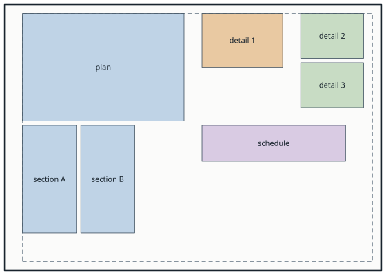
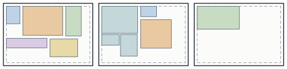
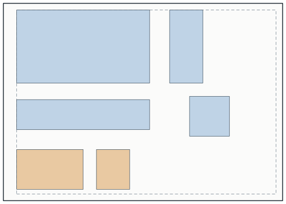
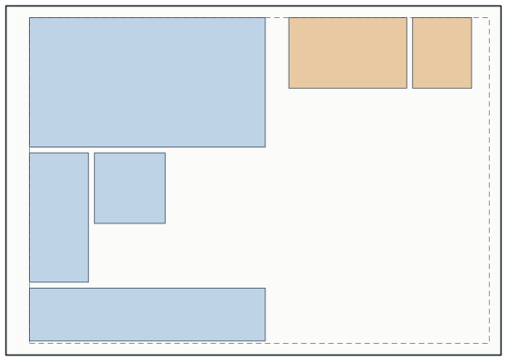
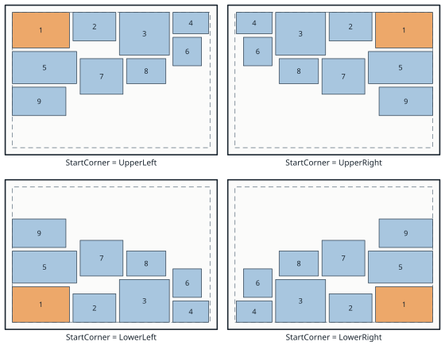
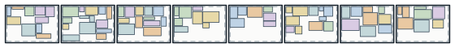
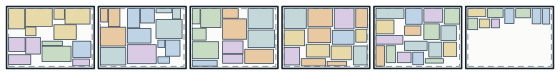
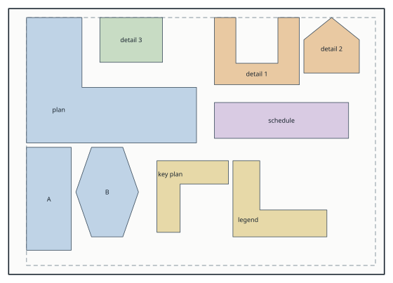
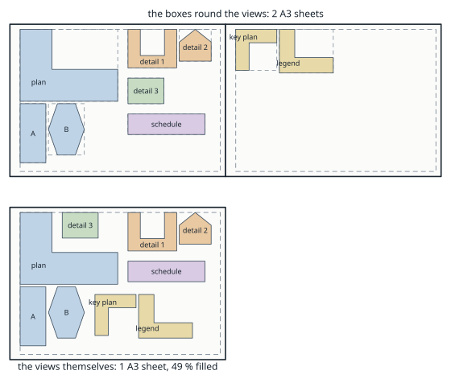
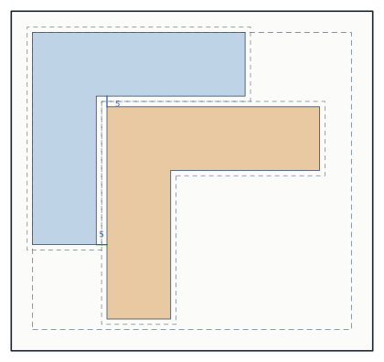

# Packing boxes onto sheets

`GeometryHelper.Packing` lays boxes out on sheets of paper: drawing views, schedules, anything that can be brought
to a [`GeoRectangle2`](xref:GeometryHelper.Geometry.GeoRectangle2). Every box goes inside the part of a sheet its offsets leave, each group of boxes that belong
together is kept together, and when a sheet is full the next one is begun beside it. The boxes are only moved,
never turned or resized: what comes back for each is how far it moves. A view cut to a polygon, an L or a U as VPCLIP
leaves it, is packed by its own shape rather than by the box round it: see [Views cut to a polygon](#views-cut-to-a-polygon).

## Quick start

```csharp
using GeometryHelper.Geometry;
using GeometryHelper.Packing;

var sheet = new Sheet(PaperSize.A3)          // 420 x 297 mm, landscape
{
    OffsetLeft   = 20.0,
    OffsetRight  = 10.0,
    OffsetTop    = 10.0,
    OffsetBottom = 10.0,
};

var groups = new List<GeoRectangle2[]>
{
    new[] { plan, sectionA, sectionB },      // a view and its sections: kept together
    new[] { detail },
};

PackResult result = SheetPacker.Pack(groups, sheet, new PackOptions { Spacing = 5.0, GroupSpacing = 20.0 });

PackPlacement placement = result.Placements[0][1];   // sectionA: the same shape as the groups given
if (placement.Placed)
{
    int onSheet = placement.SheetIndex;              // which sheet it goes on, the first nought
    GeoVector2 move = placement.Translation;         // how far it moves
    GeoRectangle2 box = placement.ViewBox;           // the box, moved
}
```

With a plan 180 by 120, sections 60 by 120, details 90 by 60 and 70 by 50, and a schedule 160 by 40, it all goes on
the one A3, filling 50.7 % of the part inside the offsets:



## The sheet

A [`Sheet`](xref:GeometryHelper.Packing.Sheet) is the size of the paper, the scale it is drawn at, the offsets round its edges that nothing goes into,
and where it lies.

| Size | Millimetres | | Size | Millimetres |
|---|---|---|---|---|
| `A0` | 841 x 1189 | | `A3` | 297 x 420 |
| `A1` | 594 x 841 | | `A4` | 210 x 297 |
| `A2` | 420 x 594 | | `Sheet.Custom(width, height)` | any |

An A sheet lies across, landscape, unless it is turned: `new Sheet(PaperSize.A1, SheetOrientation.Portrait)`.

| Property | Default | Meaning |
|---|---|---|
| `Scale` | 1 | How many units of the boxes a millimetre of paper stands for: 50 for a drawing at 1:50 of boxes in millimetres of the model |
| `OffsetLeft`, `OffsetRight`, `OffsetTop`, `OffsetBottom` | 0 | How far in from each edge the boxes keep, in millimetres on paper |
| `Origin` | (0, 0) | Where the first sheet lies: its lower left corner, in the units of the boxes |
| `NewSheet` | `Right` | Which side of the one before each new sheet goes on: `Right`, `Left`, `Top` or `Bottom` |
| `SheetSpacing` | 0 | The gap between one sheet and the next, in millimetres on paper |

The paper size, the offsets and the spacings are on paper; times `Scale` they are in the units of the boxes, as the
origin, `Width`, `Height` and every frame are. An A1 sheet at 1:50 is 42,050 by 29,700:

```csharp
var sheet = new Sheet(PaperSize.A1) { Scale = 50.0 };
sheet.PlaceCorner(SheetCorner.UpperLeft, new GeoPoint2(0.0, 0.0));   // its upper left corner at the origin

SheetFrame second = sheet.GetFrame(1);   // the next sheet: to the right of the first
GeoPoint2 corner = second.Bounds.LowerLeft;                  // (42050, -29700)
GeoRectangle2 usable = second.UsableArea;                    // the part inside the offsets
```

`PlaceCorner` sets `Origin` from any corner, or the middle: a frame already drawn at a known point can be packed
where it is. Every frame is a `GeoRectangle2`, so each corner is there to read: `LowerLeft`, `UpperRight`, `Center`.

Nine groups of up to three boxes, on A4 sheets with offsets of 10 and a `SheetSpacing` of 20, take three sheets, each
begun to the right of the one before when it is full:



## Groups

Each `GeoRectangle2[]` is a group of boxes that belong together, packed onto a sheet as one block:

| [`GroupLayout`](xref:GeometryHelper.Packing.GroupLayout) | The boxes of a group |
|---|---|
| `Compact` (default) | laid out afresh, as close together as they go, in their order from the start corner: the first box, the main view, at that corner of its block, the upper left unless `StartCorner` says another |
| `Keep` | as they stand to one another: a layout already drawn moves as one block, its boxes overlapping or not |

The boxes of a group stand `Spacing` apart, and the groups `GroupSpacing` apart, both in millimetres on paper: a
group spacing wider than the spacing shows which boxes belong together. A group too large for one sheet is split,
in its order, into blocks that each go onto one sheet, laid out compactly.

A layout of four views already drawn, in blue, and a group of two, in orange, on an A3. `Keep` moves the four as they
were drawn, gaps and all; `Compact` lays them out afresh, the first of them, the main view, at the upper left, the
default start corner:

| | |
|---|---|
|  |  |
| `GroupLayout.Keep` | `GroupLayout.Compact` |

## Where the boxes go

`result.Placements[g][i]` is the box `groups[g][i]`:

| Property | Meaning |
|---|---|
| `SheetIndex` | Which sheet the box goes on, the first nought; -1 for one that goes on none |
| `Translation` | How far the box moves, the sheets lying where `Origin` and `NewSheet` lay them |
| `ViewBox` | The box moved by `Translation`, the same size and turn |
| `ViewPolygon` | The shape moved by `Translation`: for a box its four corners, lower left first, counter-clockwise; for a polygon the polygon moved, and `ViewBox` is the upright box round it |
| `Placed` | Whether it found a place; false only for a box larger than the usable area of a sheet, or not at finite coordinates |

`result.Sheets` are the frames of the sheets taken, the first always among them, and `result.Utilization` how much
of their usable area the placed boxes fill.

The move is the same for every point of what a box stands for, so adding `Translation` to any point of it, the origin
of a drawing view or the insertion point of a block, puts it where its box goes. The box only has to be given in the
same coordinates as that point:

```csharp
foreach (View view in views)   // the views of one drawing, their boxes in the same order
{
    PackPlacement placement = result.Placements[0][index++];
    view.Origin = view.Origin + placement.Translation;
}
```

## Order and filling

The blocks are placed by the maximal rectangles method, each where its top is highest, then its left side furthest
left, so that a sheet fills from its upper left corner as the eye reads it.

`PackOptions.StartCorner` starts each sheet from another corner of its usable area: `UpperLeft` (the default),
`UpperRight`, `LowerLeft` or `LowerRight`. The first block goes into that corner, the rows run from its side and are
laid from its edge. The packing is the mirror image of the one from the upper left: the same boxes go on the same
sheets, as far from the start corner's sides as they stood from the upper left's, so the sheets taken and how full
they are do not change. A group laid out afresh puts its main view at that corner of its block; a group kept as drawn
is mirrored as one block, its boxes as they stood. Where each new sheet goes is still `Sheet.NewSheet`'s.

```csharp
var options = new PackOptions { GroupSpacing = 5, StartCorner = SheetCorner.LowerRight };
PackResult result = SheetPacker.Pack(groups, sheet, options);
```

Nine boxes, one to a group, on an A4 with offsets of 10, from each corner; the first, in orange, is in the start
corner every time:



Two options trade the order of the groups for fewer sheets:

| [`PackOptions`](xref:GeometryHelper.Packing.PackOptions) | Default | When set |
|---|---|---|
| `LargestGroupsFirst` | false, the groups in their order | the largest blocks first: they pack tighter |
| `FillEarlierSheets` | false, each sheet filled before the next, no group going back | a group goes onto the first sheet with room for it |

A thousand boxes of up to a fifth of an A1 sheet, one to a group, take 17 sheets in their order and 14 with both
set, as few as their area allows. With both set the sheets no longer read in the order the groups were given;
the boxes of a group are kept together either way.

Sixty groups, 79 boxes of 30 to 140 by 20 to 100, on A3 sheets: in their order they take eight sheets, filled 49.4 %,
and with both options set six, filled 65.8 %:





## Views cut to a polygon

A viewport clipped with VPCLIP, or a view cut to any outline, is a [`GeoPolygon2`](xref:GeometryHelper.Geometry.GeoPolygon2).
`SheetPacker.Pack` takes groups of polygons as it takes groups of boxes, with the same `Sheet`, `PackOptions` and
`PackResult`:

```csharp
var groups = new List<GeoPolygon2[]>
{
    new[] { plan, sectionA, sectionB },      // the plan cut to an L, its two sections
    new[] { detail1, detail2 },              // a U and a pentagon
    new[] { detail3 },
    new[] { schedule },
    new[] { keyPlan, legend },
};

PackResult result = SheetPacker.Pack(groups, sheet, new PackOptions { Spacing = 5.0, GroupSpacing = 20.0 });

PackPlacement placement = result.Placements[0][0];   // the plan
GeoPolygon2 outline = placement.ViewPolygon;         // the polygon, moved
GeoRectangle2 box = placement.ViewBox;               // the upright box round it
```

The polygons are only moved, never turned or resized. Each goes where its top is highest and then its left side is
furthest left, as a box does, inside the usable area of its sheet and clear of the polygons already there, but clear by
their own shape, not by their boxes: a view may stand in the notch of another, or against the slanting side of a hexagon.
A polygon that is a box is packed as the box it is.

Nine views on an A3 with the offsets of the quick start, a plan cut to an L 190 by 140 with arms 62 wide, two sections (a
box 50 by 115 and a hexagon 70 by 100), a U 95 by 75 and a pentagon 62 by 62, a box 70 by 50, a schedule 150 by 40, a key
plan 80 by 80 and a legend 105 by 85, both L-shaped, take one sheet, filled 49.2 %, the box 70 by 50 standing in the notch
of the plan:



The boxes round the same views take two sheets, the second holding the key plan and the legend, and the notch of the
plan, of the U and of the key plan left empty:



`PackPlacement.ViewPolygon` is the polygon moved, and `ViewBox` the upright box round it, `Translation` the move of
both. A box given to the rectangle overload gets its four corners as `ViewPolygon`, so a result of either kind is read
the same way.

### The spacing is a clear gap

`Spacing` is the least gap between two polygons of one group, and `GroupSpacing` between two groups, measured between
the polygons themselves, in millimetres on paper times `Scale` as for boxes. Two L-shaped views 100 by 100 with arms 30 wide
on a sheet 170 by 160 with offsets of 10 go the second into the corner the first leaves, at a `Spacing` of 5, and stand
5.000 apart: each grown by half the gap, the dashed lines, they just touch:



A polygon is grown with sharp corners, cut off square where a corner would reach further than twice the half gap, so
the gap is never less than asked for, and at a very sharp corner a little more. The gap does not apply to the edge of the
usable area: a polygon may lie against it.

### Groups, the corner and the options

Every option of `PackOptions` works on polygons as on boxes. A group laid out afresh (`GroupLayout.Compact`) is packed
together first, in its order from the start corner, into a strip of several widths, the block of least perimeter kept; it
goes onto the sheet as one block, the polygons at `Spacing`, and the block is placed by the shape of each polygon in it,
so that polygons of another group may stand in its notches, a `GroupSpacing` away. A group kept as drawn
(`GroupLayout.Keep`) moves as one block with its polygons as they stand, overlapping or not, as boxes do. A group too
large for one sheet is split, in its order, into blocks that each go onto one. `LargestGroupsFirst` orders the blocks by
the area of their polygons, not of the box round them.

`StartCorner` makes the packing from that corner the mirror image of the one from the upper left: the same polygons,
mirrored across the usable area, would be packed the same. The polygons themselves are not mirrored in the result, so
which view nests in which can depend on the corner.

### What is refused, and what is not placed

A null polygon, one with a coordinate that is not a finite number, one that encloses no area (no more than the tolerance
squared) and one that crosses itself are refused with an `ArgumentException` that names `groups` and says which polygon of
which group it is; `GeoPolygon2.MakeValid()` gives the faces a polygon that crosses itself stands for. A polygon larger
than the usable area of a sheet is not placed, `SheetIndex` -1, as a box is.

### How good, and how fast

200 views on A1 sheets with offsets of 20, 10, 10 and 10, none larger than 168 by 119, from one random series, the rectangle
overload packing the box round each and the polygon overload the polygon. The fill is the area of the views themselves over
the usable area of the sheets taken, on .NET Framework 4.8:

| 200 views | Boxes | Polygons | Time |
|---|---|---|---|
| Boxes only, one to a group | 4 sheets, 78.5 % | 4 sheets, 78.5 % | 23 ms |
| Boxes only, groups of up to 3, `Spacing` 5, `GroupSpacing` 8 | 7 sheets, 44.6 % | 6 sheets, 52.0 % | 54 ms |
| L, U, Γ, hexagon and box, one to a group | 4 sheets, 46.3 % | 3 sheets, 61.7 % | 281 ms |
| L, U, Γ, hexagon and box, groups of up to 3, `Spacing` 5, `GroupSpacing` 8 | 6 sheets, 29.3 % | 5 sheets, 35.2 % | 267 ms |

200 circles of 90 corners, 15 to 75 in radius, with the spacings of the last two rows, take 5 sheets against 7 by their
boxes, and 1.1 s. The time grows with the polygons on the
sheet being filled and their corners: the places a polygon may not stand beside another are made once for each pair of
shapes and moved to where the pair stands.

## What is promised

- A box reported `Placed` lies inside the usable area of its sheet, and clear of every other box, but the boxes of
  its own group kept as they stood. The packing is judged as it came out, box by box.
- A polygon reported `Placed` lies inside the usable area of its sheet and clear of every other polygon, `Spacing` or
  `GroupSpacing` apart, but the polygons of its own group kept as they stood, each by up to the tolerance of the options and
  no more. It is judged as it came out, polygon by polygon, from the polygons moved, not from the places the packing meant
  for them.
- Every box or polygon that fits the usable area of a sheet is placed: when one sheet is full, the next is begun.
- A box or polygon is only moved: `ViewBox` is the box given, moved by `Translation`, and `ViewPolygon` the polygon given,
  moved by it.
- The same boxes or polygons and options give the same result, to the bit; they, the sheet and the options are only read.

## See also

- [Label placement](arrange.md).
- [Geometry in the plane](plane.md).
