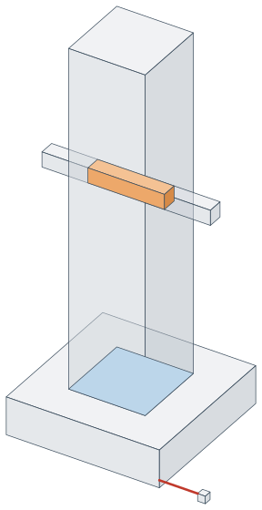
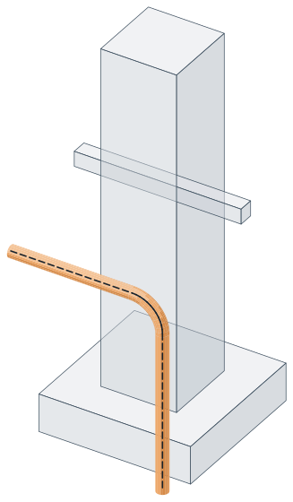

# Geometry in space

3D geometry for engineering models: points, vectors, lines, rays, planes, triangles, polylines,
polygons, circles, faces with holes, solids, boxes, local coordinate systems and transformations.

It is the counterpart of [geometry in the plane](plane.md) and follows the same shape: immutable
geometry types, operations living in static classes under `Core`, and every operation mirrored as an
instance method on the type it applies to. Both are measured with the same [shared types](common.md).

## Structure

| Namespace | Contents |
|---|---|
| `GeometryHelper.Geometry` | `GeoPoint3`, `GeoVector3`, `GeoLine3`, `GeoRay3`, `GeoXLine3`, `GeoPlane3`, `GeoTriangle3`, `GeoPolyline3`, `GeoPolygon3`, `GeoCircle3`, `GeoEllipse3`, `GeoFace3`, `GeoAabb3`, `GeoObb3`, `GeoSolid3`, `GeoSphere3`, `GeoEdge3`, `GeoPolylineArc3`, `GeoPolygonArc3`, `GeoCoordinateSystem3`, `GeoTransform3` |
| `GeometryHelper.Core` | `Boolean3`, `Collision3`, `Containment3`, `Distance3`, `Intersection3`, `Lengthen3`, `Merge3`, `Offset3`, `Parallel3`, `Parametrization3`, `Projection3`, `Splition3`, `Ellipse3`, `PlanarMap` |
| `GeometryHelper.Spatial` | `GeoBvh3` |
| `GeometryHelper.Extension` | `EnumerableExtension` |
| `GeometryHelper` | `Tolerance`, `Angle`, `OffsetOptions`, `GeometryHelperLog` |
| `GeometryHelper.Enums` | `PointLocation`, `PlaneSide`, `LineEnd`, `LineExtension`, `OffsetJoin` |

The last two are the [shared types](common.md), which the plane half uses as well, so a program
working in both dimensions sees one `Tolerance` and one `Angle` rather than two of each.

## Quick Start

```csharp
using GeometryHelper;
using GeometryHelper.Geometry;

var a = new GeoPoint3(0, 0, 0);
var b = new GeoPoint3(3, 4, 0);

double distance = a.DistanceTo(b);              // 5
GeoVector3 direction = a.GetVectorTo(b);        // [3, 4, 0]

var plane = new GeoPlane3(GeoPoint3.Origin, GeoVector3.ZAxis);
GeoPoint3 flat = plane.Project(new GeoPoint3(2, 3, 7));      // (2, 3, 0)
double signed = plane.SignedDistanceTo(new GeoPoint3(2, 3, 7)); // 7

var box = new GeoObb3(GeoPoint3.Origin, 10, 20, 30);
double volume = box.Volume;                     // 6000
```

## Geometric Types

The shapes split into three families, and which family a shape belongs to decides what you can ask of it:

| Family | Types | Encloses an area | Encloses a volume |
|---|---|---|---|
| Curve | `GeoLine3`, `GeoRay3`, `GeoXLine3`, `GeoPolyline3` | no | no |
| Planar region | `GeoTriangle3`, `GeoPolygon3`, `GeoCircle3`, `GeoEllipse3`, `GeoFace3` | yes | no |
| Volume | `GeoObb3`, `GeoAabb3`, `GeoSolid3`, `GeoSphere3` | yes | yes |

Only regions and volumes offer `Contains`. Every shape offers `Locate`, and a curve can only ever
answer `OnSide` or `OutSide`, because a curve has no interior for a point to be inside of.

A `GeoPolyline3` is always an open chain — it has no `IsClosed` flag and never joins its last vertex back
to its first. Geometry meant to enclose something is a `GeoPolygon3`, and `polyline.ToPolygon()` converts
between them. A chain of vertices tracing a square still holds only the points on its path:

```csharp
var traced = new GeoPolyline3(
    new GeoPoint3(0, 0, 0), new GeoPoint3(10, 0, 0),
    new GeoPoint3(10, 10, 0), new GeoPoint3(0, 10, 0), new GeoPoint3(0, 0, 0));

var middle = new GeoPoint3(5, 5, 0);

traced.IsPointOn(middle);              // false — a curve has no interior
traced.DistanceTo(middle);             // 5    — measured to the path
traced.ToPolygon().Contains(middle);   // true — now it is a region
traced.ToPolygon().DistanceTo(middle); // 0
```

A planar region is flat, so a point counts as inside it only when it lies on the carrier plane as well as
within the boundary. A point hovering above the middle of a polygon is outside it:

```csharp
var square = new GeoPolygon3(
    new GeoPoint3(0, 0, 0), new GeoPoint3(10, 0, 0),
    new GeoPoint3(10, 10, 0), new GeoPoint3(0, 10, 0));

square.Locate(new GeoPoint3(5, 5, 0));  // Inside
square.Locate(new GeoPoint3(5, 0, 0));  // OnSide
square.Locate(new GeoPoint3(5, 5, 3));  // OutSide — off the plane
```

### Flatness is enforced

A polygon that is not flat has no normal, no area and no interior, so `GeoPolygon3` refuses one at
construction rather than letting every property on it become quietly meaningless. Geometry that wanders
out of a plane is a `GeoPolyline3`.

```csharp
// Throws ArgumentException: these four vertices do not share a plane.
new GeoPolygon3(
    new GeoPoint3(0, 0, 0), new GeoPoint3(10, 0, 0),
    new GeoPoint3(10, 10, 0), new GeoPoint3(0, 10, 5));
```

How flat is flat enough is `Tolerance.EqualPlanar`, which is separate from `EqualPoint` because
coplanarity is measured far from the reference point: a polygon several metres across turns a hundredth
of a degree of tilt into a deviation of nearly a millimetre. Three corners are flat whatever the
tolerance, since they always share a plane.

The faces of a body a modeller gives as loops of corners can still come out of flat: Tekla Structures
left the top face beside a notch in a beam 0.04 mm low at one corner. Refused, such a face is a hole in
the body, which then has no section and the wrong volume. `GeoFace3.FromLoops` reads a face from its
loops of corners: one face, holes and all, where they lie flat, and otherwise triangles on the corners
themselves, which keep every edge the face shares with its neighbours, so the body stays as closed as it
was given and no corner moves. A hole off the plane of its boundary is kept the same way. The Tekla
and IFC conversions read faces through it.

```csharp
// One corner 1 mm up: out of flat at the default tolerance, so two triangles on these four corners.
GeoFace3[] faces = GeoFace3.FromLoops(
    new[] { new GeoPoint3(0, 0, 0), new GeoPoint3(100, 0, 0), new GeoPoint3(100, 100, 1), new GeoPoint3(0, 100, 0) },
    holes: null);
```

Self-intersection is a different matter and is *not* checked on the way in, because the check costs more
than building the polygon does. `polygon.IsSimple()` runs it when you want it: no edge crossing or
touching another except where neighbours share their vertex. A polygon that is not simple is still read
consistently, under the even-odd rule, but its `Area` no longer means what it says. One whose lobes
cancel exactly, a symmetric bow tie, is refused at construction all the same — with no net area it has no
normal, and without a normal there is no plane to be flat in.

### Two kinds of box

`GeoAabb3` is an axis-aligned bound — the cheap test that comes before the expensive one.
`GeoObb3` is an oriented shape that carries its own axes and describes a beam running at an angle
tightly, where an axis-aligned box would only bound it loosely.

```csharp
var bounds = GeoAabb3.FromPoints(new[]
{
    new GeoPoint3(1, 5, -2),
    new GeoPoint3(-3, 0, 4),
});

bounds.Min;    // (-3, 0, -2)
bounds.Max;    // (1, 5, 4)
bounds.Volume; // 4 * 5 * 6 = 120
```

The axes of a `GeoObb3` are made orthonormal on the way in, so a Y direction that is not quite square to
X is corrected rather than producing a skewed box:

```csharp
var box = new GeoObb3(
    GeoPoint3.Origin, 2, 2, 2,
    GeoVector3.XAxis,
    new GeoVector3(0.5, 1, 0));   // not square to X

box.AxisX.IsPerpendicularTo(box.AxisY);  // true
box.AxisX.CrossProduct(box.AxisY).IsEqualTo(box.AxisZ); // true
```

A box has its six faces, `GetFaces()` and `ToSolid()`, however thin, read from its own numbers rather than against
the global tolerance: a plate 0.002 by 50 by 30 is a body, where it was refused as having a zero size on some axis,
and only a side no more than a millionth of a millionth of how far the box reaches from the origin is nought; it reaches
every query that goes through its solid, and `IsDegenerate()` calls it flat only where a whole side is no longer than the
point tolerance: the plate 0.0015 thick is a box at a tolerance of a thousandth, where half its side was read and it was
flat, and one 0.0005 thick is flat. A box,
oriented or not, gives crossings only where a shape comes within the point tolerance of it, as `CollidesWith` reads
it: a segment along X standing 0.000714 off both faces past an edge of the box 10 by 10 by 10, 0.00101 from it, crosses
nothing, where it was given two points, and so for a ray, a line without ends, a chain and an arc ending near a corner.
The other way round, a segment, a ray, a line or a chain that touches the box within the point tolerance without crossing
a face is given the point of it nearest the box: the segment from (5, 10.1, 9.9007) to (5, 9.9007, 10.1), 0.0005 off the
edge where the faces y = 10 and z = 10 meet, is given (5, 10.00035, 10.00035), where it collided and was given nothing.
The point is the same whichever way round the shape is given. One lying wholly inside the box collides and crosses
nothing, as before, and so does one lying along the box within the tolerance, within the planar tolerance of the plane
of the face it stands over or the line of the edge it runs with all along, as the body of the box and an arc in the same
place read it, a curve lying on a surface crossing it nowhere: the chain 0.0005 over the top face is given no point, and
the segment 800 long from 0.0006 over the top face, tilted 9E-6 and so rising 0.0072, touches it at its low end. A ray starting within the
tolerance of the box and running away from it touches it at its origin, and so does one whose short cut stands within
the planar tolerance of the face it starts beside, though no part of it longer than the point tolerance lies level over a
face or along an edge: with a point tolerance of a hundredth and a planar one of five hundredths, the ray from 0.0075
beside a side of the box 100 by 80 by 50, 0.005 from its edge and running away from both, touches it at its origin,
where it collided and was given nothing. Cutting a chain by a box cuts only where it crosses a face, since a touch cuts
nothing.

### Solids and openings

A `GeoSolid3` is the set of faces bounding a body. An opening is a whole solid subtracted from it — a duct
through a slab, a recess in a footing — which is not the same thing as a hole in a `GeoFace3`, which is
flat and belongs to a single face.

```csharp
GeoSolid3 slab = new GeoAabb3(GeoPoint3.Origin, new GeoPoint3(10, 10, 10)).ToObb().ToSolid();
GeoSolid3 duct = new GeoAabb3(new GeoPoint3(4, 4, 4), new GeoPoint3(6, 6, 6)).ToObb().ToSolid();

GeoSolid3 pierced = slab.WithOpenings(new[] { duct });

pierced.GetVolume();       // 992 — the duct cut out
pierced.GetSurfaceArea();  // 624 — the outside, and the walls of the duct
pierced.GetCentroid();     // (5, 5, 5)
pierced.IsClosed();        // true

pierced.Locate(new GeoPoint3(1, 1, 1)); // Inside
pierced.Locate(new GeoPoint3(5, 5, 5)); // OutSide — inside the duct
```

`GetVolume`, `GetSurfaceArea` and `GetCentroid` measure the material: the faces with every opening cut out, the
walls of the openings part of the surface. A body without openings — every part `GeometryHelper.TeklaConvert`
reads is one, its cuts already in its faces — is measured by its faces at once, and nothing is cut. A body with
openings has them cut out once for the tolerance, and the cut is kept, so the three, `GetMassProperties` and
`Measure3` describe one material for the price of one cut. An opening that cannot be cut out is left in the material
and the log warns of it; `TryGetVolume` says whether the volume can be trusted, every opening cut out and the
material closed. Cut in at once, the body is parted by the planes of its openings and each piece is judged by one point
of it, so a plane that runs through a piece and will not cut it, leaving it part in an opening and part out, has the
openings taken out one at a time by a difference instead: a half of a hull cut near a face within a hundredth, a box
3.5 by 3.5 by 5 standing through the cut, held 1 465.33 cubic millimetres with the box left in, and `TryGetVolume`
trusted it; it holds 1 434.58 now, where the hull less the box holds 1 434.77 on that side of the plane.

The volume is measured by the divergence theorem, so it does not depend on where the solid sits and is
reported unsigned: faces wound inwards give the same answer as faces wound outwards, and `TurnOutwards()` turns
such a body the right way out for the booleans and the containment queries, which read the winding. It does
depend on the boundary being closed, which is what `IsClosed()` is for: every stretch of every edge shared by an
even number of faces. A long edge beside two short ones is matched stretch by stretch, and two blocks meeting
along an edge put four faces on it and are closed; a missing face leaves a stretch with one, and a fin
standing off the surface one with three.

`Validate()` says where. It matches the edges as `IsClosed()` does, and gives a `SolidValidation3`: whether the faces
bound a body, closed, wound alike and outwards, and each thing found, a `SolidIssue3` with its kind, where it is, how
large, and the faces it is of. A stretch of edge an odd number of faces meet on is an `OpenEdge`. A stretch the two
faces on it run the same way is a `SameWayEdge`: a face wound the wrong way round, which `IsClosed()` counts as
closed. Faces wound inwards are `InsideOut`. Edges four faces meet on, short edges, faces thinner than the tolerance
and faces out of flat are noted, and leave the body valid.

```csharp
GeoSolid3 lidless = new GeoSolid3(slab.Faces.Where(face => face.Normal.Z < 0.5)); // the slab without its top

SolidValidation3 check = lidless.Validate();
check.IsValid;     // false
check.Issues;      // four OpenEdge stretches round the rim of the gap, each 10 long
check.Issues[0];   // SolidIssue3[OpenEdge 10 long at (5, 10, 10), face 2; 1 one way, 0 the other]
```

**Every question takes the openings into account.** The faces of a pierced body run straight across its
openings — a plate's top face is a whole square even where a bolt hole passes through it — so nothing reads
the faces alone as where the material ends. A pin through a bolt hole touches nothing, a ray down the hole
crosses nothing, and a point in the hole is measured to its walls:

```csharp
GeoSolid3 plate = new GeoAabb3(GeoPoint3.Origin, new GeoPoint3(100, 100, 20)).ToObb().ToSolid()
    .WithOpenings(new[] { new GeoAabb3(new GeoPoint3(40, 40, -1), new GeoPoint3(60, 60, 21)).ToObb().ToSolid() });
GeoSolid3 pin = new GeoAabb3(new GeoPoint3(45, 45, -50), new GeoPoint3(55, 55, 50)).ToObb().ToSolid();

plate.CollidesWith(pin);                          // false — five clear of every wall
plate.DistanceTo(pin);                            // 5
plate.Locate(new GeoPoint3(50, 50, 20));          // OutSide — on the top face as drawn, but in the hole

plate.TryCutOpenings(out GeoSolid3 material);     // the same material with the holes cut in: 10 faces
plate.TriangulateSurface();                       // the mesh of where the material ends, walls and all
```

A question about touching or crossing cuts only the openings the probe can reach, so a bolt against a plate
with twenty holes costs one cut. A question about distance cuts them all, because the nearest material can sit
on the rim of an opening the probe never comes near. **A body asked many questions is prepared once** with
`Prepare()` — see [A body asked many questions](#a-body-asked-many-questions) — or cut once with
`TryCutOpenings` and the result asked instead: the same answers, the cutting paid once. The material of a closed
body with closed openings comes back closed as `Validate` reads it, as a boolean's does, or not at all: where cutting
the openings in at once leaves a crack, it is welded within the tolerance, and where that does not close it the
openings are taken out one at a time by a difference. A plate 300 by 200 by 12 with twelve blind holes ending 0.011
under its top, turned and far from the origin, came back open at a hundredth for 15 of 30 turnings; every one closes
now, within 0.03 cubic millimetres of what `GetVolume` measures. `Triangulate` still
meshes the faces as they are; `TriangulateSurface` is the mesh to read as the boundary.

A triangle of the surface mesh is left out only when its corners lie on a line within a millionth of the point
tolerance; a face 0.002 by 0.002 is its two triangles at the default tolerance. A triangle has no area,
`IsDegenerate(tolerance)`, when its height over its longest side is within the point tolerance, or its corners lie on
one line to rounding: each half of that face, 0.0014 high, is a triangle, with its `Normal` and its `GetPlane()` and
read as a face, where they threw; one 100 by 0.0008 has no area at the default tolerance and keeps its normal all the
same. `Normal` is read from the triangle's own numbers and throws only for corners on a line to rounding. A polygon
under the vector tolerance in area is kept where it has width in the same way, so a square 0.002 by 0.002 is one; the
meshes read no area as they did, and the queries of a triangle read it by `IsDegenerate` (see
[how near is touching](#how-near-is-touching-in-space)). A face thinner than the tolerance is a seam at
it and has no triangle: a slab 100 by 100 and 0.0008 thick, built within 1E-5, is 12 triangles at 1E-5 and 4 at 0.001,
its four sides gone, and a Debug line in `GeometryHelperLog` says how many faces were left out whole and how much area
they had; a face meshed in part is not counted. Such a mesh is closed within the tolerance, the top and the bottom
meeting where the sides were, but not edge by edge: the slab's 4 triangles leave 8 edges with no triangle on the other
side. Triangulate at the tolerance the body was built within for a mesh closed edge by edge, the slab's 12 triangles at
1E-5.

## Operations

| Class | Answers |
|---|---|
| `Parallel3` | is this parallel, perpendicular, coplanar with that |
| `Containment3` | where does a point sit relative to a shape |
| `Distance3` | how far apart are two shapes |
| `Projection3` | which point of a shape is closest to a point |
| `Intersection3` | where exactly do two shapes meet |
| `Lengthen3` | extend or trim a segment along its own line |
| `Offset3` | move a segment sideways, grow or shrink a flat region |
| `Collision3` | do two shapes overlap at all |
| `Parametrization3` | which point sits at a position along a curve |
| `Merge3` | put curves that meet end to end back together |
| `Splition3` | cut a curve, a region or a body into pieces |
| `Boolean3` | join two bodies, keep what they share, take one out of the other |

Every operation is reachable both ways. The static form names the larger shape first and the point or
curve second; the instance form sits on whichever of the two reads better where you are calling from:

```csharp
var line = new GeoLine3(new GeoPoint3(0, 0, 0), new GeoPoint3(10, 0, 0));
var point = new GeoPoint3(4, 3, 0);

Distance3.DistanceTo(line, point);   // 3
line.DistanceTo(point);              // 3
point.DistanceTo(line);              // 3
```

`Intersection3` returns a single result and reports `false` when there is not exactly one. Two shapes that
overlap along a whole line or a whole area — a segment lying in a plane, two coincident planes, two
collinear segments — have no single crossing to name, so they come back `false` rather than picking an
arbitrary point out of the overlap:

```csharp
var crossing = new GeoLine3(new GeoPoint3(0, 0, -5), new GeoPoint3(0, 0, 5));
var lyingIn  = new GeoLine3(new GeoPoint3(0, 0, 0), new GeoPoint3(10, 0, 0));

crossing.TryIntersectWith(GeoPlane3.XY, out GeoPoint3 hit); // true, hit is (0, 0, 0)
lyingIn.TryIntersectWith(GeoPlane3.XY, out _);              // false
```

`Collision3` answers yes or no and says nothing about where. Two oriented boxes are tested with the
separating axis theorem, which needs the nine cross-product axes as well as the six face axes to catch two
boxes passing each other at an angle:

```csharp
var first  = new GeoObb3(GeoPoint3.Origin, 10, 10, 10);
var beside = new GeoObb3(new GeoPoint3(5, 0, 0), 10, 10, 10);
var apart  = new GeoObb3(new GeoPoint3(11, 0, 0), 10, 10, 10);

first.CollidesWith(beside); // true
first.CollidesWith(apart);  // false
```

### Asking a body about what is around it

A `GeoSolid3` answers the same questions the flat shapes do, and against every shape in the library that a
body can be measured against at all:

```csharp
GeoSolid3 slab = new GeoAabb3(GeoPoint3.Origin, new GeoPoint3(100, 100, 100)).ToObb().ToSolid();

slab.DistanceTo(point);      slab.DistanceTo(line);       slab.DistanceTo(ray);
slab.DistanceTo(triangle);   slab.DistanceTo(polygon);    slab.DistanceTo(polyline);
slab.DistanceTo(plane);      slab.DistanceTo(obb);        slab.DistanceTo(aabb);
slab.DistanceTo(otherSolid);

slab.CollidesWith(line);     slab.CollidesWith(ray);      slab.CollidesWith(polyline);
slab.CollidesWith(polygon);  slab.CollidesWith(face);     slab.CollidesWith(obb);
slab.CollidesWith(aabb);     slab.CollidesWith(otherSolid);

slab.GetIntersections(line);   // where it goes in and where it comes out
slab.GetIntersections(ray);
slab.GetIntersections(plane);  // where the plane cuts its edges

slab.GetClosestPointOnBoundary(point);  // on the surface, even for a point inside
slab.GetShortestLineTo(point);          // the segment out to it
slab.GetShortestLineTo(line);   slab.GetShortestLineTo(ray);
slab.GetShortestLineTo(triangle);
slab.GetShortestLineTo(otherSolid);
```

`DistanceTo` reads a body as solid through: a point inside it, or a segment reaching into it, is nothing
away, and so is a body sitting wholly inside another without their surfaces meeting. `GetShortestLineTo`
runs **surface to surface**, so it has a length in all of those cases:

```csharp
var inside = new GeoPoint3(50, 50, 10);

slab.DistanceTo(inside);                  // 0.0  — inside the body
slab.GetShortestLineTo(inside).Length;    // 10.0 — out through the nearest face
```

Both ends of the segment lie on the shapes they came from, so it can be drawn as it is, and it is exactly
as long as the distance wherever the two readings agree at all. The shortest line between two bodies is
found by weighing face against face, skipping any pair whose boxes already stand farther apart than the
best segment so far.

Every pair that has a distance in space has a shortest line too, from either side: a point to every curve and
region, a segment to a plane, a polygon or a chain, and chains to chains, triangles, polygons, planes and bodies.
Flat regions are read as their distance reads them, bodies run surface to surface, and a shape lying level
within the point tolerance of a plane, a polygon or a body keeps its true gap:

```csharp
var square = new GeoPolygon3(
    new GeoPoint3(0, 0, 0), new GeoPoint3(100, 0, 0), new GeoPoint3(100, 100, 0), new GeoPoint3(0, 100, 0));
new GeoPoint3(50, 50, 30).GetShortestLineTo(square);   // straight down to (50, 50, 0), 30 long

var box = new GeoAabb3(GeoPoint3.Origin, new GeoPoint3(100, 100, 100)).ToObb().ToSolid();
var bar = new GeoPolyline3(new GeoPoint3(20, 50, 10), new GeoPoint3(80, 50, 10), new GeoPoint3(80, 50, 60));
bar.DistanceTo(box);                                   // 0.0  — inside the body
bar.GetShortestLineTo(box).Length;                     // 10.0 — down to the floor

var hover = new GeoPolyline3(new GeoPoint3(0, 0, 0.0004), new GeoPoint3(10, 0, 6));
hover.DistanceTo(GeoPlane3.XY);                        // 0.0    — within the point tolerance of touching
hover.GetShortestLineTo(GeoPlane3.XY).Length;          // 0.0004 — the line keeps its true length
```

A shape that crosses a plane meets it in a segment of no length at its first point of contact, along a segment
or edge by edge. A segment or chain that comes at a polygon, a triangle or a body end-on and stops within the point
tolerance of it is read as crossing it, as the segment to a triangle always has been: the segment of no length then
sits at that end, up to the tolerance off the surface. Three kinds of pair have no shortest line, on purpose: a box, whose line goes through
`ToSolid()`; two planes, which share no one segment; and two points, whose segment is `new GeoLine3(a, b)`.

A ray is a half-line, so it cannot be cut into a segment and measured that way without first choosing how
far to cut. It is measured as a ray instead: every answer is one the ray really holds, and a ray starting
inside a body crosses its surface once on the way out.

```csharp
var incoming = new GeoRay3(new GeoPoint3(-200, 50, 50), new GeoVector3(1, 0, 0));
var leaving  = new GeoRay3(new GeoPoint3(-200, 50, 50), new GeoVector3(-1, 0, 0));

slab.GetIntersections(incoming).Length;  // 2 — in one side, out the other
slab.DistanceTo(incoming);               // 0.0
slab.DistanceTo(leaving);                // 200.0 — its nearest point is its own origin
```

A ray is given a place where it meets a body exactly where `CollidesWith` says the two touch, which reads the ray by the
point tolerance and the body to a billionth. One starting within the planar tolerance of a face and rising from it
touches the face at its origin only where the origin stands within the point tolerance of the surface, whatever the ray
meets further on and however deep in the body it starts: with a point tolerance of a hundredth and a planar one of five
hundredths, the ray from 0.04 over the top of the box 100 by 100 by 50, rising a hundredth for each unit along it, is
given nothing, where it was given its origin and collided with nothing, and the one from 0.004 over it touches it at its
origin; the ray from 0.04 off the inner wall of a U, its prongs and base 20 thick, across the gap, is given the two walls
of the far prong, and the one from 0.04 under the top of the box where it leaves, where each was given its origin
besides. One that collides and crosses no face is given its point nearest the surface, where that stands within the
point tolerance of it, to the rounding of numbers the size of the body's, or the body holds the origin: at a tolerance of
nought,
where the rounding of a body turned about in space refuses the crossing of every face, the ray from the middle of a box
100 by 80 by 50 turned 0.7 of a radian is given where it leaves, to 1E-14 of where it leaves at a thousandth, where it
collided and was given nothing. A prepared solid gives a ray that starts within the point tolerance of where its material
ends and crosses no triangle its origin, as its `CollidesWith` reads it.

A `GeoCircle3` is not on the list. The distance from a circle in space to a flat face has no closed form,
and the library does not guess: turn it into a chain first, which says in the call how close an answer you
are asking for.

```csharp
slab.DistanceTo(circle.ToPolylineByChordTolerance(0.1));
```

### And every shape can be asked, not only the body

For a long time a body could be asked about a segment and the segment could not be asked about the body.
That is gone. Every measuring question reads from either side and gives the same answer:

```csharp
GeoSolid3 slab = new GeoAabb3(GeoPoint3.Origin, new GeoPoint3(100, 100, 100)).ToObb().ToSolid();

var beside  = new GeoLine3(new GeoPoint3(200, 50, 50), new GeoPoint3(300, 50, 50));
var through = new GeoLine3(new GeoPoint3(-50, 50, 50), new GeoPoint3(150, 50, 50));

beside.DistanceTo(slab);                  // 100.0, the same as slab.DistanceTo(beside)
through.CollidesWith(slab);               // true,  the same as slab.CollidesWith(through)
through.GetIntersections(slab).Length;    // 2,     in one side and out the other
```

A joining segment is the one thing that is not simply interchangeable. It **leaves the shape it was asked
of and lands on the other**, so the two directions are each other reversed:

```csharp
GeoLine3 away = beside.GetShortestLineTo(slab);   // starts on the segment, ends on the body
GeoLine3 home = slab.GetShortestLineTo(beside);   // starts on the body, ends on the segment

away.StartPoint.IsEqualTo(home.EndPoint);         // true
away.Length == home.Length;                       // true, both 100
```

A point, a segment, a ray, a triangle, a polygon, a face, a plane, either kind of box, a polyline, an arc, a
circle, an edge, and the chains and loops of arcs all take part. Two things are asked from one side only, on
purpose: an ellipse is asked from the ellipse, and a point answers whether it lies on or in a shape with
`IsPointOn` and `Contains` rather than with `CollidesWith` or `GetIntersections`.
Every shape in space also moves, which is the translating transformation and nothing more:

```csharp
var by = new GeoVector3(11, -23, 37);

slab.Translate(by);   beside.Translate(by);   GeoPlane3.XY.Translate(by);
```

#### How near is touching, in space

**In space, as in the [plane](plane.md), `DistanceTo` reads nought only where two shapes truly meet.** That is where they
cross, touch or overlap, or one holds the other, a point on a rim counting as held. Everywhere else it is the gap in space,
measured exactly however small and the same whichever way round it is asked, and `CollidesWith` is whether that gap is no
more than the point tolerance. Nothing is widened by the tolerance and nothing is laid flat. It holds for points, segments,
rays, polylines, triangles, polygons, faces, boxes and bodies against one another, and, for collisions, for arcs, circles
and chains and loops of arcs against all of them. Measured at a thousandth:

* **Straight shapes.** A segment starting 0.0005 off the square 100 by 100, in its plane, is 0.0005 from it, from either
  end, and collides; one hovering 0.0003 over it is 0.0003 from it; a point 0.0004 under the plane of the square and 0.0005
  beside it is 0.00064 away; one ending 0.0012 off its corner is 0.0012 away and does not collide; and one 0.0009 up and
  0.0009 out is 0.00127 away and does not collide, though neither offset is as much as a tolerance.
* **Segments, rays and chains** are as far apart one way as the other. Two segments meeting end to end, one tilted by
  8E-6 radian, are nought apart whichever is asked first; a ray passing through the end of a segment, from 0.00035 below it,
  is nought from it, and one running 0.0009 over a segment is 0.0009 from it and collides.
* **Arcs, circles, chains and loops of arcs** collide exactly where the gap between them in space is no more than the point
  tolerance, in whatever plane they lie, lifted or tilted out of it. A straight side facing the top of an arc touches it as an
  end does: across the dome of radius 50, a side at y = 50.0005 touches it and one at y = 50.0012 does not. A box is read by
  its corners, so one thinner than the tolerance, or a few thousandths across, is asked about as surely as any other. No member
  measures the distance from a curve in space to anything but a point; the gap is worked out inside. On .NET Framework 4.8
  an arc against a triangle takes 1.2 microseconds to ask about where they stand far apart and 6.8 where they stand near.
  An arc or a circle crosses a triangle, a polygon, a face or a box only where it collides with it: an arc starting 0.00107
  beside a side and 0.0007 over the plane, 0.0013 from the region and running away from it, is given no point, where it
  was given one. One that touches it without crossing, tilted or bowing beside a side in its plane, is given the point of
  it nearest the shape, as a segment touching a box is: the arc of radius 5 standing upright 0.0006 beside the side of
  the square 30 by 20 and dipping to 0.0006 over its plane touches it at (15, -0.0006, 0.0006), where it collided and was
  given nothing. One lying level over the material within the tolerance, rising off its plane by no more than the planar
  tolerance round its circle, is given none, as a curve lying on a surface crosses it nowhere; tilted further it touches:
  the arc of radius 300 tilted 9E-6, which rises 0.0027 round its circle, touches the material where it dips to 0.0006
  over it. Cutting a curved chain by a face or a box still cuts only where it crosses. A segment, a ray or a line that
  touches an arc, a circle, a curved edge or a curved chain without crossing it, piercing its plane a hair beside the
  rim, is given the point of the curve nearest it: the segment from (0, 50.0006, 1) to (0, 50.0006, -1) touches the
  circle of radius 50 about the origin at (0, 50, 0), where it collided and was given nothing. Of 20 000 segments
  piercing the plane of an arc from 1E-7 to 0.002 beside its rim, asked of the arc, its circle and its edge, 4 676 times
  one collided and was given no point; none does now. A point of the circle on the line of a segment or a ray, held by
  each within the point tolerance, is given only where the segment or ray, at its point nearest it, comes within the
  point tolerance of the curve, each point on its own: the segment from (0, 0, 0.0008) to (49.9992, 0, 0.0008), ending
  0.00113 from the circle of radius 50 about the origin, is given nothing, where it was given (50, 0, 0.0008) and collided
  with nothing; the one from (-60, 0, 0.0008), passing 0.0008 over the far rim, is given that touch alone; and the one
  from (-60, 0, 0.0006) to (49.9994, 0, 0.0006), ending 0.000849 from the near rim, both. A chain names each place once: two points within the point
  tolerance of each other are one place, and so are two that the edges either side of a corner give where both lie
  within the point tolerance of the corner, a crossing kept over the point of a touch and otherwise the first. Places
  further from a corner are kept however close the legs run: a segment crossing both legs of a hairpin 0.0009 across at
  50 from its tip is given both crossings, 0.043 apart.
* **A segment against a plane** that ends within the planar tolerance of it, without crossing it, touches it at that
  end and is given it, as a triangle or a polygon in the plane gives it: the segment from (-50, 0, 0.5) to
  (50, 0, 0.0005) touches the plane z = 0 at its end, where it collided and was given nothing. One lying in the plane,
  longer than the point tolerance and both its ends within the planar tolerance of it, meets it along its length and
  names no place. The plane asked about the segment, or about an edge that is one, gives the same points.
* **Segments, rays, lines and chains against a triangle, a polygon or a face** are read alike. The crossing is given
  where it stands within the point tolerance of both and the two touch: a ray starting 0.00076 under the plane of a plate
  and beside the rim of its hole, 0.00113 from the material and running away from it, is given nothing, where it was
  given its origin. One that touches without crossing is given the point of it nearest the region: the segment from
  (-5.0004, 4.9996, 0.0004) to (4.9996, -5.0004, 0.0004), passing 0.0007 off the corner at the origin of the triangle
  (0, 0, 0), (100, 0, 0), (0, 100, 0), is given (-0.0004, -0.0004, 0.0004), where it collided and was given nothing, and
  so a ray, a line and a chain, whose corner touching it is given. One with no crossing of the plane to give, lying level
  over the material within the planar tolerance of the region's plane at both its ends, running in over the rim among
  them, is given none, and so is one lying along a side of the rim within that of the side's line, as a segment lying
  along an edge of a box is. A segment has no crossing where it climbs no more than the planar tolerance from end to
  end, and is read level by its own two ends. A line without ends has none where the segment it is cut to, a millimetre
  past the region, climbs no more than that. A ray is read as the line without ends along it is, and given what that
  line meets at its origin or ahead of it: the ray from 0.0005 over a square 100 by 100, falling 1E-5 for each unit
  along it, climbs 0.001 across the square and is given its crossing 50 along, as its line is, where it was given
  nothing; the one from 0.0002 over it falling 4E-6 climbs 0.0004 and is given nothing, as its line is; and one a
  hundred-millionth or so off the plane and level to rounding is given nothing however near it starts. Where the line
  meets the region only behind the origin, or lies level over it only behind a ray running away from it, a ray whose
  origin touches the region is given its origin. A ray is given a point exactly where `CollidesWith` says it touches the
  region, but where it holds more than the point tolerance of a part of its line lying level over it: the ray from 0.0006
  beside the side of the square and 0.0003 over it, running away from the side at a hundredth, 0.00067 from the square,
  touches it at its origin, where it collided and was given nothing, its own part read along the side; and at a
  tolerance of nought a ray starting 4E-12 over the square and rising from it touches nothing and is given nothing, where
  it was given the crossing of its line 4E-12 behind its origin. `TryIntersectWith` of a ray gives the first point of this list and is
  false where the list is empty, so the ray from 0.0002 over the square falling 4E-6 is refused there too, where it was
  given its crossing of the floor; that of a segment or a line without ends gives the crossing alone, and is false for a
  touch the list gives. Such a ray or line is read by the two ends of the part of it over the region, from where its shadow on the
  region's plane first crosses the rim to where it last does, or beside the side it runs along, and not by where it was
  cut past the region: the ray from 0.0004 over the triangle rising 1E-6 was given its origin, the one from 1E-12 under it
  (10.000001, 20, 0), and the line without ends 0.0009 over the square rising 1E-6 the point over its rim. Every other
  crossing is given: the ray from 0.0009 under the triangle rising 1.5E-5 crosses it 60 along, though the part of it over
  the triangle runs from 0.0009 under to 0.0003 over. A ray and a segment along it can answer otherwise, each read by its
  own ends: from 0.0004 over the square rising 1E-5 the ray stands 0.0013 over the far rim and touches the square at its
  origin, where a segment 40 long along it gives nothing; and from 0.0003 over the triangle dipping 9E-6, level within the
  vector tolerance, the ray and the line along it give nothing, where a segment 150 long gives the crossing (38.333, 20, 0)
  and one 70 long nothing. A part no longer than the point tolerance, of one that only passes a corner or runs
  away from the rim, lies along nothing, and the touch is given. Against a box a ray is read as the segment from its
  origin past the box, and a line as the segment past it both ways, as before. Cutting a curved chain by a face still
  cuts only where it crosses.

A triangle with no area, by `GeoTriangle3.IsDegenerate`, its height over its longest side within the point tolerance,
such as (0, 0, 0), (100, 0, 0), (50, 1E-8, 0), is the segment it has collapsed to: it touches what comes within the
tolerance of it, as its distance says, is crossed where its sides are, and holds the points on them, `OnSide`, and none
inside. The triangle 0.003 by 0.003, which twice its area against the vector tolerance read as having none, is a triangle
to every query: it holds its centroid, which stands 0.001 from two of its sides and so is `OnSide` at a thousandth, and
a segment through its middle crosses it. The area is read at the tolerance a query is asked within, so at 1E-5 the
triangle 100 long and 0.0005 high is a triangle and holds a point in its middle, though `TryGetBarycentric`, which reads
the global tolerance, gives false for it. A triangle whose corners lie on one line to rounding has no plane at all, as
`Normal` reads it, and is measured as its sides; a thin one that has a plane is read as standing off it by the rounding
of its normal.

Seven things are read otherwise, on purpose:

* **A body against a body**, or an oriented box against an oriented or an axis-aligned box, is searched through the
  triangles of the two and reads nought when they are within the point tolerance of each other: two solid boxes 0.0004 apart
  are nought apart, and so is an axis-aligned box 0.0004 from an oriented box or a solid, though the line between them
  (`GetShortestLineTo`) is 0.0004 long. Only `GeoAabb3.DistanceTo(GeoAabb3)` is exact.
* **A plane** reads a ray, a chain, a triangle, a polygon, a face, a box or a body within the point tolerance of it as on
  it: the plane z = 0 is nought from a square 0.0004 above it. A point, a segment and another plane are measured to it exactly.
* **A billionth of a millimetre outside a body** reads as in it, so that rounding in a body turned about in space cannot lose
  a crossing: a point, a segment, a ray or a region 5E-10 above the top of a solid box is nought away, and so is a triangle,
  a polygon or a face that close to an oriented or axis-aligned box, though a point or a segment 5E-10 from the box itself is
  5E-10 away.
* **A segment you give, no longer than the point tolerance, is read as its start** where it does not truly meet the other
  shape, as it is in the plane.
* **A circle collides as its rim and a loop of arcs as its outline**, so a circle or a loop round a shape touches nothing:
  the circle of radius 40 about the origin does not touch the square 20 by 20 in its middle, and touches the segment from
  (40.0005, 0, 0) to (80, 0, 0). The distance from a point to a circle is to the filled disc, as it always was: nought at the
  centre, and 5 for a point 5 above it. A loop's is to its outline.
* **Projections and intersections keep their readings.** `GetShortestLineTo` and `GetIntersections` ask where the shapes
  are, not whether they are near, so within the tolerance a shortest line can be of no length where the distance is the gap:
  the segment from (5, 5, 0.0004) to (5, 5, 9) over the square is joined at (5, 5, 0.0004) and is 0.0004 from it. Between
  segments, the line can still differ by the order of the arguments.
* **One case is searched and not proved**: two partial arcs lying nearly on one axis whose distance stays almost constant
  just beyond the tolerance, which are walked finely with every low point polished.

#### A segment or a ray against a flat shape

A segment, a ray and a flat region have no thickness between them, so there is nothing to overlap in: they
touch exactly where the gap between them is no more than the point tolerance, and cross where that gap is nought.

```csharp
var flat = new GeoTriangle3(
    new GeoPoint3(0, 0, 0), new GeoPoint3(100, 0, 0), new GeoPoint3(0, 100, 0));
var piercing = new GeoLine3(new GeoPoint3(20, 10, -50), new GeoPoint3(20, 10, 50));

piercing.CollidesWith(flat);   // true
flat.CollidesWith(piercing);   // true
```

A `GeoFace3` is material with holes in it, so a run down the middle of a hole touches nothing at all:

```csharp
var plate = new GeoFace3(
    new GeoPolygon3(
        new GeoPoint3(0, 0, 0), new GeoPoint3(100, 0, 0),
        new GeoPoint3(100, 100, 0), new GeoPoint3(0, 100, 0)),
    new[]
    {
        new GeoPolygon3(
            new GeoPoint3(40, 40, 0), new GeoPoint3(60, 40, 0),
            new GeoPoint3(60, 60, 0), new GeoPoint3(40, 60, 0))
    });

new GeoLine3(new GeoPoint3(20, 20, -50), new GeoPoint3(20, 20, 50)).CollidesWith(plate);   // true
new GeoLine3(new GeoPoint3(50, 50, -50), new GeoPoint3(50, 50, 50)).CollidesWith(plate);   // false
```

A ray is a half-line, so where it starts decides as much as where it points. One starting inside a box
touches it without entering anywhere:

```csharp
GeoAabb3 crate = new GeoAabb3(GeoPoint3.Origin, new GeoPoint3(100, 100, 100));

new GeoRay3(new GeoPoint3(50, 50, 50), new GeoVector3(1, 0, 0)).CollidesWith(crate);    // true, inside it
new GeoRay3(new GeoPoint3(-50, 50, 50), new GeoVector3(1, 0, 0)).CollidesWith(crate);   // true, into it
new GeoRay3(new GeoPoint3(-50, 50, 50), new GeoVector3(-1, 0, 0)).CollidesWith(crate);  // false, away
```

#### Flat shapes against each other

Triangles, polygons and faces in space say whether and where they meet each other, a plane, a ray and a body, and how
far apart they are, from either side. They are read filled, a face by its material. Two in planes that are not one meet
where an edge of either reaches the other, because the ends of every stretch they share lie on an edge of one of them,
so the crossings named are those ends, however finely a side is cut into pieces; two within the point tolerance of
each other touch, and their distance is the gap, 0.0004 for a square lying level 0.0004 over another; two in one plane are laid out with `PlanarMap` and the plane half
answers:

```csharp
var floor = new GeoPolygon3(
    new GeoPoint3(0, 0, 0), new GeoPoint3(100, 0, 0), new GeoPoint3(100, 100, 0), new GeoPoint3(0, 100, 0));
var wall = new GeoPolygon3(
    new GeoPoint3(-20, 50, -30), new GeoPoint3(120, 50, -30), new GeoPoint3(120, 50, 30), new GeoPoint3(-20, 50, 30));

floor.CollidesWith(wall);        // true
floor.GetIntersections(wall);    // (100, 50, 0), (0, 50, 0): where the wall's line runs out of the floor
```

Apart, the distance is the least of every edge of each against the other, which is exact, since two flat regions
apart always have their nearest pair on an edge of one of them. A segment through a face's hole is measured to the
hole's rim:

```csharp
var tilted = new GeoPolygon3(
    new GeoPoint3(0, 0, 40), new GeoPoint3(100, 0, 40), new GeoPoint3(100, 100, 80), new GeoPoint3(0, 100, 80));
floor.DistanceTo(tilted);                  // 40, from (0, 0, 0) to (0, 0, 40)

var plate = new GeoFace3(floor, new[] { new GeoPolygon3(
    new GeoPoint3(30, 30, 0), new GeoPoint3(70, 30, 0), new GeoPoint3(70, 70, 0), new GeoPoint3(30, 70, 0)) });
var pin = new GeoLine3(new GeoPoint3(50, 45, -20), new GeoPoint3(50, 45, 20));
pin.CollidesWith(plate);                   // false — it passes through the hole
pin.GetShortestLineTo(plate);              // (50, 45, 0) to (50, 30, 0), 15 long, out to the hole's rim
```

A plane meets a shape where its corners' heights change sign or reach nought within the point tolerance, and a body
where one of its faces straddles it, so a body in two pieces either side of a plane touches it nowhere. Two rays cross
where two segments on the same lines would: a ray from (0, -1, 0) half a degree off the X axis crosses it at
(114.59, 0, 0), and two rays along one line touch and name no point. A box is answered as its `ToSolid()`, and has no
shortest line of its own. Left out, on purpose: two planes, which meet in a line; and the crossings of a body or a box
with another, which are the booleans' and the clash's.

### Infinite lines

`GeoXLine3` is a line that runs both ways for ever: a point on it and a direction of unit length, the space
counterpart of [`GeoXLine2`](plane.md) and of the XLINE of AutoCAD, and `GeoRay3` with no start. A direction of
no length is refused.

```csharp
var box = new GeoAabb3(new GeoPoint3(0, 0, 0), new GeoPoint3(100, 100, 20));
var line = new GeoXLine3(new GeoPoint3(-50, 50, 10), GeoVector3.XAxis);

line.GetIntersections(box);                  // (0, 50, 10), (100, 50, 10): in the order the line runs
line.CollidesWith(box);                      // true
line.Translate(new GeoVector3(0, 100, 0)).DistanceTo(box);   // 50: the parallel line through (-50, 150, 10)
line.GetPointAtDistance(-30);                // (-80, 50, 10): a line has points behind its origin
line.ClipTo(box);                            // (0, 50, 10) -> (100, 50, 10), for drawing
line.IsPointOn(new GeoPoint3(-5000, 50, 10.0005));            // true: nothing stops short at the origin
```

**It is asked what a ray is asked**, and every answer reads as the segment's does: a closed shape is filled for the
distance and the collision, so a line through the box is nought from it, while the shortest line runs to the surface. Every
shape that takes a `GeoRay3` takes a `GeoXLine3` too, from either side, so `box.DistanceTo(line)` gives the same number
to the bit, and so do the crossings, the shortest line turned round and the collision: a point, a segment, a ray,
another line, a plane, a triangle, a polygon, a face, a polyline, a box of either kind, a body, and, to be asked
whether they touch and where they cross, an arc, a circle, an ellipse, an edge and the curved chains and loops. Unlike
the ray and the segment, the line is asked of an ellipse from both sides. The curved shapes have no `DistanceTo` or `GetShortestLineTo` to a line, as they have none to a ray or a segment: the
distance from a curve in space to anything but a point has no closed form, and `ToPolyline3(chordTolerance)` is the way to ask. A flat shape is crossed at one point or nowhere, and a line lying in
its plane names no place; `TryIntersectWith` against a plane, a triangle, a polygon or a face gives that point, and
against every other shape the array of points, empty when there is none.

Against any shape that has an end to it, the line is answered as the segment that runs from a millimetre (or a hundred
point tolerances, whichever is more) before the nearest the shape reaches along it to the same past the farthest;
the origin is not part of it, so a shape a million along is asked as the stretch round it. A body counts for the corners of
its box, a circle or an ellipse for its centre brought onto the line less and plus its radius, and an arc for its
two ends and the point of its circle furthest ahead or behind along the line where the arc holds it, so a nearly straight arc
on a circle of a radius of a million does not stretch the segment to a million. Nothing of the shape lies outside, so the
line answers as that segment does, and shares its faults: an ellipse reads the point tolerance where the line crosses its
plane, so a line that passes its rim at 0.0009 at a slant, within the tolerance of a thousandth, may not be seen to touch
it, whatever the length of the segment.

**Two lines in space are skew unless they happen to meet.** They are as far apart as the common perpendicular between
them is long: the line through the origin along X and the one through (0, 0, 30) along Y are 30 apart, as is the one through
(0, 0, 30) along -X, whichever way it runs, and nought where they cross. The perpendicular is worked out to a rounding of its
own, each component of the cross product of the directions as the difference of two products taken exactly, so that two
lines a hundred millimetres apart, at a sine of 1E-8 and with their origins near each other, at coordinates up to ten
million, are held to the exact gap to 3E-14, where the plain arithmetic of the same formula is out by 4E-7; origins ten million
apart along the lines carry the rounding of that distance, 3E-9. Two lines whose directions differ by a sine above 1E-9
always have one, whatever the tolerance and however far out. At a sine of 1E-9 or less they are parallel by rounding when the
perpendicular lies further out than a double can place within the point tolerance, that is (the larger of the two
distances along the lines to its feet, plus the largest coordinate of the two origins) times 2.2E-16 above the tolerance,
which is 4.5E12 along for a thousandth at coordinates near nought, and are as far apart as the nearer origin is from the other
line. Two lines 5 apart in one plane at an angle of 1E-9 cross 5 billion along and are nought apart; at 1E-13 they are 5
apart; and two lines 5 apart with their common perpendicular at the origins are 5 apart at any angle. The segment that joins
two such lines is as long as their distance to what a double can place its ends to, that rounding of the larger distance
along the lines, which the rule holds below the point tolerance, and square to the second line. A line and a plane follow the
same rule: a line starting within the planar tolerance of the plane touches it, as a ray does, nought from it and colliding
with it (and naming no crossing where it lies in it), and one that starts further off crosses it, nought from it, where a double
can place the crossing: at any angle above a sine of 1E-9, and at a sine of 1E-9 or less where the crossing lies no further
than 4.5E12 along for a thousandth (tilted a ten-thousandth of a radian, a line 7 above the floor crosses it 70 000 along).
Beyond that it is read as running level, and is as far from the plane as its origin: the line through (0, 0, 100) along
(1, 0, -1E-11) is 100 from the floor, so a line can read further from a shape than its own ray does where the
crossing cannot be placed, which reads that ray as nought from it. `GetIntersections` and
`TryIntersectWith` of two lines are as strict as for two rays: lines within the angle tolerance of parallel give no point,
even where they are the same line, and a crossing is the middle of the common perpendicular where it is no longer than
the point tolerance, the same point to the bit whichever of the two asks. A line and a ray are nought apart where the ray reaches the
common perpendicular, and otherwise as far as the origin of the ray is from the line.

`Equals` reads the fields, so the line from (500, 50, 10) along -X is not equal to the line from (-50, 50, 10) along X;
`IsSameLineAs` reads the line and says they are the same, within the point tolerance for the origins and the vector
tolerance for the directions. `Reverse` runs the same line the other way, `ToRay()` is the half ahead of the origin,
`ToLine(from, to)` the segment between two signed distances along it, and `GeoRay3.ToXLine()` and `GeoLine3.ToXLine()` give the
line a ray or a segment lies on. `ClipTo(box)` clips a line that crosses the box exactly; one that misses it by no
more than the point tolerance is clipped to the box grown by it, so its ends are no more than the tolerance outside, and
one that misses by more gives null. The line two planes share is
`GeoPlane3.TryGetIntersectionLine(other, out GeoXLine3 line)`: the floor and the wall x = 100 meet in the line along Y through
(100, 0, 0), and parallel planes, apart or one, are refused. It is the line `TryIntersectWith(other, out GeoRay3 ray)`
names as a ray.
A line lies in the plane of a frame as a line of the plane, `line.ProjectToXLine2(frame)`, and a line of the plane
stands in space again with `xline.ToXLine3(frame)`; a line along the normal of the frame has no direction in its plane and is
refused.

`GeoBvh3.GetIntersections` and `GeoPreparedSolid3.GetIntersections` and `CollidesWith` take a line as they take a ray (the prepared body names a seam once, in the order along the line, as the body does), and `GeoBvh3` gives what the plain scan gives, each triangle asked
`line.TryIntersectWith(triangle, ...)`: the branches whose box, grown by the larger of the point and planar tolerances, the line
never enters are not looked at, and the line runs both ways from its origin, so the answer is the same whether the origin lies before
the mesh, inside it or past it, but for a crossing within rounding of the tolerance. The line through (3, 6, 4) along Z crosses the mesh of the box 10 by 10 by 10 from the origin at
(3, 6, 0) and (3, 6, 10), where the ray from the same point reaches only the second. Like the ray's, a line through an edge two
triangles share is named by both.

`DxfWriter.Add(line, layer)` writes the XLINE entity (`AcDbXline`, the origin in groups 10, 20, 30 and the unit direction in 11, 21, 31);
`ObjWriter.Add(line, length, name)` and `Wkt.Write(line, length)` write the segment of that length centred on the origin: the line
through (1, 2, 3) along Z, written 50 long, runs from (1, 2, -22) to (1, 2, 28). The AutoCAD bridge, `GeometryHelper.CadConvert`,
converts the `Xline` and `Ray` entities: `xline.ToGeoXLine3()` and `line.ToAcadXline()`, `ray.ToGeoRay3()` and `geoRay.ToAcadRay()`, losing nothing,
since each holds a base point and a unit direction (the direction is made unit length again on reading, so it can differ in its last digit
after a round trip, and an entity whose direction has no length is refused with an `ArgumentException`). The viewer draws a `GeoXLine3` through the box of the scene.

### Balls

`GeoSphere3` is a solid ball: a centre and a radius above nought (nought, a negative radius, an infinite one and a number that is
not one are refused). It is a volume, so it offers `Contains` and `Locate`, `Volume` (a ball of radius 50 holds 523 598.8) and
`SurfaceArea` (31 415.9), `GetAabb()`, `SignedDistanceTo` (negative inside, tied to `Locate` as for the other volumes) and
`DistanceToSurface`, which measures to the shell from either side. It moves with `Translate` and `TransformBy`, which keeps a ball
a ball under a turn, a shift, a mirror or an even scaling and refuses what would make it an ellipsoid, a scaling of one axis or a
shear, as a circle is refused its stretch.

```csharp
var ball = new GeoSphere3(GeoPoint3.Origin, 50);

ball.DistanceTo(new GeoPoint3(20, 0, 0));          // 0: a ball is filled, like a body
ball.SignedDistanceTo(new GeoPoint3(20, 0, 0));    // -30: thirty inside the surface
ball.DistanceTo(new GeoPoint3(200, 0, 0));         // 150
ball.GetShortestLineTo(new GeoPoint3(200, 0, 0));  // (50, 0, 0) -> (200, 0, 0)

ball.GetIntersections(new GeoXLine3(new GeoPoint3(0, 30, 0), GeoVector3.XAxis));   // (-40, 30, 0), (40, 30, 0)

ball.TryGetIntersectionCircle(new GeoPlane3(new GeoPoint3(0, 0, 30), GeoVector3.ZAxis), out GeoCircle3 cut);
// true: the circle of radius 40 about (0, 0, 30), square to Z

GeoSolid3 mesh = ball.ToSolid(0.01);               // 30 420 triangles, none further than 0.01 from the sphere
```

**It is asked what a ray is asked, and more.** A ball is a point grown by its radius, so its gap to any shape is the distance
from its centre to that shape less the radius, and nought where the shape reaches into it. The shape's own distance to a point
does the measuring, so every shape is read as it reads a point: a point, a curve and a plane as they are, a polygon, a triangle and
a face as filled surfaces (a hole is not material: a ball of radius 30 about (5, 0, 0) is 5 from the square 200 by 200 with a hole 80 by
80 about the origin), a circle and an ellipse as the discs they are, a curved loop to its outline (a ball in the middle of a large curved loop is apart from it), a box and a body as their
material, and another ball as a ball: the ball of radius 10 about (200, 0, 0) is 140 from the one above, 200 less 60, whichever is
asked. Unlike the line and the ray, which are not measured from a curve in space, a ball is, because the distance from a curve to a
point has a closed form: the arc of radius 100 about the origin in the floor, a quarter turn from (100, 0, 0), is 50 from the ball.
Every shape in space answers `DistanceTo`, `CollidesWith`, `GetShortestLineTo` and the crossings below about a ball as the ball
answers about it, to the bit, and the shortest line turned round is the one the other side gives: a point, a segment, a ray, a line,
an arc, a circle, an ellipse, an edge, a polyline, a polygon, a curved chain, a curved loop, a triangle, a face, a plane, a box of
either kind, a body and a ball. A point answers with `Contains` and `IsPointOn` and not `CollidesWith`, as it does for every shape.

`CollidesWith` is the gap being no more than the point tolerance: the plane 50.0005 above the ball of radius 50 about the origin touches it
and the plane 50.002 above does not. The shortest line leaves the surface of the ball for the point of the shape nearest its centre and is as
long as the gap; where the shape reaches into the ball it has no length and lies at that point, the centre itself where a body holds it.
Two balls that meet have one of no length at the middle of the stretch of the line between their centres that both hold.

**Where the surface is crossed** is asked with `GetIntersections` and `TryIntersectWith`, of a segment, a ray, a line, an arc, a circle,
an ellipse, an edge, a polyline, a curved chain, a polygon, a triangle, a face and a curved loop. It is the surface that is crossed, not the
ball: a line through the middle crosses it twice, in order along the line, one that grazes it within the point tolerance once, at its
foot, and a line or curve that lies wholly inside collides with the ball and crosses it nowhere, as does a curve that lies on the surface itself. A flat shape is crossed where its
boundary meets the surface, so the square from (-100, -100, 0) to (100, 100, 0) holds the ball of radius 50 and is crossed nowhere, while
the strip from (-30, -100, 0) to (30, 100, 0) is crossed at (30, -40, 0), (30, 40, 0), (-30, 40, 0) and (-30, -40, 0), in the order its sides are
met. A curve in a plane meets the surface where it meets the circle that plane cuts from it, by the library's own crossing of two curves in a plane;
a corner on the surface counts once. A body or a box is asked whether it touches the ball and how far from it, and where their surfaces cross is
the clash's question, asked of `ToSolid`. A plane and another ball do not cross in points but in a circle:
`TryGetIntersectionCircle` gives it, in the plane, about the foot of the centre (the ball of radius 50 about (0, 0, 30) cut by the floor is the circle of
radius 40 about the origin), and for two balls about the point on the line between the centres where their surfaces cross, square to it, with
its normal along the line from the ball asked to the other: the ball of radius 50 about the origin and the ball of radius 30 about (50, 0, 0)
share the circle of radius 28.62 about (41, 0, 0). `TryGetTangentPoint` gives the one point where they only touch, within the point tolerance either
side (for two balls halfway between the surfaces on the line of centres, so within the tolerance of both), and the two are never both true. Touching is read within the
tolerance, so shells that cross within it of each other, or a plane that cuts less than it deep, touch at a point though the true circle can be a few units across: sqrt(2 R tol), 4.5 for a radius R of 10 000; balls on one centre share the whole surface or none of it, and give neither. Asked from either ball the
circle is the same to the bit but for the sign of its normal.

**Meshing.** `ToSolid(chordTolerance)` is a closed body of triangles facing outwards and `TriangulateSurface(chordTolerance)` its triangles: an
icosahedron of twenty triangles, each cut into n by n by lines parallel to its sides, with every corner pushed out onto the sphere and the least n
for which no triangle strays further than the tolerance from it. A ball of radius 50 within 0.1 is 20 by 13 by 13, 3 380 triangles, and within 0.01
20 by 39 by 39, 30 420, which hold 0.036 % less than `Volume`, as the corners lie on the sphere and the body inside it. A tolerance that needs more
than 1 048 576 triangles is refused, as it is for the chords of a circle: radius 50 within 0.0001 would need three million, and a ball of radius 1 can be
cut within 5.7E-6 and not 5E-6. A tolerance of nought picks 0.2 % of the radius. A default ball is refused, and one of a radius below about 0.01 has triangles thinner than the point tolerance and may mesh into a body the library calls open at the default tolerance. A corner shared by two triangles is the same to the bit in both, so the
body is closed with no weld. A ball goes into a clash as `ball.ToSolid(0.01)`, which is as exact as the tolerance.

**Writing, showing and reading from IFC.** `ObjWriter`, `DxfWriter` and `Wkt` take a ball with a chord tolerance and write the triangles of
`TriangulateSurface(chordTolerance)`, as they write a body: the ball of radius 50 within 0.1 is 3 380 triangles in each (a 3DFACE apiece in DXF, a
`POLYHEDRALSURFACE Z` in WKT), the tolerance a finite number above nought and one that needs more than 1 048 576 triangles refused; see
[Common](common.md) for the writers. The viewer shows a ball as that mesh cut at its chord tolerance (a tenth of the point tolerance of the scene) in
at most 262 144 triangles, with a dot at its centre and three great circles, which are exact, and its centre snaps as a centre. A ball
of radius 50 is drawn in 255 380 triangles, none further than 0.0012 from the sphere; one of radius 5 000
in as many, within 0.114, and the item is warned of where the mesh may lie further from the sphere than ten point tolerances. All the balls of a scene
together are drawn in at most four million triangles: 40 balls of radius 100, which would take 10.2 million, are all cut within 0.0062 of their spheres
instead, 3 808 800 triangles, and the scene is warned of it once. From an IFC file,
`IfcStoreCache.GetSpheres(guid)` of GeometryHelper.IfcConvert gives the `GeoSphere3` of each `IfcSphere` among the items of a product's body, at the
root of an `IfcCsgSolid` among them, or in a mapped item (placed by the mapping, a uniform scale of it scaling the ball), with its position and radius as the
file gives them, where `GetSolids` gives the same ball as the engine's mesh, 1.2 % under its volume for a radius of 0.5 m. An element that openings cut
gives no ball when `ApplyVoids` is set, a ball with a void in it not being a ball.

### How deep inside, not just whether

`DistanceTo` reads a body as solid through, so a point anywhere inside one is nought away and how far in it
sits cannot be got back out of the answer. `SignedDistanceTo` keeps it, for the three shapes that enclose a
volume — `GeoSolid3`, `GeoObb3` and `GeoAabb3` — and by a `GeoPoint3`, which asks the same thing from the
other side.

```csharp
GeoAabb3 box = new GeoAabb3(GeoPoint3.Origin, new GeoPoint3(100, 100, 100));
GeoSolid3 cube = box.ToObb().ToSolid();

cube.DistanceTo(new GeoPoint3(50, 50, 50));         // 0.0    — inside, and that is all it says
cube.SignedDistanceTo(new GeoPoint3(50, 50, 50));   // -50.0  — fifty in from the nearest face
cube.SignedDistanceTo(new GeoPoint3(50, 50, 10));   // -10.0
cube.SignedDistanceTo(new GeoPoint3(50, 50, -20));  //  20.0  — outside
box.SignedDistanceTo(new GeoPoint3(50, 50, 50));    // -50.0  — either kind of box answers too

new GeoPoint3(50, 50, 50).SignedDistanceTo(cube);   // -50.0  — and so does the point
```

The definition is tied to `Locate`: negative where it answers `Inside`, nought where it answers `OnSide`,
positive where it answers `OutSide`. So `Math.Abs(body.SignedDistanceTo(point))` is the distance out to the
surface and the sign carries the rest.

The surface of a pierced body is its faces **and** the walls of every opening, openings of openings
included, because that is what `Locate` calls the boundary. A point in the material beside a duct is measured
to the wall of the duct rather than out to the far skin:

```csharp
GeoSolid3 duct = new GeoAabb3(new GeoPoint3(40, 40, -10), new GeoPoint3(60, 60, 110)).ToObb().ToSolid();
GeoSolid3 pierced = cube.WithOpenings(new[] { duct });

pierced.SignedDistanceTo(new GeoPoint3(30, 50, 50));   // -10.0 — to the wall of the duct at x = 40
cube.SignedDistanceTo(new GeoPoint3(30, 50, 50));      // -30.0 — the same point in an unpierced body
pierced.SignedDistanceTo(new GeoPoint3(50, 50, 50));   //  10.0 — in the duct, so off the material
```

A duct bored right through runs out past both faces, and the part of its wall out there bounds nothing, so
each candidate is held against the body and kept only where the body agrees it is on the boundary.

The flat shapes in space are not offered one. A `GeoTriangle3`, a `GeoPolygon3` and a `GeoCircle3` enclose no
volume, so a point is inside one only when it is also on its plane: a sign for them would be negative on a
set of no thickness and would read as though it meant more. `GeoPlane3.SignedDistanceTo` answers the question
that does make sense for something flat, which is which side of it a point lies on.

### Parametrization

A **parameter** is normalized: 0 is the start of a curve and 1 its end. A **distance** is a true arc length
from the start. Values outside the natural range follow the shape of the curve — a line segment
extrapolates along the infinite line carrying it, a polyline clamps because an open chain has no single
direction to extend along, and a circle wraps.

```csharp
var segment = new GeoLine3(new GeoPoint3(0, 0, 0), new GeoPoint3(10, 0, 0));
segment.GetPointAtParameter(2.0);   // (20, 0, 0) — extrapolates

var chain = new GeoPolyline3(
    new GeoPoint3(0, 0, 0), new GeoPoint3(3, 0, 0), new GeoPoint3(3, 4, 0));
chain.GetPointAtDistance(5.0);      // (3, 2, 0)
chain.GetPointAtDistance(100.0);    // (3, 4, 0) — clamps

var square = new GeoPolygon3(
    new GeoPoint3(0, 0, 0), new GeoPoint3(10, 0, 0),
    new GeoPoint3(10, 10, 0), new GeoPoint3(0, 10, 0));
square.GetPointAtParameter(0.25);   // (10, 0, 0) — a quarter of the way round
square.GetPointAtParameter(1.25);   // the same point again — wraps
```

A polygon is measured around its boundary starting at its first vertex, and a circle around its
circumference. Both wrap, so there is no out-of-range parameter for a closed curve.

### Splitting

`Splition3` cuts a curve at a position along it or wherever a plane crosses it, and cuts a region or a
body by a plane. Pieces of a curve come back in order along the subject, so the first piece always holds
its start point and the last holds its end point. Every overload reports `false` when there was nothing to
cut and still hands back the subject as a single piece, so the result is usable either way. Each split is
also reachable as an instance method on the shape being cut — it sits on the subject, since
`plane.Split(line)` would not say which of the two comes back in pieces.

```csharp
var line = new GeoLine3(new GeoPoint3(0, 0, 0), new GeoPoint3(10, 0, 0));

line.TrySplitAtDistance(4, out GeoLine3[] pieces); // true: lengths 4 and 6
line.TrySplitAtDistance(0, out _);                 // false — a cut at an endpoint makes no piece
line.TrySplitBy(new GeoPoint3(5, 3, 0), out _);    // false — the point is not on the segment
```

An arc is cut the same way, and keeps its centre, its radius and its plane — only the sweep is shared out,
so the pieces put back end to end draw exactly what went in:

```csharp
GeoArc3 bend = GeoArc3.FromThreePoints(new GeoPoint3(100, 0, 0), new GeoPoint3(71, 71, 0), new GeoPoint3(0, 100, 0));

bend.TrySplitAt(0.25, out GeoArc3[] quarters);                   // at a parameter
bend.TrySplitAt(bend.GetPointAtParameter(0.5), out _);           // at a point, or the place nearest one
bend.TrySplitAtDistance(50.0, out _);                            // at a length along the curve
```

A cutter does not have to be a plane. Cutting by a **closed body** sorts the pieces into those inside it
and those outside, because a body has no side the way a plane does:

```csharp
var chain = new GeoPolyline3(new GeoPoint3(-5, 5, 5), new GeoPoint3(20, 5, 5));

chain.TrySplitBy(solid, out GeoPolyline3[] inside, out GeoPolyline3[] outside);
// inside holds the stretch within the body, outside the two stretches beyond it
```

The same works against a `GeoObb3` or a `GeoAabb3`, which are cheaper because the crossings come from the
slab test rather than from walking a surface. Neighbouring pieces that end up on the same side are joined
back up, so what comes out is the longest run on each side rather than a chain chopped at positions that
separate nothing — a chain running down the shaft of an opening meets the caps at each end without ever
entering material, and that is not a cut.

Several bodies can be given at once, and they behave as their **union**: a stretch is inside when any one
of them holds it. Cutting by each in turn would not do the same thing, because the pieces of the first cut
would have to be sorted again against the second and the runs joined back up by hand.

```csharp
var route = new GeoPolyline3(new GeoPoint3(-10, 5, 5), new GeoPoint3(60, 5, 5));

route.TrySplitBy(new[] { beam, slab }, out GeoPolyline3[] embedded, out GeoPolyline3[] clear);
// embedded holds the stretches buried in either body, clear the stretches in the open
```

Because it is the union being asked about, two bodies that overlap do not each claim their own piece of
the answer, and two meeting face to face leave no cut between them — the run through both comes back
whole. An empty array is the same rule at its limit: nothing holds anything, so the whole chain is clear.

An array of `GeoObb3` or of `GeoAabb3` works the same way and is the cheaper form where the cutters really
are boxes. A `GeoObb3` is a reference, so a null entry is skipped; a `GeoAabb3` is a value with no null to
pass, and the entry left out there is the empty box, which could hold nothing anyway.

Cutting by a **bounded region** cuts only where the subject really goes through it, which is what is wanted
when the cutter stands for a physical plate rather than an endless surface:

```csharp
chain.TrySplitBy(plate, out GeoPolyline3[] pieces);          // only where it pierces the plate
chain.TrySplitBy(plate.GetPlane(), out GeoPolyline3[] more); // anywhere it crosses the carrying plane
```

Cutting a region sorts the result by side, and a concave subject can fall into more than two pieces, which
is why each side comes back as an array:

```csharp
// A U shape opening upwards, cut horizontally through its two arms.
var uShape = new GeoPolygon3(
    new GeoPoint3(0, 0, 0), new GeoPoint3(9, 0, 0), new GeoPoint3(9, 10, 0),
    new GeoPoint3(6, 10, 0), new GeoPoint3(6, 4, 0), new GeoPoint3(3, 4, 0),
    new GeoPoint3(3, 10, 0), new GeoPoint3(0, 10, 0));

var cutter = new GeoPlane3(new GeoPoint3(0, 7, 0), GeoVector3.YAxis);

uShape.TrySplitBy(cutter, out GeoPolygon3[] above, out GeoPolygon3[] below);
// above.Length == 2 — one piece per arm
// below.Length == 1
```

A solid is cut the same way, and the two halves come back closed:

```csharp
GeoSolid3 cube = new GeoAabb3(GeoPoint3.Origin, new GeoPoint3(10, 10, 10)).ToObb().ToSolid();

cube.TrySplitBy(GeoPlane3.XY.Offset(4), out GeoSolid3 upper, out GeoSolid3 lower);
// upper.GetVolume() == 600, lower.GetVolume() == 400, both IsClosed()
```

The body may be concave and its faces may carry holes. Each face is cut on its own, and the new surface
closing each half is built from the edges the cut left behind: in a closed body every edge is traversed
once by the face beside it, so the same edge traversed the other way belongs to the cap. That section may
be several loops, and one loop may sit inside another, so the loops are nested into faces rather than
assumed to be a single boundary:

```csharp
// A square tube — a block with a shaft through it. The section across it is a ring, not a disc.
tube.TrySplitBy(GeoPlane3.XY.Offset(5), out GeoSolid3 upper, out GeoSolid3 lower);
// each half is closed, and its cap is one face carrying one hole
```

Which loop lies inside which is asked only of loops whose boxes meet, so many pieces cost little more than
a few: a comb face of 5 000 teeth cut across them comes back in its 5 001 pieces in 0.05 seconds, where
asking every pair took 1.2.

Two consequences worth knowing. A cut can leave one half as **several disconnected shells** — a plane
across both arms of a U leaves two bodies above it — and they come back as one `GeoSolid3`, which measures
and answers containment correctly because each shell is closed and wound outwards. And a plane passing
through a **hole** in a face turns that rim into part of the boundary, so the piece on each side has no
hole where the subject had one.

A body that closes as `Validate` reads it comes apart into two halves that close so too, or `TrySplitBy` returns
`false`. A plane a hair over the tolerance inside a face, and all but parallel to it, cuts off a slab little thicker
than the tolerance, every edge down its sides about the tolerance long, and cut within the tolerance such a slab can
come out open. The body is then cut again within a tenth of the tolerance, and then a hundredth, and failing both the
slab is welded closed; the halves are taken only where they hold the body within the tolerance times the section. A
hull 20 across cut 0.0011 inside a face gives a slab of 0.022 cubic millimetres, closed, and of 3 000 hulls cut so none
gives an open half, where 79 did, the halves of 77 adding up to the body within 1E-8 cubic millimetres. A body that
does not close is cut as it is.

A plate can also be cut **along a line marked on it**, or **against a body**:

```csharp
plate.TrySplitBy(cutLine, out GeoPolygon3[] halves);              // cut along a drawn chain
plate.TrySplitBy(solid, out GeoPolygon3[] embedded, out GeoPolygon3[] clear);
```

The second answers which part of a plate is embedded in a body. It works by cutting the plate with the
plane of each face of the body in turn — the surface of the body never leaves those planes, so once that is
done no piece can straddle the boundary — and then joining the pieces back up where they agree. What comes
back covers each side exactly, though it may be in more pieces than strictly necessary.

### Extending and trimming

`Lengthen3` changes how long a segment is while keeping it on its own line, as AutoCAD's LENGTHEN, EXTEND
and TRIM do. A segment has no picked point to say which end is meant, so each method takes a `LineEnd`;
the other end never moves, and the segment never turns round.

```csharp
var beam = new GeoLine3(new GeoPoint3(0, 0, 0), new GeoPoint3(10, 0, 0));

beam.Extend(5.0, LineEnd.End);           // (0,0,0) -> (15,0,0); a negative distance shortens
beam.Extend(2.0, 3.0);                   // both ends at once: (-2,0,0) -> (13,0,0)
beam.ExtendToLength(8.0, LineEnd.End);   // (0,0,0) -> (8,0,0), LENGTHEN Total

var wall = new GeoPlane3(new GeoPoint3(20, 0, 0), GeoVector3.XAxis);
beam.TryExtendTo(wall, LineEnd.End, out GeoLine3 reached);   // (0,0,0) -> (20,0,0)
```

`TryExtendTo` only ever lengthens, out to the nearest place the line meets the boundary; `TryTrimTo` only
ever shortens, back to the nearest crossing still within the segment. The boundary can be a point, a
segment, a plane, a polygon, a face or a solid — a solid is met at its faces, so a segment running towards
a body stops at its surface and one running out of a body is cut where it leaves it. An end already on
the boundary within tolerance satisfies both, so `line.TryExtendTo(b, end, out fit) ||
line.TryTrimTo(b, end, out fit)` fits an end to a boundary whichever side of it the end starts on.

In space two segments almost never cross, so `TryTrimExtendToCorner` — FILLET with a radius of zero —
asks that they pass within `EqualPoint` of each other. Where they do, each keeps its longer part and both
end at the meeting point; where they pass wider than that, it reports `false` rather than inventing a
corner one of them does not touch.

**Arcs, chains and edges.** An arc is lengthened **along itself** — the centre, the radius and the plane
stay, the sweep grows, and the distance asked for is arc length and not chord. A chain is lengthened by its
**end leg**, along that leg, which is how a bar's end is pulled out for anchorage without disturbing a bend.

```csharp
GeoArc3 bend = GeoArc3.FromThreePoints(new GeoPoint3(100, 0, 0), new GeoPoint3(71, 71, 0), new GeoPoint3(0, 100, 0));

bend.Extend(50.0, LineEnd.End);                 // fifty more of curve, same centre, radius and plane
bend.ExtendToLength(200.0, LineEnd.Start);      // two hundred of curve, end where it was
bend.TryTrimTo(bend.GetPointAtParameter(0.5), LineEnd.End, out GeoArc3 half);

GeoPolylineArc3 bar = new GeoPolyline3(
    new GeoPoint3(0, 0, 0), new GeoPoint3(400, 0, 0), new GeoPoint3(400, 200, 0)).Fillet(50.0);

bar.Extend(300.0, LineEnd.End);                 // the last leg carries on; the bend keeps its radius
bar.ExtendToLength(1000.0, LineEnd.Start);      // a thousand long, measured along the arcs
bar.TryTrimTo(bar.GetPointAtDistance(200.0), LineEnd.End, out GeoPolylineArc3 back);
```

A whole turn is the limit for an arc, so an extension past it is refused rather than wrapped. **A chain is
carried outwards only** — shortening one belongs to the splitting family, which keeps its bends, and
`TryTrimTo` is that cut with the end named rather than the piece. A `GeoEdge3` answers both ways too:
straight on if it is a leg, round if it is a bend.

### Offsetting

`Offset3` moves a segment sideways and grows or shrinks a flat region within its own plane.

A segment in space has no left until a plane is named, so every line offset takes a direction as well as
a distance:

```csharp
var line = new GeoLine3(new GeoPoint3(0, 0, 0), new GeoPoint3(10, 0, 0));

line.OffsetInPlane(2.0, GeoVector3.ZAxis);            // (0,2,0) -> (10,2,0): left, seen from the normal
line.Offset(2.0, new GeoVector3(0, 1, 1));            // towards a direction; only its square part counts
line.Offset(lateral: 2.0, vertical: 3.0, up: GeoVector3.ZAxis);  // sideways and up in one call
line.OffsetThrough(new GeoPoint3(3, 7, 0));           // the parallel through a point
```

A region is offset in the plane it already lies in, so the result comes back exactly in that plane:

```csharp
var square = new GeoPolygon3(
    new GeoPoint3(0, 0, 0), new GeoPoint3(10, 0, 0),
    new GeoPoint3(10, 10, 0), new GeoPoint3(0, 10, 0));

square.Offset(2.0);                       // one square, 14 x 14, sharp corners
square.Offset(2.0, OffsetJoin.Round);     // corners rounded to a radius of 2
square.Offset(-5.0);                      // none: it shrinks away

plate.Offset(-1.0);                       // a GeoFace3 keeps its holes, which grow as the boundary shrinks
chain.OffsetInPlane(1.0, GeoVector3.ZAxis);   // a GeoPolyline3 needs a plane, like a segment
circle.TryOffset(2.0, out GeoCircle3 wider); // a circle stays a circle
```

A flat chain has its plane even when it encloses no area: the Z through (0, 0, 2), (10, 0, 2), (0, 10, 2),
(10, 10, 2) lies in z = 2, and a curved chain whose vertices lie on one line takes the plane its arcs turn in.

The corner joins are the same three AutoCAD's OFFSETGAPTYPE offers — `Miter`, `Round`, `Chamfer`, set
through `OffsetJoin` or `OffsetOptions`, which is documented with the
[shared types](common.md)
package they come from.

**What comes back.** The offset of a region is exact, not its edges moved one by one, so a polygon does
not always give one polygon back. `Offset` returns the boundary loops of the result: none when it shrinks
past its own width, one per piece when it pinches off, and, where a growing polygon closes a gap around
empty space, that space as a hole wound against its outer loop so that signed areas add up. `GeoFace3`
returns faces with their holes attached. A polyline's parallel curve has the loops a tight turn would
make cut away and comes back in pieces when a turn cuts it clean through.

The planar work happens in a frame built on the region's own plane, through the same corner construction
the plane library uses, so a plate lying at an angle offsets exactly as its plan view would. The loops
themselves are resolved by the library's own winding-number solver, where the plane half hands that
part to Clipper2. The test suite checks the two against each other. The solver finds where edges cross by
sweeping them along the axis of the frame they overlap least along, so a comb of 4 000 teeth whose teeth
run along the frame's first axis is offset in 0.14 seconds, where sweeping along the teeth took 4.7.

### Combining bodies

`Boolean3` joins two solids, keeps the part they share, or takes one out of the other:

```csharp
first.TryUnion(second, out GeoSolid3 joined);
first.TryIntersect(second, out GeoSolid3 shared);
first.TrySubtract(tool, out GeoSolid3 left);
```

Each reports `false` when the answer is nothing at all — two bodies that never touch share nothing, and a
body swallowed whole leaves nothing behind. That is an outcome rather than a failure, which is why it
comes back as `false` rather than as an exception or an empty body.

`false` is also what comes back where the answer could not be worked out, which the log says why. The
overloads taking an `out BooleanOutcome` tell the two apart, as a net volume worked out by taking cutters
off a part one after another needs: nothing left takes the part to nought, where no answer is a step to
work out some other way.

```csharp
if (!part.TrySubtract(cutter, out GeoSolid3 left, tolerance, out BooleanOutcome outcome)
    && outcome == BooleanOutcome.NotWorkedOut)
{
    // No answer: not nothing left. Work this step out some other way.
}
```

The method is the cutting above carried up a dimension. For a union or a difference both bodies are
divided by one shared set of planes — the face planes of each of them together — which leaves cells that
are each wholly inside or wholly outside the other, since the surface of a body never leaves the planes of
its own faces. The cells
the operation wants are then glued: a face shared by two kept cells appears twice, once each way round,
and dropping both leaves exactly the outer skin.

Two details are worth knowing. Using one shared plane set for both bodies rather than each against the
other is what makes the gluing work where they meet — cut that way both sides of the interface are the
same plane carved by the same knives, so they come out as the same polygon and cancel. Not always vertex
for vertex, though: a knife that reaches the cell on one side and not the one on the other leaves one copy
in two pieces, so faces still lying back to back after that are cancelled by the area they share rather
than left standing inside the body as a sheet of no thickness. And dividing A by the planes of B already
lays a face along every part of the surface of B that runs through A, which is why a difference is just the
cells of A that fall outside B: the walls of the cavity are already there.

An intersection needs no more than that, so it cuts one body only — by the planes of the other that come
near it, and of its own openings — and the one it cuts is the one fewer planes cut. A bent bar cut by the
planes of its own bend as well came apart into thousands of cells, since every plane of a bend runs on
through the rest of the bar; cut by a beam's handful, it is a few.

**What comes back closes within the default tolerance.** Two faces of a result meeting on an edge each have it
where their own planes put it. Where a plane of one body passes within the tolerance of a face of the other, the
two copies stand a few hundredths apart: closed within the tolerance the boolean was given, open read within a
finer one. A result open within the default, or within its own tolerance where that is the finer, has its corners
within its tolerance of each other made one, each group at the corner of it that moves the volume least, and each
corner within the tolerance of another face's edge put on that edge. What comes of it is kept where it closes within the
default and within its own tolerance, and holds its volume within the tolerance times its area. Of 10 314 cuts within
0.05 of the parts of a Tekla model by the parts they meet, 14 came out open within 0.01 that way; they close now. A
result open within its own tolerance is welded too, where that closes it, and one closed within the default is left
as it is. `Validate()` shows where a body is open, and why.

A weld that would take a corner off the plane of a face it is a corner of keeps the face on its plane instead, where
that closes: the face keeps its corner, a face beside it moving the corner along its own plane keeps it as well, and
the step a few thousandths across left between them is closed by a face of its own. A column 300 by 300 joined, within
a hundredth, to a beam 383 wide and 366 high whose end stands 0.008 clear of the column's face had the parts of the
end beyond the column tilted into wedges, 999.8 cubic millimetres over the two where filling the gap holds 878; it
holds the two and the gap filled now. A box less a cube in its corner had its side, 4 000 square millimetres, taken
off flat by a corner of the top 0.0099 from its edge, and fanned it held 6.5 too little; the sliver between them is a
face of its own now. Where the faces kept on their planes leave the two rims of a gap open, each a loop, the one a few
thousandths over the other corner for corner, with nothing of the body between them, the gap is closed by a strip along
each edge of a rim: a column 300 by 300 and a beam 387 wide and 118 high whose end stands 0.008 clear of its face,
joined within a hundredth, held 41.06 cubic millimetres more than the two and the gap filled, the parts of the end
beyond the column tilted into wedges, and holds the two and the gap filled now. Rims bounding a slab both bodies hold,
a beam's end exactly the tolerance within a column, are no gap. The weld is made as before where the steps do not close as strips a few tolerances wide, where a
face it builds runs back over itself or two of its faces lie over each other in one plane, where keeping the faces on
their planes would move the volume further than tilting them, and where the tilt is not worth it: no face tilted by more
than a hundredth of the tolerance, or the tilt moving the volume by no more than a tenth of the tolerance times the
area of the faces it tilts.

**Closed as `Validate` reads it, or not made.** `IsClosed()` matches the ends of the edges first, made one within the
tolerance, and calls two copies of an edge about the tolerance apart one edge, where `Validate()`, matching them along a
line, reads two, each open. A boolean of two closed bodies takes what it makes as closed only where `Validate` reads it
so: one open to it is welded as above, within the tolerance the boolean was given, kept where it closes and the weld
moves the volume no further than moving each corner it moves by the point tolerance can, and otherwise worked out by
cutting both bodies by every plane of both, or for a common part the other body; where it stays open the boolean says it
could not be worked out, `false`, logged, rather than handing it back, and `TrySubtractAll` asked to close the cuts it
skips is handed what it gave. A corner moved by a distance sweeps, on each face it is a corner of, no more than the
distance times a third of the triangle it makes with its two neighbours. A result that came out open on the way is taken
only where its volume adds up: a union holds the two less their common part, a difference the first less the common
part, a common part the two less their union, the other worked out by the same boolean at the same tolerance, within the
tolerance times the area of the common part's skin and what the weld moved. The union of a box 100 by 60 by 40 and a
cube 1.25 across standing out through three of its faces a hair more than the tolerance came out open and, closed, held
240 001.2065, the cube counted whole, where the two less their common part hold 240 000.0032, and is not worked out. A
union of two bodies lying face to face within the tolerance of each other and apart, welded closed, is taken where it
holds the two and the gap filled over where their faces lie against each other. Two cubes of 100 side by side 0.01
apart, turned, closed across the gap at a tolerance of a hundredth into a body of 2 000 000, the two, 1 999 900, and
the gap, 0.01 by 10 000 square millimetres. What two bodies exactly the tolerance apart join into still depends on where
they lie: turned another way, the two cubes hold 1 999 933.3, part of the gap. What a weld closes
from a body that adds up is taken, and can hold a volume between the readings of a feature exactly the tolerance thick:
the union of a cube of 100 and a block 120 by 120 by 50 running 0.001 into its top holds 1 720 012.73, the two with
nothing in common at the tolerance being 1 720 014.4 and the cube and the block beyond it 1 720 004.4. A result that
closes as it comes is taken unchecked. Of 8 000 boxes 100 by 60 by 40 less a cube 0.1 to 1.9 across a hair either side
of the tolerance off one to three of their faces, turned or not, far from the origin or not, 17 came out closed to
`IsClosed` and open by two stretches to `Validate`, and 2 open to both: 13 close now, each holding a volume between the
cube cut and the cube taken with the outside, and 6 are reported as not worked out. No result closed to both moved, by a
bit, across 40 000 differences, unions, common parts and cuttings of openings of those boxes.

Where both bodies would be cut by every plane of both, and that costs far more than cutting one of them did, which gave
a result that came out open, that result is sealed first and taken where it closes and adds up. A beam 2 000 by 200 by
300 less a bar 16 across bent through a right angle in forty steps, its end 0.001 short of the beam's floor, cut by the
664 planes of both, ran for minutes into tens of thousands of cells; it takes under a second now.

**Thinner than the tolerance is nothing; thicker is cut.** A void, a chip or a slab no thicker than the point
tolerance is within the tolerance of nothing, and a boolean takes no notice of it: a cube of 100 less a box 40 by 30
and 0.0005 thick inside it is the cube. One thicker than the tolerance and a trillionth of the size of the
coordinates of the two bodies is cut however thin: less a box 0.0015 thick, the cube holds 999 998.2, the two have that
box in common, and joined to a block running 0.0015 into its top they hold the chip once. One exactly the tolerance
thick on a turned body is that thick to a few bits either way, and is read as no thicker. The trillionth is of the two
bodies' coordinates, whichever is cut, so the common part and both differences read a chip one way, and each
difference and the common part add up to the body it was taken from: a chip 0.0010000001 deep at the corner of a turned
cube of 100 and one as deep along its edge are both read as no thicker than a tolerance of 0.001, where the corner was
cut. A union of the two holds anything from the two less such a chip to the two, the seam where they meet read part
way. A union that comes out wound against itself, two bodies wound alike, is worked out again with each cell no thicker
than the tolerance lying within the other body against its face left out, and taken so where that closes wound alike and
holds a volume a union can: no less than the larger, no more than the two, and the two less their common part within
the tolerance times the area of that part's skin. A turned cube of 100 joined to a slab 40 by 30 and 0.001 thick inside
its top came out wound against itself round the slab's sides, 1 000 000.4, and is the cube now. One wound against itself
that holds no such volume either way is not worked out: the same cube and a block 40 by 40 by 50 running exactly 0.001
into its top at the corner held 1 080 003.21, more than the two. A difference or a common part of two closed bodies that
makes a closed body enclosing no more than a slab the tolerance thick, as `Validate` reads it (`SolidIssueKind.NoVolume`),
and nothing else wrong with it than such a slab has, leaves nothing, and says so, `false` with `BooleanOutcome.Empty`: the
common part of that cube and such a slab inside it was the slab, 1.2 cubic millimetres enclosing nothing, and a plate 10
by 10 and 0.0018 thick less a box over all but 0.0018 of its width left a rod 0.0018 square. Two bodies apart, a body
that does not close, and what is left of a body itself enclosing no more than such a slab are not asked: the slab at the
cube's top less the cube is the slab as it came. An opening whose face stands the
tolerance off the body's, to the last bit, is read as touching it, as one a hair nearer is: a box 100 by 60 by 40
with an opening 0.1 across 0.001 off three of its faces comes out closed, the opening taken with the outside,
239 999.998 97, where it came out open 7.66 short.

**Parts drawn against each other.** The tolerance says how exact a boolean is; how near two faces of two parts
have to be to touch is a question of the model. Tekla Structures draws parts against each other a few thousandths
of a millimetre into or off each other, and cut within a thousandth, a part whose cutter's face stood 0.0049 inside
its own keeps a skin of itself that thick: 110 square metres of surface on a part of 119. `SolidBooleanOptions`
says how near is touching: each face of the second body lying parallel to a face of the first with every corner
within `Contact` of its plane is put onto that plane first, and the first body is not moved.

```csharp
var options = new SolidBooleanOptions(Tolerance.Default, contact: 0.01);
part.TrySubtract(cutter, out GeoSolid3 left, options, out BooleanOutcome outcome);
```

A net body, a part less every part it meets, is `TrySubtractAll`: each cut checked by `Validate`, one whose result
is not valid worked out again within the `fallback` tolerance where one is given, and one that is still not valid
skipped, the part kept as it was before it, with the report saying which. A body closed with two faces lying one on
the other the same way round holds the wrong volume, which is why each is checked.

```csharp
var options = new SolidBooleanOptions(Tolerance.Default, contact: 0.01,
    fallback: new Tolerance(0.01, 0.01, Tolerance.DefaultEqualAngleRad, 0.01));

if (part.TrySubtractAll(cutters, out GeoSolid3 net, options, out SubtractReport report))
{
    double volume = net.GetVolume(options.Tolerance);
    double area = net.GetSurfaceArea(options.Tolerance);
    // report.Skipped: the cutters not taken away, by their place in the list.
}
```

Of the 79 864 parts of a Tekla model each cut so by the parts it meets, 3 344 came out within a thousandth alone
with more than 1 % more surface than within a hundredth, 5 466 square metres in all, and 203 with a contact of a
hundredth, 220 square metres. A contact of two hundredths starts to take what is there.

A cut skipped can be closed instead. Given `SolidClosingOptions` as well, `TrySubtractAll` closes a cut it would skip
with `TryClose`, the cut within the tolerance first and then the one within the fallback, and takes the body closed only
where it is valid within the booleans' tolerance and holds what a cut can leave: no more than the part before it, and no
less than that less the whole cutter, each within the tolerance times their area. No cut is closed where the part before
it or the cutter carries openings: an opening cut out of a body not closed takes material before any closing can, so
such a cut is skipped as without closing. A part not valid as given is closed at its first cut that would be skipped,
even by a cutter that does not reach it. Every other cut is taken as without it, bit for bit. `report.Closed` lists the
cuts taken closed, `report.Closings` what the closing did to each, and `report.RefusedByVolume` those that closed
holding the wrong volume, which stay skipped:

```csharp
var closing = new SolidClosingOptions(Tolerance.Default, 0.005, maxHoleArea: 100.0, maxOffFlat: 0.01);

if (part.TrySubtractAll(cutters, out GeoSolid3 net, options, closing, out SubtractReport report))
{
    // report.Closed: the cutters taken away closed; report.Skipped: those still not taken away.
}
```

Of the 17 parts of that model with a cut skipped, 35 cuts in all of their 314, closing so takes 9 and leaves 10, the
cuts after one closed taken where they were skipped: the 8 parts whose bodies cut within a hundredth are valid come out
within 0.12 % of those where they were up to 10 % off, the 0.12 % a part no closing changes, and no cut is refused for
its volume.

**Flat shapes and boxes.** Two areas in one plane are combined by the plane library and the answer lifted
back, so it is exact; and a box is combined through the body it bounds, which is six flat faces and no
fitting at all.

```csharp
var plate = new GeoPolygon3(
    new GeoPoint3(0, 0, 0), new GeoPoint3(100, 0, 0), new GeoPoint3(100, 100, 0), new GeoPoint3(0, 100, 0));
GeoPolygon3 patch = plate.Translate(new GeoVector3(50, 50, 0));

GeoFace3[] joined = plate.Union(patch);      // GeoFace3, because joining two areas can leave a hole
plate.Intersect(patch);                      // what they both cover
plate.Subtract(patch);                       // what is left of the first
plate.Xor(patch);                            // what they cover between them but do not share

var first = new GeoObb3(GeoPoint3.Origin, 100, 100, 100);
var second = new GeoObb3(new GeoPoint3(50, 0, 0), 100, 100, 100);

first.TryUnion(second, out GeoSolid3 both);   // a GeoSolid3: a boolean of two boxes is hardly ever a box
first.TryExpand(10.0, out GeoObb3 bigger);    // and a margin on every face, keeping the axes
```

Everything comes back as `GeoFace3` because joining two areas can leave a hole in the middle and only a
face can hold one — four bars round a square give one face with one hole. **A shape that does not lie in
the first one's plane is refused**, with an `ArgumentException`: projecting it in would report two plates a
metre apart as overlapping and say nothing about it. The whole of the shape has to lie in the plane, every
corner and the middle of every arc: a plate turned half a degree about one of its corners is refused too,
though its plane is parallel within the angle tolerance and passes through that corner. `SharesPlaneWith`
asks beforehand, on `GeoPolygon3`, `GeoFace3` and `GeoPolygonArc3` alike.

### Closing an open solid

A body read out of a model can come in open: two faces meeting on copies of an edge a few thousandths apart, a
corner standing off the edge of the face beside it, a face left out. `Validate()` says where. `TryClose` closes it with
the least change that does it, and says in a `SolidClosing3` what it changed; where the change is not certain it
changes nothing, returns `false`, and says why and where. The body given is not changed, and one valid already comes
back as the very instance, nothing done.

```csharp
var options = new SolidClosingOptions(Tolerance.Default, maxGap: 0.01, maxHoleArea: 50000.0);

if (part.TryClose(out GeoSolid3 closed, options, out SolidClosing3 report))
{
    double volume = closed.GetVolume(options.Tolerance);
    // report.Repairs: each change, in the order it was made; report.AddedArea; report.VolumeChange
}
else
{
    // report.Failure says why and report.FailureLocation where; nothing was changed
}

part.TryClose(out closed, Tolerance.Default, 0.01);   // welds within the gap, and fills no hole
```

**The gap has to be given.** `MaxGap` is how far apart the corners across a gap may stand and still be made one, and
how far a corner may stand off an edge and still be put on it. It is a question of how the body was made, not of the
tolerance it is judged within: a boolean cut within a hundredth closes within a hundredth, so read within the default
thousandth it can be open by copies of an edge up to a hundredth apart, which a gap of a hundredth reaches. A face left
out is another matter, which no weld closes.

**Nothing is filled unless asked.** `MaxHoleArea`, the most a hole may enclose and still be filled, is nought by
default, and `double.PositiveInfinity` fills any. `MaxOffFlat`, how far out of flat a hole may stand and still be filled
by triangles, is nought by default too, so that only holes flat within the planar tolerance are filled. `Fill` says
which holes are: `FillStrategy.WhenUnambiguous`, the default, only those that can be filled one way as far as the
volume goes; `MinArea` every one that may be, by the way adding the least area; and `None`, none.

**The steps**, each taken only where the ones before did not close the body:

- **Clean.** A face covering nothing within the tolerance is dropped, a face given twice is taken once, and of a face
  and a copy of it turned over, the one wound against the faces round it goes. A face no other face runs an edge of,
  lying back to back on a face of the body, is a sheet of no thickness, and goes too. The faces are then turned so that
  each shell is wound alike, and each closed shell inside no other outwards, with every shell inside it: a shell inside
  another keeps its winding against it, a block within it wound the same way and a cavity wound the other, since both
  read valid. An inside-out box comes back turned, six `Flip`s, and a box with a box inside, both wound outwards, one
  face of the outer turned, gets that face alone turned back. The stretches of edge longer than the gap say first which
  way a face faces, and a shorter one only where it is the whole of an edge of both its faces, so that copies of an
  edge a hair apart turn nothing over. A shell still open keeps its winding until the welds or a fill close it, and a
  shell within the box of one still open waits for that one to close; a shell enclosing no volume, as a face on its own
  does, is left as it is.
- **Fins.** An edge left open past a fin, a face standing off the surface, stops the closing there: a face across the
  loop round it would be the fin again the other way round.
- **Welds.** The whole body is welded shut before any loop of it is read as a hole. The corners of the edges left open
  are made one within the point tolerance, then twice it, four times and so on while below the gap, and within the gap
  last, the first reach that closes the body taken, so that no corner moves further than it has to. A box's top with a
  corner moved 0.003 out in its plane is welded back within a gap of 0.005, the copy moving 0.003 onto the corner the
  faces beside it keep; beside a chamfer whose ends stand 0.07 apart, a corner moved 0.0015 is welded within two
  thousandths and the chamfer is kept, though the gap allowed is a tenth. The nearest corners go first, each group to
  the corner of it that bends the faces round it least, each face weighed by its area, so that no weld tilts a large cap.
  Only corners of edges left open move, so a slot 0.0035 wide cut into the box stays a slot while a corner 0.003 off
  elsewhere on it is welded within 0.004; and two corners of one face are made one only where they are copies of one
  corner side by side on its ring across an edge left open, so that a slot whose mouth opens beside a gap keeps its
  mouth. A face welded stays one face where its corners lie flat about their middle, so a cap of a thousand corners
  tilted by a hair is not broken into triangles. No reach is taken that welds a face through another, an edge of either
  reaching through the other by more than the gap on both sides where the faces they were built from did not cross: a
  strip 0.004 wide left along a top, a blade 0.002 thick standing in it, is not welded shut through the blade, and the
  body is `StillOpen` at the blade, the gap not too wide but blocked; a blade standing through the top away from the
  strip is the body's own, and the strip is welded shut beside it. What a reach leaves open is read again only where
  its faces changed: a sphere of 6 240 faces with one copy of a corner moved 0.003 is welded closed in a second under
  .NET Framework 4.8 and a fifth of one under .NET 10, most of it in checking the body as given and as closed.
- **Corners on edges.** Only where no reach of welds alone closes the body is a corner standing within the reach of an
  edge left open, between its ends, put on it, the edge split there: moved onto it within the corner's own face where
  the crack lies in that face's plane, and the edge bent through the corner where it stands otherwise. No reach is
  taken that leaves a ring running out to a corner and straight back, or a face lying back to back with another, both
  of which read valid and are no body; nor one whose faces sweep out more volume than the reach times their area.
- **Flat holes.** What is left open is followed round into loops. A loop flat within the planar tolerance is filled by
  one face on the body's own corners, bit for bit, the loops lying in its plane inside it the face's holes: a box 30 by
  20 by 10 missing its top is filled by one `Fill` of 600, and a plate with a hole through it missing its top by the top
  again, its hole and all, 800. Two such loops at the two ends of a hole through a shell whose walls are missing,
  facing apart and turning at as many corners, can cap it or be joined by walls round it, straight, slanting or
  tapering, each wall flat and convex and crossing no face; where both ways lie on no face of the body, as for a plate
  whose hole has lost its four walls, `WhenUnambiguous` takes neither and `MinArea` takes the one adding less area,
  there the caps, 200 against 400.
- **Holes out of flat.** A loop further out of flat than the planar tolerance, and no further than `MaxOffFlat`, is
  filled by the triangles of least area across it on its own corners, of the ways none of whose triangles lies back to
  back with a face of the body or turns back against the loop, folding over the outside of a concave rim: an L-shaped
  top lifted a little at a corner is filled across its inside. `WhenUnambiguous` takes them only where those ways close
  one volume within the loop's area times the planar tolerance, the uncertainty a face called flat carries already: the
  top of a box 100 by 100 with a corner lifted 0.005 is filled by two triangles, which close 8.3 more one way across
  than the other, within a bound of 10, and lifted 0.05 it is ambiguous. A loop of 200 corners out of flat is filled by
  198 triangles in a few hundredths of a second; one of more than 256 is not filled, and nor is one with another loop
  inside it.
- **The check.** Once the fills close the body, every shell is read again for which way it faces, as the cleaning reads
  a closed shell: one inside no other wound inwards is turned whole, with every shell inside it. The body is then
  checked as the welds' is: valid within the tolerance, no ring doubling back, and no face new to it lying back to back
  with another. No fill is taken that crosses a face of the body, or of a fill taken before it, an edge of either
  through the inside of the other, though such a body reads valid: a box missing its top, with a post 4 by 4 standing 5
  out through the top's plane, is `StillOpen` at the post, not closed round it holding 6 208. Caps that would cross are
  no way, and the walls are taken where they cross nothing; a fill that only touches a face, along an edge or at a
  point, crosses nothing.

A gap too wide for the welds is a loop like any other, and filled where fills are allowed and it can be: a strip 0.03
wide missing along the top of a box is too wide for a gap of 0.005, and closed by one face of 20 by 0.03 where
`MaxHoleArea` is at least 0.6. The reason given for a body not closed is that of the first step that could not go on,
where none after it closed the body either.

**What it refuses, and why.** `Failure` says, and `FailureLocation` is a point at the trouble:

| `ClosingFailure` | |
|---|---|
| `NonManifold` | an edge left open past a fin longer than the gap, a corner two holes meet at, or a shell that cannot be wound alike, as a Möbius strip |
| `GapTooWide` | corners further apart than the gap across a gap only a weld closes; the point is where the gap is widest |
| `HoleTooLarge` | a hole enclosing more than `MaxHoleArea`, or one out of flat of more than 256 corners; or none may be filled, `MaxHoleArea` nought or `FillStrategy.None` |
| `HoleOffFlat` | a hole further out of flat than `MaxOffFlat` |
| `HoleAmbiguous` | under `WhenUnambiguous`, a hole that can be filled more than one way, the ways closing different volumes; or, whatever the strategy, a hole with another inside it where either is out of flat |
| `StillOpen` | the body still not valid after every step, as where every fill of a hole would lie back to back with a face of the body or cross one, or cross a fill taken before it, or a gap a weld would close only through a face standing in it, as a blade in a crack; or not worked out, which the log says |

Two faces of a box left out side by side show what ambiguous means. A box 10 by 1 by 1 without its top and its front
has one loop round the two, of six corners and 0.47 out of flat. Of the fourteen ways across it, the least area, 15.1,
cuts the box along its diagonal, but each end of that cut is a triangle lying on the end face it stands in, and is no
way. Of the six ways lying on no face, four are the two faces again and close the box whole, 10, and two cut across its
corner and close 8.3: `WhenUnambiguous` refuses the hole, and `MinArea` takes the two faces again, 20 of area.

```csharp
GeoSolid3 box = new GeoAabb3(GeoPoint3.Origin, new GeoPoint3(10, 1, 1)).ToObb().ToSolid();
GeoSolid3 open = new GeoSolid3(box.Faces.Where(face => face.Normal.Z < 0.5 && face.Normal.Y > -0.5)); // top, front out

var oneWay = new SolidClosingOptions(Tolerance.Default, 0.005, double.PositiveInfinity, maxOffFlat: 1.0);
open.TryClose(out _, oneWay, out SolidClosing3 refused);          // refused.Failure: HoleAmbiguous

var leastArea = new SolidClosingOptions(Tolerance.Default, 0.005, double.PositiveInfinity, 1.0, FillStrategy.MinArea);
open.TryClose(out GeoSolid3 whole, leastArea, out SolidClosing3 filled);
// filled.Repairs: one Fill of 20; whole.GetVolume() is 10
```

**Reading the report.** `Repairs` lists each change in the order it was made, a `SolidRepair3` of a `SolidRepairKind`
whose `Size` is the kind's: a `Drop` of the area dropped, a `Flip` of the area turned over, a `Weld` of the furthest a
corner of the group moved, a `SplitEdge` of how far the corner stood off the edge, and a `Fill`, one per hole, of the
area added across it, its `Location` the middle of the faces added. `AddedArea` is the area of the faces added.
`VolumeChange` is what the body closed holds less what the faces given held, each measured from the middle of its own
box: faces that do not close hold a volume only from where they are measured, so a box with a face left out holds five
sixths of itself from its middle, and the face filling it adds the sixth, 1 000 on the box of 6 000. Welds alone move it
by no more than the gap times the area they touched. A body not closed reports no change: no repairs, nought added and
nought moved, with the reason and the point. The openings of the body are carried to the result as they are, the same
instances.

**On real parts.** The 1 989 parts of a Tekla model, each valid as read, were damaged five ways and closed within a gap
of 0.005, holes of any size filled and up to 0.01 out of flat: 9 736 bodies of the 9 945 closed, each valid and none
further from the part's volume as read than 13 parts in a million, in 0.8 milliseconds as a median. With its largest
face left out a part closed 98.6 % of the time, with a face at random 99.9 %, with every face on copies of its corners
moved up to 0.002 in its plane 98.2 %, and with a face turned over every time. The rest were refused with the reason,
most of them `NonManifold`, as where the rim of a face left out runs twice through a corner. Of the 35 cuts
`TrySubtractAll` skips on the 79 864 parts of a Tekla model, open or not valid within a thousandth, 23 closed, none
further from the same cut within a hundredth than 2.1 parts in a million; of the others, one holds a hole larger than
the 100 allowed, and 11 are cut wrong, by fins and by slivers wound the wrong way, which no closing undoes.

### Making bodies

A body can be made by moving a flat profile: straight out of its plane, along a path, or round an axis.

```csharp
var placement = new GeoCoordinateSystem3(GeoPoint3.Origin, GeoVector3.XAxis, GeoVector3.YAxis);

GeoSolid3 plate  = GeoSolid3.Extrude(outline, placement, 20);          // a GeoPolygon2, GeoFace2 or GeoPolygonArc2
GeoSolid3 slab   = GeoSolid3.Extrude(face, new GeoVector3(0, 0, 200)); // a GeoPolygon3 or GeoFace3, any way out of its plane
GeoSolid3 bolt   = GeoSolid3.Cylinder(head, tip, 8, 32);               // corners on the circle
GeoSolid3 bar    = GeoSolid3.Pipe(centreLine, 8, 0.1);                 // a GeoPolylineArc3, bends and all
GeoSolid3 member = GeoSolid3.Sweep(section, path);                     // the section's Y up where the path allows
GeoSolid3 ring   = GeoSolid3.Revolve(profile, placement, 2 * Math.PI, 0.1); // X from the axis, Y along it
```

Every body comes back closed and wound outwards whichever way round the profile was drawn. A hole in the
profile runs through the extrusion as a shaft. Carried along a path, the section stands square to it at either
end and lies on the plane halving each bend, so the pieces meet mitred; it turns with the path about the axis
of each bend and nothing else, so it does not twist. With the section centred on the path, the volume is the
section times the path's length exactly — the wedge a mitre adds outside a bend is the one it takes inside.
Curves come back as facets: a bend, a circle or a revolution is cut into chords no further than the chord
tolerance from the curve, and nought picks one from the radius.

A path turning back on itself at one vertex — sharper than about 170 degrees — is refused, and so is a profile
revolved across its own axis. A section larger than a tight bend folds over itself at the inside of the bend;
that is not checked.

### Weighing a body, and cutting it

```csharp
MassProperties3 steel = plate.GetMassProperties(7.85E-6);   // kg per cubic millimetre

steel.Mass;                 // the density times the volume, openings taken out
steel.Centroid;             // the centre of mass
steel.Ixx; steel.Ixy;       // moments and products about the centroid, parallel to the world's axes
steel.PrincipalMoments;     // smallest first, with PrincipalAxes turning with them
steel.GetMomentAbout(hinge, GeoVector3.XAxis);   // about any other axis

GeoFace3[] cut = plate.Section(new GeoPlane3(new GeoPoint3(0, 0, 10), GeoVector3.ZAxis));
```

The integrals are exact for the faces — the divergence theorem over the surface, after Eberly — and are taken
from the middle of the body's box, so a part far from the origin loses nothing to the size of its coordinates.
Like every other question, both read the material: a bolt hole comes out of the weight, moves the centroid,
and is a hole in the section. A section is one face per region the plane cuts, facing along the plane's normal;
a plane that misses the body, or only lies along one of its faces, gives none.

**Reading the faces more than one way.** `Measure3` measures a body by the method asked, and every method side by side:

```csharp
double net    = Measure3.Volume(plate, VolumeMethod.Surface);        // the material, openings cut in
double kg     = Measure3.Mass(plate, 7.85E-6, VolumeMethod.Surface); // the density times the material's volume
double skin   = Measure3.SurfaceArea(plate, AreaMethod.Faces);       // the walls of the openings included
GeoPoint3 mid = Measure3.Centroid(plate, VolumeMethod.FlatFaces);

MeasureComparison3 every = Measure3.Compare(plate);
every.GetVolume(VolumeMethod.Fan);   // each method's volume, centroid and surface area
every.VolumeSpread;                  // how far apart the methods come
every.ReferenceSpread;               // how far the faces fall short of closing
```

| `VolumeMethod` | Each face read as | |
|---|---|---|
| `Fan` | the fan of its boundary from its first corner, less its holes' | the quickest; what `GeoSolid3.GetVolume` sums |
| `Surface` | the triangles lying in it, on its own corners, holes left open | a closed surface of triangles; what `GetMassProperties` sums |
| `FlatFaces` | flat, on the plane square to its area through the middle of its corners | rests on no triangulation |

Over flat faces the three give the same volume, centroid and moments but for the rounding, as the divergence theorem
is exact for them. They part only over a face a hair out of flat, as the planar tolerance lets one be, and such a face
is no one surface: a face of four corners with one of them lifted holds a third of the lift times its area more split
along the diagonal through that corner, a sixth more split along the other, and a quarter more read flat. So the
spread is the answer to which is right — it says how far the faces leave the volume open — and where it matters,
`Surface` is the reading that stays consistent: cut a body in two, and the halves read so hold what it held, where read
by their fans, each face flat through its first corner, they held a ten-thousandth more. A fan sums to that whatever the
face's shape, so `Fan` moves by a third of a face's area times how far its first corner stands off its middle plane,
and it is the way Tekla Structures reports a part's volume. `ReferenceSpread` is the other doubt: faces that meet within
the tolerance but not on one another, as copies of one edge a few thousandths apart, leave gaps that the volume holds
or not depending on where it is measured from. Both spreads are the rounding for a body whose flat faces close.

`AreaMethod.Faces` gives each face's area as its outline does, read flat, and `AreaMethod.Surface` the area of the
triangles lying in it, a hair more where the face is out of flat. The volume, mass, centroid and surface area are the
material's, openings cut in, and a body its openings take whole holds nothing. The material is the one the body's
own `GetVolume` measures, cut once and kept, so measuring it every way costs one cut.

A body cut into many pieces at once, the blocks, bays or lifts of a grid, is what `ToCells` gives, described with
[meshing in space](mesh3.md).

### Hulls and fitted boxes

`ConvexHull3.Of(points)` is the smallest convex body holding some points, closed and with coplanar triangles
merged, so the hull of a box's corners is the box. `GeoObb3.Fit(points)` stands a box on each face of that hull
in turn, with the smallest rectangle round the points on that face, and keeps the smallest: exactly the least
box for a block, a prism, or anything with a flat face to stand on, and close to it otherwise. Of the boxes
standing on faces of the hull that are as small to rounding it keeps the thinnest, its least side first, then
the middle one, and so of two rectangles on one face: a prism 40 long on a right triangle with legs 18 and 24 is
fitted the box 14.4 by 30 by 40 along its long side, not the one 18 by 24 by 40 along its legs, and the
tetrahedron on (0, 0, 0), (24, 0, 0), (0, 18, 0) and (0, 0, 40) the box 13.548779 by 27.340984 by 46.647615 however
it is turned, where turned it was given the one 13.548779 by 30 by 42.513057 as large, found first on its long face.
Of boxes that tie to rounding the one kept can have its axes named otherwise than before for the same hull: the prism is
14.4 by 30 by 40 still, but its `SizeX`, `SizeY` and `SizeZ` read 30, 14.4 and 40 where they read 30, 40 and 14.4.
Points all in one plane give a box of no depth.

The hull holds every point within the tolerance of its triangles, and closes, on plates down to a few thousandths
thick: the faces of such a plate meet at its rim so nearly flat that a point 10 off the rim stands within a
thousandth of every plane, and a hull that leaves a point out so, does not close, or folds back over itself, is
built again with an exact test of which side of a face a point stands on. A hull that closes and holds every point
is kept as it is built. Points all within the tolerance of a plane span no volume; a plate no thicker than twice the
tolerance lies within it of its middle plane, and its hull is found or not by the plane it starts from. Merging the
triangles of one plane within the tolerance can stand a face as far again from a point: up to 1.08E-3 off on 5 of
1 000 plates 100 by 100 and from 0.002 to 1 thick. Every point is held within the tolerance of the merged hull: where
one is not, the triangles are merged again within a tenth of the planar tolerance, then a hundredth, and left as they
are where that does not hold it either; a hull that holds every point merged is kept as it was, to the bit. A point is read only against the faces that can stand below it, found by the way
they face, so the work grows little faster than the points even where every one is on the hull: 10 000 points in a
cube take 50 milliseconds, and 12 000 on a sphere 0.18 seconds, where they took 2.4. Fitting the box round 3 000 on
a sphere takes 0.27 seconds and round the 12 000 1.9, where they took 0.53 and 7.7: each corner of the hull is
taken once, a face is passed over where no box on it can be as small as one found already, so 8 of the hull's
6 000 faces are fitted, and what a face can stand is read from the corners and rim edges near it, laid out in
trees.

```csharp
GeoObb3 box = GeoObb3.Fit(part.Faces.SelectMany(face => face.Boundary.Vertices));
```

### Merging

`Merge3` is the other direction. `ConsecutiveLines` and `ConsecutivePolylines` take the pieces in the order
given and only ever join a piece to the one after it. `Join` ignores order and direction and reassembles
whatever chains the set actually forms, which is what a bag of edges out of a model needs:

```csharp
GeoPolyline3[] chains = Merge3.Join(new[]
{
    new GeoPolyline3(new GeoPoint3(3, 4, 0), new GeoPoint3(3, 0, 0)), // reversed middle
    new GeoPolyline3(new GeoPoint3(3, 4, 0), new GeoPoint3(8, 4, 0)), // last
    new GeoPolyline3(new GeoPoint3(0, 0, 0), new GeoPoint3(3, 0, 0)), // reversed first
});

// One chain, 4 vertices, total length 12.
```

`CoplanarFaces` does the same job for a surface. Cutting a body leaves it more finely divided than it needs
to be, and repeated cutting compounds that, so this puts the surface back into as few faces as describe it:

```csharp
GeoSolid3 tidied = Merge3.CoplanarFaces(subdivided);
// same volume, same surface area, fewer faces
```

Faces are grouped by the oriented plane they lie on, so a face and one facing the other way are never
merged — they are different surfaces that happen to be flat in the same place. Merging a ring of faces
keeps the hole in the middle as a hole. Two faces count as touching only where they share a whole edge, so
a T-junction stops that one join rather than the whole group; merging under-joins rather than guessing.

## Arcs in space

A `GeoPolyline3` is straight by definition, so a chain that curves is its own type, exactly as it is in the
plane. `GeoEdge3` is one piece of it, and it carries the one thing space needs that the plane does not:

| | Stored per piece |
|---|---|
| `GeoEdge2` | `StartPoint`, `EndPoint`, `Bulge` |
| `GeoEdge3` | `StartPoint`, `EndPoint`, `Bulge`, **`Normal`** |

The bulge keeps its meaning — the tangent of a quarter of the swept angle — and the normal says which plane
it bulges in. A chord and a bulge alone are satisfied by an arc in any of the planes through that chord, so
without the normal there is no one arc to mean. A positive bulge sweeps counter-clockwise about the normal.

```csharp
var straight = new GeoEdge3(new GeoPoint3(0, 0, 0), new GeoPoint3(300, 0, 0));
var bulged = new GeoEdge3(new GeoPoint3(0, 0, 0), new GeoPoint3(100, 0, 0), 1.0, new GeoVector3(0, 0, 1));

bulged.IsArc;       // true
bulged.ToArc();     // the GeoArc3 it draws, radius 50
bulged.GetChord();  // the segment across it
bulged.GetPlane();  // the plane it bulges in
```

Any bulge but nought is an arc, however little it bows, until it bows less than its arc can place its points to:
an edge 0.01 long with a bulge of a thousandth stands 0.000005 off its chord, well inside the point tolerance, and
is measured, cut, moved and asked about as the arc it is. Its `GeoArc3` is built from its circle, and a move is the
arc through where its two ends and its middle land, that middle worked out across the chord; neither is refused for
three points lying within a tolerance of one line. A move that stretches the arc's plane unevenly makes part of an
ellipse of it, and the arc through those three points stands for it, as it always has. An arc is kept as its centre
and radius, so it places its points within a few times its radius times 1E-16 of where they are, and an edge whose sag
is no more than 2.5 parts in 1E16 of how far its centre and its radius reach from the origin is its chord, `IsArc`
false, and measures, cuts and flattens as the segment, keeping its bulge: the edge 100 long with a bulge of a
billionth, of radius 2.5E10, whose arc placed its points 0.00001 off, and the one with a bulge of 1E-12, whose middle
stood 0.008 off, are segments, and one with a bulge of 1E-7 is an arc. Read so, an edge's middle and length are the
chord's, off the true arc's by no more than its sag, which is less than the rounding of the arc's centre; split, its
pieces are straight, their bulge nought; `DxfWriter` writes it as its chord, with no bulge; and the reading follows how
far the edge reaches from the origin along the axes, so moving or turning an edge close to the threshold can change it.
However short the chord, an edge is built: only two ends that are one point to the last digit are refused, as an edge
in the plane refuses only a chord of nought, so an edge 1E-6 long is built, read and moved, and a piece split off an
arc a hair from its end is an edge, read as its chord where it bows less than its centre can be placed to.

### A bar is a chain with a bend at every corner

This is what the types are for. A reinforcing bar is set out the way a schedule sets it out — the points it
turns at, and a bending radius — and the bar itself is that polyline with a tangent arc at every bend:

```csharp
GeoPolylineArc3 bar = new GeoPolyline3(
    new GeoPoint3(0, 0, 0), new GeoPoint3(300, 0, 0),
    new GeoPoint3(300, 300, 0), new GeoPoint3(300, 300, 300)).Fillet(50.0);

bar.Length;                        // 857.1, walked along the arcs, not 900
bar.IsPlanar();                    // false: the second bend leaves the plane of the first
bar.GetClosestPointOnBoundary(p);
bar.DistanceTo(p);
```

Each bend is rounded in the plane of its own two legs, so the bends need not share a plane, and each arc
carries that plane away with it. A bar is shorter than its set-out by `2r - πr/2` at every bend, which is
the number a bar schedule has to carry.

A radius per corner works too, read the way the bulges are read: the entry at an index belongs to the vertex
at that index, and nought leaves that corner square. `TryFilletAt` rounds one named corner. A bend with too
little straight run either side to fit its radius is left square rather than forced, and where two bends want
more of the run between them than it is long, the one taking more of it gives way.

Only a corner between two **straight** legs is rounded. A leg that already curves lies in a plane of its own,
which need not be the plane of the corner, so there is no one plane to do the arithmetic in.

### Closed loops have to lie flat

`GeoPolylineArc3` requires no plane, as `GeoPolyline3` requires none. `GeoPolygonArc3` does require one, and
enforces it at construction exactly as `GeoPolygon3` does: a loop that is not flat encloses nothing and has no
inside. A bar bent out of one plane whose ends happen to meet is a `GeoPolylineArc3`, not a loop.

An arc lies in the plane when no point of it stands further off the plane than `EqualPlanar`, the test its
corners pass. The angle between its own plane and the loop's decides nothing on its own: a half circle 1 000
across turned 0.99 degrees out of the loop stands 8.64 off it and is refused, and a side 100 long bowing a
ten-millionth of its chord lies in the loop however its own plane is turned. `IsPlanar`, `TryGetPlane` and
the `PlanarMap` layouts read an arc the same way. The stand-off is read from the chord, as the corner of the
box round the arc that stands furthest off, so an arc of a huge radius is judged as surely as a half circle;
the box can stand off a little further than the arc, up to two thirds more, which errs on refusing an arc right
at the tolerance. An arc past a half turn is read round its circle, exactly.

That one rule is what makes everything else exact. Area, centroid, what is inside, offsetting and rounding
are all answered by laying the loop out in its own plane as a `GeoPolygonArc2`, working there, and lifting
the answer back:

```csharp
GeoPolygonArc3 tie = new GeoPolygonArc3(new GeoPolygon3(
    new GeoPoint3(0, 0, 0), new GeoPoint3(300, 0, 0),
    new GeoPoint3(300, 200, 0), new GeoPoint3(0, 200, 0))).Fillet(40.0);

tie.Area;                  // counting each arc against its own chord
tie.Centroid;
tie.Contains(point);       // a point off the plane of the tie is outside it
tie.Offset(25.0);          // moved in the plane of the tie, arcs kept as arcs
tie.ToPolygonArc2();       // laid out in its own frame
```

A loop in space cannot report its winding through `IsClockwise`, because it is laid out in a frame that turns
with it. What reversing turns over is the plane the loop names.

### Between the plane and space

`PlanarMap` carries arcs both ways now, so the round trip closes on a curved edge instead of flattening it:

```csharp
GeoCoordinateSystem3 frame = plate.GetFrame();

PlanarMap.TryToPolylineArc2(frame, edgeInModel, out GeoPolylineArc2 laidOut);
GeoPolylineArc2 moved = laidOut.Offset(10.0)[0];
GeoPolylineArc3 backInModel = PlanarMap.ToPolylineArc3(frame, moved);
```

`ToArc3`, `ToEdge3` and `ToPolylineArc3` lift; `TryToArc2`, `TryToEdge2` and `TryToPolylineArc2` lay out
again and **refuse** what does not lie in the frame rather than flattening it quietly. An arc whose normal
runs against the frame is the same arc seen from behind, so its bulge changes sign coming down; that is what
keeps the trip exact whichever way the frame was built.

### One bar against another, and against everything else

A bar is asked about a plane, a segment, a ray, an arc, a circle, a triangle, a polygon, a face, either
box, a body — and about another bar.

```csharp
bar.GetIntersections(new GeoLine3(new GeoPoint3(200, -50, 0), new GeoPoint3(200, 50, 0)));
bar.GetIntersections(new GeoRay3(new GeoPoint3(200, -50, 0), new GeoVector3(0, 1, 0)));
bar.CollidesWith(otherBar);                       // one chain against another
stirrup.GetIntersections(bar);                    // a loop against a chain, either way round
bar.GetIntersections(setOut);                     // and against a straight GeoPolyline3
```

**Chain against chain walks every pair of edges**, so the work grows with the two edge counts multiplied
rather than added: two forty-edge bars are sixteen hundred edge pairs. What makes it usable is that each
edge carries a box round itself, so a pair whose boxes cannot reach each other is dropped before any
arithmetic is done, and bars in a model are mostly far apart. Two pieces lying along each other meet along
a length and name no place, so `CollidesWith` is what says they touch.

### Cutting a bar to a schedule, and to the openings

```csharp
bar.SplitAtDistances(new[] { 1000.0, 2500.0 }, out GeoPolylineArc3[] lengths);
bar.TrySplitBy(opening, out GeoPolylineArc3[] inside, out GeoPolylineArc3[] outside);       // a box
bar.TrySplitBy(everyOpening, out GeoPolylineArc3[] within, out GeoPolylineArc3[] clear);   // an array of them
```

A piece is inside when it is inside **any** cutter, so overlapping openings behave as the one region they
cover: consecutive pieces on the same side are joined into one run, and a gap in the array is passed over
rather than throwing. Which side a piece is on is settled at its **middle** and never at an end, because
every end is on a surface by construction and a surface belongs to neither side.

### Cutting corners in space, and measuring from a loop

A chamfer needs no plane at all — it moves back along one leg and forward along the other, so both points
land on the legs themselves. Only a corner between two **straight** legs is cut, the rule the fillet keeps,
because a leg that curves leaves at a tangent.

```csharp
crooked.Chamfer(50.0);                     // a GeoPolyline3 that lies in no one plane, all the same
crooked.Chamfer(80.0, 20.0);               // unequal: back along the way in, then along the way out
loop.Fillet(30.0);                         // a GeoPolygon3 rounded: a GeoPolygonArc3 comes back
bar.OffsetInPlane(30.0, GeoVector3.ZAxis); // and a bent bar moved to another cover, bends and all

stirrup.GetShortestLineTo(point);          // leaves the boundary, lands on the point
stirrup.GetClosestEdge(point);             // which edge that was
stirrup.GetShortestLineTo(coplanarPlate);  // to a shape in the same plane
```

**A point needs no coplanarity and every other shape does.** That is not a compromise: a point off the
plane stands at the same height above every point of the boundary, so the nearest place to it is the
nearest place to its shadow, and the answer is exact. Two shapes in different planes have no such
shortcut, so they are refused. `GetClosestEdge` takes a primitive probe only — a point, a segment, an arc,
a circle or an edge — because the nearest edge of one many-edged shape to another is a *pair* of edges.

### What is exact, and what is sampled

Everything worked out on the curve itself is exact, because a `GeoArc3` answers the point nearest another
point in closed form: length, walking, the nearest point, the box, moving, reversing, planarity, flattening,
filleting, and **everything** on `GeoPolygonArc3`, because it projects.

**Where** two things cross is exact; **how far apart** they are is the refusal, and the line between the two
is drawn there on purpose. A crossing reduces to one quadratic — two coplanar circles meet on their radical
line, two in different planes on the line where their planes meet — and the distance from an arc to anything
but a point has no closed form at all once they are not coplanar. It wants a polynomial root solve, and a
sampled answer under an exact name is worse than no answer. Say how closely the bar should be followed and
ask the ordinary question instead:

```csharp
bar.ToPolyline3(0.1).DistanceTo(slab);
bar.ToPolyline3(0.1).CollidesWith(slab);
```

A sampled chain lies inside the arcs it stands for, so it is never nearer to anything outside the bar than
the bar is: a clearance worked out this way errs on the safe side. The same bargain `GeoCircle3` offers
through `ToPolylineByChordTolerance`.

Two coplanar circles that stay within the point tolerance of each other all the way round, their centres and their
radii no more than the tolerance apart put together, are one circle, as in the plane, and cross nowhere: the circles of
radius 1 000 and 1 000.00002 with their centres 1E-4 apart, and two arcs of one circle. Two that draw further apart
than that somewhere cross on their radical line however close their centres: the circles of radius 1 000 and
1 000.0005 with their centres 6E-4 apart cross at (-833.33324, 552.77094, 0) and (-833.33324, -552.77094, 0) in the
plan, and at the same points turned with them in any plane. Centres no further apart than the point tolerance are still
one centre where the rounding of the numbers leaves the line nowhere in particular.

Two circles, and two arcs, give the same places, to the last digit, whichever is asked first. Each is read against the
other and a place both readings name is given once, the first reading that of the one lying within the planar
tolerance of the other's plane, or, where both or neither do, of the one that comes first by centre, radius, normal
and angles. Read from the circle asked first alone, the circle of radius 473.706 about the origin in the plan and the
circle of radius 477.624 about (-37.520, -84.167, 0.0009), tilted 4.6E-6 radians off it, crossed at
(421.493, -216.198, 0) asked the one way and at (-442.545, 168.972, 0.001) as well asked the other; both ways give both
now. Of 4 000 such pairs tilted 1E-7 to 1E-3 radians, 65 gave a different number of places by the order they were
asked in, and of arcs cut from them 37, and none does. Asked the other way round, the points come in the opposite order
along their line, whichever way the two normals point: the circle of radius 100 about the origin with its normal up and
the circle of radius 90 about (60, 20, 0) with its normal down cross at (72.222, -69.166, 0) and (16.278, 98.666, 0) in
that order, and asked from the second, the other way. In planes parallel within the vector tolerance but further apart
than the planar one, the points are put in order along the line square to the one between the centres, as in one
plane, so that the same two circles 0.005 apart, at a point tolerance of 0.01 and a planar one of 0.0001, give them in
the opposite order asked the other way round too. `TryIntersectWith` gives the points `GetIntersections` gives, and a
ball's crossings with a circle or an arc, read through the circle the ball cuts from the curve's plane, are this reading's.

Two arcs or two circles that `CollidesWith` reads as touching, within the point tolerance of each other, are given the
place, as two ellipses are: where no reading names one there, the middle of the shortest line between them. The arc of
radius 100 about the origin in the plan and an arc of radius 50 leaning 0.01 radians, the end of its diameter along X
0.0005 above (0, 100, 0) and running square to the first there, touch at (0, 100, 0.00025), and 0.0011 above, not at
all. Of 2 000 pairs of circles drawn to pass within 0.0012 of each other at tilts up to a radian, 1 034 collided and
were given no place, and of arcs cut from them 288; none is now. Two arcs of one circle still name no place.

## Ellipses in space

`GeoEllipse3` is the ellipse of [the plane half](plane.md#ellipses) standing in space: a centre, the normal of
its plane, the direction of its major axis in that plane, and the two semi-axes. It is read the way a
`GeoCircle3` is read, as a flat disc, and everything it does in its own plane is the plane ellipse's
arithmetic, so its length, its walking and its flattening are the plane ellipse's to the last bit.

```csharp
var ellipse = new GeoEllipse3(center, GeoVector3.ZAxis, GeoVector3.XAxis, 300.0, 100.0);

ellipse.Area;                                   // 94 247.78
ellipse.Length;                                 // 1 336.4893
ellipse.MinorAxis;                              // (0, 1, 0): the normal crossed with the major axis
ellipse.GetPointAtAngle(Math.PI / 4);           // (212.132, 70.7107, 0), the eccentric angle as in the plane
GeoEllipse3.FromCircle(circle);                 // a circle as an ellipse, its angle starting where the circle's does
```

A major axis given a little out of the plane is laid into it; one along the normal is refused. The minor
axis is the normal crossed with the major one, so the angle runs counter-clockwise seen from the tip of the
normal, as a circle's does.

**A disc for distance, the rim for crossings.** A point is in the ellipse when it lies within the planar
tolerance of the plane and inside the outline, and its distance is to the nearest point of the filled disc.
A point above the disc is measured straight down to it; one beside it, to the rim. The rim points are all
at the same height above the plane, so the nearest of them to a point in space is the nearest to its foot,
and that is exact.

```csharp
ellipse.DistanceTo(new GeoPoint3(0, 0, 50));                 // 50, straight down
ellipse.Contains(new GeoPoint3(0, 0, 50));                   // false: off the plane
ellipse.Locate(new GeoPoint3(300.0005, 0, 0));               // OnSide, within the point tolerance of the rim
ellipse.GetClosestPointOnBoundary(new GeoPoint3(400, 200, 80));
                                                             // (275.5969, 39.5057, 0), 218.2534 away
ellipse.GetClosestPointOnBoundary(new GeoPoint3(0, 0, 50));  // (0, 100, 0): at the centre, the end of the minor axis
```

Crossings and collisions are asked of the rim, as they are of a circle's, against everything a circle in
space is asked about and another ellipse besides: planes, segments, rays, arcs, circles, triangles,
polygons, faces, bodies, both boxes, edges and the arc chains. A shape lying in the ellipse's plane is laid
out and answered by the plane ellipse; anything else meets the rim on the line the two planes share. A
segment through the middle of the disc neither crosses nor touches it, as it does not touch a circle's rim. Two
ellipses are read in one plane where either lies within the planar tolerance of the other's plane, whichever is asked
first: the ellipse 192 by 32 in the plan and one 496 by 46 tilted 3E-6 radians, their rims within 0.0003 of each
other at four places, collided asked one way round and not the other; of 4 000 such pairs tilted 1E-7 to 1E-3
radians, 339 answered by the order they were asked in, and none does now. Two ellipses in no one plane are read from
the one that comes first by centre, radii, normal and axis, whichever is asked first, and their rims touch where they
pass within the point tolerance of each other without crossing on the line the planes share, at the middle of the
shortest line between them: the ellipse 300 by 100 in the plan about the origin and an ellipse 200 by 100 leaning 0.01
radians, the end of its major axis 0.0005 above (0, 100, 0) and its rim running square to the first there, touch at
(0, 100, 0.00025), and 0.0011 above, not at all. Of 4 000 pairs drawn to pass within 0.0012 of each other at tilts up to
a radian, 134 answered by the order they were asked in and 1 517 came within 0.00098 of each other and touched neither
way round; none does now.

Where the one rim comes within the tolerance of the other's plane, it is searched for where the gap between the rims
comes within the tolerance, piece by piece, a piece passed over only where bounds on the gap prove it further than the
tolerance: how fast the rim moves, its height above the other's plane, and how far its foot on that plane lies from the
other's ellipse. Each run of the rim within the tolerance of the other is one place, where the gap along it is least: two
copies running along each other within the tolerance for a long way touch at one place, where they come nearest, and
the ellipse 3 000 by 1 000 and its copy 0.0012 above, leaning so that its rim is 0.0001 to 0.0023 above, touch at
(0, -1 000, 0.00005). Two runs are two places wherever the gap rises above the tolerance between them, however near each
other along the rim, unless the other curve runs within the tolerance of the rim all the way between: a circle of radius
247 passing a rim 5 995 by 2 863 within 0.018 and 0.017 at two places 11.4 apart, the gap rising to 0.069 between, at a
tolerance of 0.05, touches it at both, and a circle of radius 2.12 crossing a needle 33.5 by 0.00013 twice, 0.141 apart,
crosses it at both. Pieces not proved clear are halved until the rim runs no more than twice the tolerance along them;
halving stops after 384 readings, which only rims running along each other within a few tolerances for a long way
reach, and what is left is brought down by Brent's method, the one part not proved. A pair not in one plane costs a few
microseconds where the rims are far apart, and up to about a millisecond for long copies running along each other.

The rim read is read at points no further apart than twice the tolerance along it, so two places the other ellipse
passes within the tolerance, the gap rising above it between over a shorter stretch than that, can lie between two
readings and be one; and where the other is narrow, its two sides a few tolerances apart, the rim read can pass both so:
a rim 30 080 by 18 333 passing 0.000013 from either side of a needle 2.78 by 0.0028, leaning 0.56 radians off its plane,
touched it at one side only. So where the other ellipse's rim lies no more than 32 tolerances from its major axis beside
a place found, it is searched too, across its inside, where its other side is, beyond the stretch about the place that
runs within the tolerance, and a place found there is given unless it stands within the tolerance of a place given
already or either rim runs within the tolerance of the other all the way to one: the two touch at both sides now, 0.0026
apart, whichever is asked first, and the end of a rim 100 000 by 1, which a copy 0.001 larger in its plane rings within
the tolerance, is still one place at each end. Searched only within four tolerances, an ellipse 21.25 by 0.93, b² / a
4.07 tolerances at a tolerance of 0.01, passing a rim 5.26 by 3.59 at two places 0.058 apart missed the second, and
searched only within eight, an ellipse 23.46 by 1.379, its rim 9.29 tolerances from its major axis beside the touch,
passing a rim 10 336.8 by 7 088.3 at two places 0.0755 apart, the gap rising 4 % above the tolerance between, did too;
and searched from inside the stretch about the place found, near the end of the major axis, the search read a touch
beyond it as the same place: a rim 36.66 by 30.95 passing an ellipse 21.88 by 0.908, b² / a 3.77 tolerances, within
0.0020 either side of its end, the two places 0.056 apart and the gap rising 4 % above the tolerance of 0.01 between,
touched it once, and touches it at both now. Read in one plane, the same holds. Only the sides of the ellipse not read,
and only where it is so narrow, are parted so: two touches a narrow ellipse's own reading makes one stay one, as a
needle 0.754 by 0.108 read first, passing a rim 31 536 by 14 839 at two places 0.0357 apart at a tolerance of 0.01, the
gap rising 15 % above it between, is given one place. Of 7 500 rims drawn across the end of an ellipse whose b² / a is 2
to 24 tolerances, at tolerances of 0.001, 0.01 and 0.05, each passing it within the tolerance at two places with the gap
rising up to 15 % above it between, 27 are given one place, where 164 were before: 22 read from the ellipse, and 5 read
from the rim, the ellipse 14.9 to 21.9 tolerances wide beside the place and the gap rising under 0.7 % above the
tolerance between.

Two ellipses that each lie within the planar tolerance of the other's plane are read from the
one that comes first too, and give the same points to the last digit either way. A circle or an arc passing the rim
within the point tolerance touches it in the same way: the circle of radius 50 leaning 0.01 radians, the end of its
diameter along X 0.0005 above (0, 100, 0), touches the ellipse 300 by 100 at (0, 100, 0.00025); of 2 000 circles drawn to
pass within 0.0012 of an ellipse's rim, 1 056 came within 0.00098 and collided nowhere, and none does now. Where one rim
crosses the other's plane, the crossing is kept only where it lies within the tolerance of both rims, and two crossings
no further apart than twice the tolerance are one: a rim 182 by 0.004 only grazing the plane of another is read at the
middle of its chord there, which lay 0.0084 off it, and the search gives the place instead. A circle and an arc are
asked about an ellipse as the ellipse is asked about them, `circle.CollidesWith(ellipse)`,
`arc.GetIntersections(ellipse)` and `circle.TryIntersectWith(ellipse, out points)` giving the ellipse's answer and
points, in its order.

Read in one plane, the other curve is laid flat in the plane it is read in with its radii kept, though it may lean off
that plane by up to the planar tolerance, or, where only the one lies within the tolerance of the other's plane, by far
more: an ellipse 1.97 by 0.0023 lying within the tolerance of the plane of one 15 338 by 15 274, which leans 0.02 radians
off its own, saw the huge rim 3.1 off its true place where the two pass 0.00016 apart. So a crossing read flat is kept
only where it lies within the point tolerance of both rims in space, a touch read flat only where the rims come within
the tolerance of each other in space, and the rim is then searched in space for where the two pass within the tolerance
of each other, as rims not in one plane are, a run within it one place; the same ellipse, or an ellipse and a circle with
their centres and radii within the tolerance, still cross nowhere. That pair touches near (-5595.742, -6793.740,
-12510.089) now whichever is asked first, and two ellipses read in one plane give their points in the opposite order
asked the other way.

Two ellipses draw the same curve where their centres and radii are within the point tolerance and their axes along one
line, or both are round within it, their two radii no further apart than it, whatever their axes, as one 100.0004 by
99.9998 and one 100.0003 by 99.9999 turned a quarter about the same centre; or where one is a circle, its two radii one
to within 1E-12 of the larger, and the centres and both radii of the other are within the tolerance of the circle's,
whichever way its axis points, as an ellipse and a circle do: the ellipse 100.0007 by 99.9995 and the circle of radius
100 about its centre cross nowhere asked as a circle, as the circle read by `GeoEllipse3.FromCircle`, where the second
gave four places, or as the circle drawn as an ellipse 100 by 99.99999999999999, its radii a rounding apart, which gave
four too. Two ellipses neither of which is drawn as a circle, nor both round, are not one curve with their axes turned:
one 1.04978 by 1.04840, its radii 0.00138 apart, and one 1.04936 by 1.04903, their centres 0.00032 apart, cross at four
places. Curves drawing the same one touch where either holds where the other starts, or where their rims come within the
point tolerance anywhere else, the rim searched for that, about half a millisecond to a millisecond and a half: an
ellipse 100.0009 by 99.9995 about that circle's centre, its major axis towards where the circle starts and leaning 8E-6
radians, stands 0.0012 off the circle at either start and comes within 0.00042 of it elsewhere, and touches it, the
circle read as an ellipse, and an arc of it passing there.

```csharp
ellipse.GetIntersections(new GeoPlane3(new GeoPoint3(150, 0, 0), GeoVector3.XAxis));
                                                  // (150, -86.6025, 0), (150, 86.6025, 0)
ellipse.GetIntersections(new GeoEllipse3(center, GeoVector3.ZAxis, GeoVector3.YAxis, 200, 150));
                                                  // (±134.1641, ±89.4427, 0): two ellipses in one plane cross four times
```

The line two planes share is found from the shape's own centre, for the ellipse and the circle alike, not from
the world origin, which keeps the crossings within 2E-7 of where they are on planes a thousandth of a degree
apart, a thousand from the origin. Whether a line grazes the rim is judged in drawing units, so an ellipse 210
by 0.23 touched by a plane is touched at one point.

**Seen from elsewhere.** A circle in space stays a circle only under an even scaling, and refuses any other, a
shear or a skew that keeps both lengths among them: round means that the two axes of its plane come out of the
transformation so nearly equally long and square to each other that the circle moved lands within the global point
tolerance of where the transformation puts each of its points, as a ball is read: a turn whose numbers are rounded to six
places on their own moves the circle of radius 100 at the scale it is drawn, 0.000065 off, and not scaled by 1 000, where
it would be 0.065 off, and the skew that sends X to (1, 0, 0) and Y to (0.6, 0.8, 0), which a circle of radius 100 in the plan came through at
radius 100, is refused, since it would be an ellipse. The plane is carried by its normal, made of unit length by its own
length, so an even scaling of 1E5 or more carries it as any other does: the circle of radius 10 scaled by a million is the
circle of radius 10 000 000, where the normal, a millionth long, was read shorter than the vector tolerance and the
scaling refused. A turn, a shift, a mirror or an even scaling of its
plane moves it whole, by its centre and its radius, so an arc of any sweep moves, one a hair short of a whole turn
among them, which threw; under any other transformation, a skew or a stretch of its plane, the arc through where its two
ends and its middle land stands for the ellipse only where it lands within the global point tolerance of where the
transformation puts the rest of it, and is refused otherwise: a stretch of 3E-6 moves the arc of radius 100 sweeping a
whole turn less 1 at the scale it is drawn, 0.00035 off, and refuses it scaled by 1 000, where it would be 0.35 off, as
its circle and a ball are refused, and that skew refuses the arc of radius 100 in the plan from 0.5 to 2 radians, which it
took to an arc of radius 177.7 far off the ellipse. An edge with a bulge is judged the same way, where it was moved
through its three points under any map: the edge of bulge 0.5 from the origin to (10, 0, 0) stretched to twice along a
diagonal of its plane is refused, and stretched by a millionth it moves, 8.3E-7 off. Each point is read from the
moved start, so an edge 100 long bowing by 1E-12 moves under a turn rounded to six places. An arc of a whole turn, which
has no ends to go through, is refused as the circle is, and one past a half turn whose ends the skew brings within the
global point tolerance of each other is refused with an `ArgumentException`; under a turn rounded to a float or to six
places, which carries a circle, such an arc is moved whole as the whole turn is. An ellipse takes every transformation that can be undone, and comes back an ellipse. Seen square onto a
plane, a circle or an ellipse is an ellipse in that plane:

```csharp
var tilted = new GeoCircle3(new GeoPoint3(1000, 500, 200), new GeoVector3(0, -Math.Sin(th), Math.Cos(th)), 300);
                                                  // th = 60°: a circle tilted 60° from the plan

tilted.ProjectToPlane(GeoPlane3.XY);              // an ellipse 300 by 150 about (1000, 500, 0)
tilted.ProjectToEllipse2(GeoCoordinateSystem3.Global);  // the same, as a GeoEllipse2 in plan
GeoEllipse3.FromCircle(circle).TransformBy(GeoTransform3.Scaling(1, 2, 1));
                                                  // a circle of radius 100 stretched: 200 by 100
```

A shape standing square to the plane, which would show as a segment, is refused with an
`InvalidOperationException`; one leaning off square by more than a millionth of a millionth of a radian
comes back, however thin.

Left out, as they are for the plane ellipse or the circle in space: offsetting, since the offset of an
ellipse is not an ellipse; the booleans; elliptical arcs; and the distance to anything but a point, for
which `ToPolylineByChordTolerance` gives a chain that errs on the safe side.

## Splines in space

`GeoSpline3` is the NURBS curve of [the plane half](plane.md#splines) in space: a degree from 1 to 10, control points, knots kept as
they were given and, when it is rational, weights; clamped, so it starts at its first control point and ends at its last. It is made,
read, cut and measured as the plane's is, by the same engine, so everything said there about its exactness holds here: the point at a
parameter, derivatives, tangent, `Length`, `GetAabb` (a `GeoAabb3`), `Split`, `Reverse`, `Flatten(chordTolerance)` into a
`GeoPolyline3` (a part no longer than the point tolerance, as `Split` cuts off near an end, the chain of its corners as they are), and the two kinds of parameter: the members named for a parameter (`GetPointAtParameter`, `GetParameterAtPoint`, `Split`)
take a share of the domain from 0 to 1, those named for a knot (`GetPointAtKnot`, `GetKnotAtPoint`, `SplitAtKnot`) a value of the
knots, and those named for a distance (`GetPointAtDistance`, `GetParameterAtDistance`, `GetDistanceAtPoint`) a length. In space a curve has no left to turn to, so `GetCurvatureAtParameter` and `GetCurvatureAtKnot` are never negative.

```csharp
var arch = new GeoSpline3(3,
    new[] { new GeoPoint3(0, 0, 0), new GeoPoint3(100, 150, 60), new GeoPoint3(200, 150, 60), new GeoPoint3(300, 0, 0) },
    new double[] { 0, 0, 0, 0, 1, 1, 1, 1 });

arch.GetPointAtParameter(0.5);                   // (150, 112.5, 45)
arch.GetAabb();                                  // 300 by 112.5 by 45, not the 300 by 150 by 60 of its control points
arch.DistanceTo(new GeoPoint3(150, 200, 45));    // 87.5, and point.DistanceTo(arch) is the same number to the bit

var floor = GeoSpline3.FromCircle(new GeoCircle3(new GeoPoint3(0, 0, 0), GeoVector3.ZAxis, 100));
floor.DistanceTo(new GeoPoint3(0, 0, 30));       // 104.4: 100 across and 30 up from every point of the rim
```

`GeoSpline3.Interpolate(fitPoints, degree)`, with or without the two tangents, `FromControlPoints`, `FromPolyline`, `FromArc` and
`FromCircle` (any plane: the circle is nine control points and every point of it is on the circle to rounding) are as in the plane. The
nearest point is found as it is there, from the roots of a polynomial on each span, so `DistanceTo`, `GetClosestPointOnBoundary`,
`GetKnotAtPoint`, `GetParameterAtPoint`, `GetShortestLineTo` and `IsPointOn` are exact to rounding and the same from either side;
the boxes of the spans are kept in a tree, built on the first query, so the spans near the point are reached without looking at the rest and
a query takes the logarithm of the number of spans (about 0.01 ms at 100 000, where it took 0.5), with every answer the same to the bit as it was
before the tree. `Interpolate` takes a
`Tolerance` that decides which neighbouring fit points are one point; points just above it make the curve swing far, as in the plane. A spline is carried by
`TransformBy(GeoTransform3)` by its control points, exactly for every affine map; `ProjectToSpline2(frame)` lays it square onto the
plane of a frame, and `GeoSpline2.ToSpline3(frame)` and `PlanarMap.ToSpline3` put one back, the weights and knots unchanged. A spline
that stands square to the plane has no spline to give there, and is refused.

**Writing, showing and reading from IFC.** `DxfWriter.Add(spline, layer)` writes a spline in space as the SPLINE it is, as
[in the plane](plane.md#splines), its control points in world coordinates: flagged planar, with the plane's normal turned up in its largest
component as the extrusion, where its control points lie in one plane to the rounding of their coordinates (the circle of radius 25 on the
normal (1, 1, 0) has the extrusion (0.7071, 0.7071, 0)), and with no flag and no extrusion where they do not, as for the cubic through
(0, 0, 0), (100, 0, 0), (100, 100, 0), (100, 100, 100). `ObjWriter.Add(spline, chordTolerance, name)` and `Wkt.Write(spline, chordTolerance)`
write the line of its chords, every corner of `Flatten` kept and the ends exact, as an OBJ line and a `LINESTRING Z`. The viewer draws,
measures, snaps to and reads a spline in space as it does one in the plane; a SPLINE of a DXF file that lies on the floor with its extrusion
up comes back as a `GeoSpline2`, and any other as a `GeoSpline3`. From an IFC file, `IfcStoreCache.GetSplines(guid)` of
GeometryHelper.IfcConvert gives the `GeoSpline3` of each `IfcBSplineCurveWithKnots` and `IfcRationalBSplineCurveWithKnots` of a product: an
item of any of its representations, the 'Axis' of a member above all, an element of a geometric set, the parent curve of a segment of a
composite curve, the directrix of a swept disk (the part of it the disk runs along, from its `StartParam` to its `EndParam`, which are
values of the knots), or in a mapped item, placed by the mapping and the product as a solid is, the knots each
repeated as the file says ((0, 0.5, 1) repeated (4, 1, 4) is 0, 0, 0, 0, 0.5, 1, 1, 1, 1) and the weights as it gives them. A periodic curve,
whose knots run on past its ends, is left out with a warning, GeometryHelper's splines being clamped.

### Against the other shapes in space

A spline in space answers the five queries about every shape in space, from either side, as a ray and a line without ends do:
`DistanceTo`, `CollidesWith`, `GetIntersections`, `TryIntersectWith` and `GetShortestLineTo`, each with a tolerance and without, about a
segment, a ray, a line without ends, a plane, a polyline, a polygon, a triangle, a face, a box, an oriented box, a solid, a ball, an arc, a
circle, an ellipse, an edge, a curved chain, a curved loop and another spline. The shape's member hands the question to the spline's, so
`plane.DistanceTo(spline)` is `spline.DistanceTo(plane)` to the bit, the crossings are the same points, and the shortest segment is the same
turned round. The other curves in space are not measured against one another (an arc, a circle or an ellipse is asked about a segment or a ray
for whether they touch and where, and no distance is given), but a spline measures the pair itself, so it answers all five about each of them.

```csharp
// arch: the cubic (0, 0, 0), (100, 0, 150), (200, 0, 150), (300, 0, 0), the parabola z = x (300 - x) / 200 in the plane y = 0.
arch.GetIntersections(new GeoPlane3(new GeoPoint3(0, 0, 100), GeoVector3.ZAxis));                  // (100, 0, 100), (200, 0, 100)
arch.DistanceTo(new GeoPlane3(new GeoPoint3(0, 0, 113), GeoVector3.ZAxis));                        // 0.5, over the top
arch.DistanceTo(new GeoSphere3(new GeoPoint3(150, 0, 150), 30));                                   // 7.5: 37.5 from the centre to the top, less the radius
arch.GetIntersections(new GeoAabb3(new GeoPoint3(100, -10, 100), new GeoPoint3(200, 10, 150)));    // (100, 0, 100), (200, 0, 100): in through one edge, out through the other
ring.GetShortestLineTo(new GeoAabb3(new GeoPoint3(-100, -100, -10), new GeoPoint3(100, 100, 10))).Length;  // 10: the ring is inside the box, and the floor and roof are 10 off
```

**The rules are the other curves'.** A flat shape, a triangle, a polygon or a face (the material of it, holes left open), is filled: a spline that
pierces it, or lies in it, is nought from it, and its shortest segment is of no length there. A circle and an ellipse are the discs they are
for the distance, as their own distance to a point reads them, and rims for the crossings: a ring through the middle of a standing disc is
nought from it, collides with it and crosses nothing. A box, an oriented box, a solid (its openings cut in) and a ball are material: a spline
inside is nought from them, crosses nothing, and its shortest segment is the gap out to the skin, as it is for a spline in a closed shape in the
plane (the ring inside the box 200 by 200 by 20 is 10 from it). A plane is a surface without ends and not a half of space, a curved chain
and a curved loop are the paths they are (the ring inside the square outline of a loop is 50 from it, not nought), and the spline itself is a
curve with no inside. The distance is nought only where the two truly meet, a crossing or a touch found to rounding, and otherwise the gap,
measured exactly: it is never read through the tolerance, the planar tolerance is not read at all, and `CollidesWith` is the distance being no
more than the point tolerance, exactly, so the two never disagree.

**A place is a least of the distance.** Two curves in space seldom meet, so a place is where the distance of the spline from the shape is least
within the point tolerance: a crossing is a place where it comes to nought, a touch within the tolerance is another, and the tolerance alone
tells a touch from a near miss (the line 0.0005 over the top of the ring touches it at (0, 50, 0) and the line 0.002 over it touches nothing; a
spline that passes a ten-thousandth of a millimetre from a line is at a place as one that crosses it is). A flat shape is pierced where the spline
passes through it, and crossed at its outline; the ring pierces the vertical polygon across the plane y = 30 at (-40, 30, 0) and then (40, 30, 0),
in order along it from its start at (0, 50, 0). A stationary point of the distance that is a greatest is not a place, nor is a point on a slope,
and one that is a least with no curvature is, which in space a spline over a line that is tangent to it and a thousandth above its plane has: the
distance is of the fourth power there, and is told from a level one by being higher a thousandth of the size of the spline either way along it (or
a hundredth or a tenth, inside the piece, for the cubic y = x³ / 100 under the line along x half a thousandth above its plane, whose distance is of
the sixth power) and lower nowhere on the way. A least that curves up is one only where the distance falls neither way: the cubic's offset from
the line y = 0.0001 stops at its inflection and goes on falling, which is no place, and the line crosses it once, at x = 0.21544. Places no further
apart than the point tolerance are one place, as are two near touches next to each other along the spline within ten times that with no point
between them farther from the shape than at either by more than four snaps (a snap is 1E-13 of the size of the numbers); two crossings are one place
only when they are within the tolerance of each other, and a meeting of two curves in one plane that is one only to the snap and no least
of the distance is left out beside a meeting to the digits, as in the plane (a quadratic sitting on a circle spline of radius 100 laid in a
tilted plane a million out touches it once, where it was given three places), and a least of the distance beside a crossing does not join two. A closed spline, its first and
last control points the same to the bit, has no ends, as in the plane: a line 0.0002 off the plane of a circle spline of radius 100, tangent to it
0.003 of a radian past its seam, touches it once, where the seam was given too.

**How each pair is solved.** Against a segment, a ray or a line without ends the part of a span's offset that stands square to the line is taken
as two signed polynomials in Bernstein form, along two directions square to the line: the span meets the line where both are nought, and a span in
a plane through the line has one of them nought all along and the other its signed offset in that plane, whose roots are the crossings however
shallow (a line a millionth of a radian off the tangent of a cubic in its plane crosses it and is nought from it, where the square of the offset
has a double root that rounding blurs) and whose stationary points are the touches, as in the plane. Out of such a
plane the places it comes nearest are the stationary points of the squared offset, the sum of the two squares, each brought to the least of the
distance by Newton's method on the distance and, where that has no curvature to go by, by a golden section down the slope it is on. Against a
plane the signed offset of each span is a polynomial, whose roots are the crossings and whose stationary points are the touches, and a dip of the
spline a few snaps below a plane between two crossings is a greatest of the distance and no place; against a ball the squared distance from the
centre less the squared radius is one of twice the degree. A flat shape is its plane, taken where the foot of the place stands over the shape, and the segments of its
outline; a box is its six faces and twelve edges and a solid its faces, a face being a flat shape. Against an arc, a circle, an ellipse or another
spline the pair is cut in halves while the hulls are near enough to matter, the nearest bound first, and the nearest pair is brought to rounding
by Newton's method, as it is in the plane (an arc, a circle and an ellipse are each made into the rational spline that is exactly it first). A piece lies along a plane, a
line or a ball when it is within a share of the size of the coordinates of it, 1E-13, which a polygon turned about in space, a hundred thousand out,
carries into the numbers it is made of: two splines in one plane, either tilted and a million from the origin, give what they give in the plane.

**Two curves in one plane, and two that share none.** Two splines that lie in one plane, every control point of both within a snap of it, are
worked out in that plane as two splines of the plane are, and the points found are put back in space, so they give the plane's answers: the sign
of the offset of one from the other tells two curves a hair apart that cross twice, two circles of radius 1 000 and 1 000.00002 with their centres
1E-4 apart cross at an angle of 1E-7 in two places in any plane at a tolerance of a hundred-thousandth (and are one circle at the default one, as
in the plane), and a polyline spline through (0, 0), (100, 0), (100, 100), (200, 150), (150, 300)
and its copy moved (0.0003, 0.0004) along its plane, which lie along each other within the tolerance all the way, cross at the three corners,
(100, 0.0004), (100.0003, 100.00015) and (199.99993, 150.00021). In a plane square to an axis the answers are the plane's to the bit; a tilted plane
is laid flat by two directions of its own, and its answers are those of the plane turned, which for two curves that run a hair from each other the
plane itself can give a place more or fewer for (none of 60 such copies turned by 0.7 radians in the plane, where 5 did, and 4 of 200 more, where 18 did). An arc, a circle, an ellipse, an edge,
a chain of edges, a segment, a ray or a line without ends in the plane of a spline is laid flat with it the same way for the places: a circle spline
of radius 100 moved (0.0003, 0.0005) along its plane is one circle with its circle and with an arc of it, as in the plane, and a segment along the
first side of a polyline spline, 1.15E-6 off it and turned by 7E-8 of a radian, is given the one place the plane gives, where it was given the spline's
start besides; the plane's answer is to the bit in a plane square to an axis, and to a millionth in a tilted one along so slight a crossing. A spline,
a segment and a line nearly on one line lie in no plane the digits can tell, and are measured in space. Two curves that share no
plane can still cross, as a helix crosses a straight spline along its cylinder once a turn. Inside a stretch where they lie along each other, a
place is a least of the distance where the two would cross if brought into one plane: seen along the gap at the least, the first stands on one
side of the second just before it and on the other just after, clear by a hundredth of the tolerance before it goes back. Lifted 0.0002 off the
plane, the copy of the polyline spline comes nearest it, 0.0002 apart, at the same three corners, where seen from above an edge of the one goes
across the other; a spline and its copy moved 0.0005 across its plane with a wobble of 0.0001, lifted off it, come nearest where the wobble brings
them nearest but stay on one side of each other, and meet nowhere, as in the plane. A spline and its own copy moved less than the tolerance out of
every plane are given a place at each least of their distance along the stretch, though the distance there is not nought, since seen along the gap a curve and its copy moved along its tangent cross
where the curve bends: a twisted cubic of 600 points and its copy moved 0.0009 are given 69 places, in about 0.1 s. The stretch is looked at four times as
often as in the plane, closer where the first spline turns, at every join of its pieces and where every join of the other is nearest it. In space
the step of Newton's method on the pair is taken as the cross product of the tangents makes it, which keeps its digits where the product less
the square of the dot has none, and with no damping first. A million out the digits are 2E-10 apart and two circles crossing at 1E-7 are within a snap, 2E-7, of each other for two
millimetres round each crossing: it has the places the rounding gives. A touch of two splines that share no plane, tangent to each other, reads a
snap or two from nought (6E-11 to 1.7E-10 for a spline about 1 000 across, where the snap is 1E-10), Newton's method following the valley of the
nearest pairs until a step gains less than a snap.

**Limits, and what is not offered.** The cutting for the nearest approach of two curves is bounded as it is in the plane (past 40 000 pairs of
parts the answer is the best of the real pairs found, with the nearest bound left in a Debug line), as is the cutting for the places (two million
pairs); two circle splines in one plane are met in closed form as the circles are, as in the plane (of radius 100 000 and 100 000.0005 with
centres 2E-4 apart they are 0.0003 apart in a third of a millisecond, and with centres 0.01 apart cross twice), and two that share no plane are
cut, and near-concentric ones can exhaust the budget. An arc, a circle, an ellipse or another spline is worked out as a pair of splines
and costs that (the arch 300 long against a circle takes about 3 ms for the distance and the crossings, against a ball a few microseconds);
a polygon or a face of many corners is asked, for each place that stands over its box, one pass over its corners, after the box has ruled out the rest. A line meeting a circle in a chord whose depth is under a snap, a line cutting the
circle of radius 1 000 in a chord of 0.02 a hundred thousand out (the depth is 5E-8, the snap 3E-8), meets it to the digits all along the chord, and
gives the places the rounding gives. A triangle with no area is the segment that spans it. Where a pair of curves in space lie along each other, no
place is given along the stretch but a crossing, and for two that share no plane a least of the distance where they would cross in one plane. Two
splines that share no plane and stay within the tolerance of each other round a turn tighter than a millimetre have their parts measured once both
are no larger than the tolerance: the copy of a degree-four spline of ten points, moved 0.00074 along its plane and lifted 0.0002 off it, takes
about 0.1 s for its places in any plane.


## Checking parts against each other

`Clash3.Find` checks a whole set of parts, or one set against another, and says what every pair that clashes
does. It lives in `GeometryHelper.Clash` with everything it takes and gives: `ClashOptions`, `ClashResult` and
`ClashKind`.

```csharp
using GeometryHelper.Clash;

ClashResult[] clashes = Clash3.Find(parts, new ClashOptions(clearance: 25.0));

foreach (ClashResult clash in clashes)
{
    switch (clash.Kind)
    {
        case ClashKind.Hard:        // clash.Overlaps, one body per region; clash.Volume
            break;
        case ClashKind.Touch:       // clash.Contact, the patches face to face; clash.ContactArea
            break;
        case ClashKind.Clearance:   // clash.Distance and clash.Gap, the segment across it
            break;
        case ClashKind.Unresolved:  // clash.Error: the pair could not be checked
            break;
    }

    // clash.First and clash.Second index the parts; clash.Location says where
}

Clash3.Find(reinforcement, embeds);   // one set against another: First indexes the first set
```

A footing 200 by 200 by 50, a column 100 by 100 standing on it, a beam 20 by 20 through the column and a bracket 50
clear of the footing, checked with a clearance of 60, are three pairs: the column touches the footing over 10 000
square units, the beam runs into the column by 40 000 cubic units, and the bracket stands 50 from the footing.



Every part is prepared once — see [A body asked many questions](#a-body-asked-many-questions) — and the boxes
are swept along whichever axis leaves the fewest pairs, so only pairs whose boxes come within the clearance of each
other are looked at, however the parts lie: 4 900 bars 6 000 long laid side by side along X take 6.7 ms on one
thread, as they do along Y or Z. Those pairs are checked in parallel, and the results come back in the order of the
indexes. Openings are honoured:
a bolt through its hole is no clash. A pair whose check throws is reported `Unresolved` and logged rather than
costing the report for the rest of the model. Parts already prepared can be passed as they are, so a model
checked twice is prepared once.

A pair is measured the same whichever part is listed first: `Find(new[] { a }, new[] { b })` and
`Find(new[] { b }, new[] { a })` give the same volume, depth, location and distance to the last bit, and `a` and `b`
keep their sides. The patches of `Contact` face out of the part listed first, and `Gap` runs from it to the other.
To get that, the check always works from the part that sorts first by its box and then its faces, and turns what names
a side back to the side it was asked for.

Underneath, each pair is asked four questions, from cheapest to dearest, stopping at the first that settles
it — the recipe to follow for a check of your own:

```csharp
foreach (var (a, b) in pairs)
{
    if (!a.GetAabb().CollidesWith(b.GetAabb()))   // boxes apart: nothing to ask
    {
        continue;
    }

    if (!a.CollidesWith(b))                       // no touch at all, openings honoured
    {
        continue;
    }

    GeoSolid3[] clashes = a.Intersect(b);         // one body per region the two share

    if (clashes.Length == 0 && a.TryGetContact(b, out GeoFace3[] bearing))
    {
        // They only touch: bearing is where they lie against each other.
    }

    foreach (GeoSolid3 clash in clashes)
    {
        double overlap = clash.Volume;            // how badly, and clash.Centroid for where
    }
}
```

- **`Intersect` gives one body per clash.** A beam through two separate plates clashes twice, and
  `TryIntersect`, which gives the whole shared region as one body, cannot say where either is. The pieces
  always add up to it. Two regions meeting only along an edge share no volume and are two.
- **Touching is not a clash.** A column standing on a footing shares no volume with it, so `Intersect` is
  empty. `TryGetContact` says where the two lie against each other, face to face — back to back in one
  plane — and a hole in the material under the contact is left out of it. Two bodies meeting only along an
  edge or at a corner have no contact patch; `CollidesWith` is what reports those.
- **`SplitShells`** gives the separate pieces of any body, the same way.
- A part checked against many others is prepared once with `Prepare()`, below; `CollidesWith` between two
  large meshes builds an index on its own once they are big enough to be worth it, but throws it away again.

### How deep a clash runs

`clash.Depth` says how deep two parts run into each other: the least thickness of the region they share, the
smallest side of the least box round it, and of the deepest region where they share more than one. A bar grazing
a flange by half a millimetre is half a millimetre deep however long the graze, where its volume grows with the
length; a bar through a plate is as deep as the thinner of the two. Of boxes as small standing on faces of the
hull of a region, the thinnest is read: a block 18 by 24 by 40 meeting a prism on its corner's triangle is 14.4
deep, the prism's thickness across its long side. It is measured when first asked for. A report that should not
count modelling slack can say how deep, or how large, an overlap has to be:

```csharp
var options = new ClashOptions(clearance: 25.0, minimumDepth: 2.0, minimumVolume: 1000.0);
```

A shallower or smaller overlap is reported as `Touch`, keeping its `Overlaps`, `Volume` and `Depth`, or not at
all when touching is not asked for. Both are nought unless given, and every overlap is hard.

### Reinforcement by its centre line

A bar need not be built as a body to be checked. `ClashBar` is its centre line and its radius, and it runs into
a part where the part comes nearer the centre line than the radius:

```csharp
GeoPolylineArc3 centreLine = new GeoPolyline3(
    new GeoPoint3(-100, 100, 150), new GeoPoint3(100, 100, 150), new GeoPoint3(100, 100, -100)).Fillet(40.0);
var bar = new ClashBar(centreLine, radius: 8.0);

ClashResult[] clashes = Clash3.Find(new[] { bar }, parts, new ClashOptions(clearance: 25.0));
// clash.Depth: how far the part reaches into the bar; clash.LengthInside: how much of the centre line runs inside
```



Among the parts above, the bar bends down through the column into the footing: two hard clashes, each the diameter
deep, its centre line 50 inside the footing and 132.8 inside the column. It is found exactly on the straight runs
and within the chord tolerance on the bends (a thousandth of the radius unless given), with no body built and no
boolean run, and the same prepared parts can be checked against bars and bodies alike. What bodies measure as a
volume, a bar measures as a depth and a length: `Overlaps` stays empty and `Volume` nought, so `minimumVolume`
does not apply to it, while `minimumDepth` does. A centre line lying along a face, within the tolerance of it, runs
inside for as long as it lies there, half the bar being in the material: a bar of radius 8 and 800 long laid on the
top of a box, half its length over it, is the radius deep and 400 inside. So is one laid along an edge of the box, a
quarter of it in the material. One drifting off the face runs inside only until it leaves the tolerance: a bar over a
box 1 000 long, from 0.0012 over the top to 0.0006 over it across 1 500, comes within a thousandth of the top 500
along and is 700 inside, up to the end of the box. Every stretch within the tolerance of the surface counts, wherever
it lies along the bar, and nothing between: from 0.0007 over the top of a box 250 before its edge to 0.0015 over it
1 000 along, a bar is 125 inside, from the edge to where it leaves the tolerance, where it read nought; dipping 0.0005
into the side of a box between two places 0.003 off it 200 apart, it is 85.71 inside, where it read 28.57; and rising
1E-5 for each unit from 0.0006 over a top that steps up 0.004 further on, it is within the tolerance over the top for
40 and over the step for 100, and is 140 inside, where it read nought. A stretch no longer than ten times the
tolerance at a crossing of a face, as a centre line crossing it at a slant steeper than about 6 degrees passes, is
left out: such a bar is measured to the crossing, as before. Three things read differently from the same bar built with `GeoSolid3.Pipe`:

- **The ends are rounded.** A ball rolled along the centre line reaches a radius past each end, where the bar
  ends flat, so a part up to a radius beyond an end is found to clash: the check errs on the side of reporting.
- **A plate thinner than the bar reads as the radius and half the plate.** Two bodies read the least thickness
  of what they share, the plate's own; by its centre line, the bar is cut through however thin the plate.
- **The bar is round.** A body built to a chord tolerance lies up to that far inside the bar, so its gaps come
  out a little wider and its depths a little shallower.

## A body asked many questions

`Prepare()` does once what the body's own questions do every time they are asked: it cuts the openings in,
meshes where the material ends and indexes the mesh, and keeps the box. The `GeoPreparedSolid3` it gives back
answers as the body does — the same locations, distances, crossings and clashes — only without paying for any
of that again. It is a snapshot, immutable and safe to ask from many threads at once.

```csharp
GeoPreparedSolid3 plate = pierced.Prepare();       // openings cut, surface meshed and indexed: once

plate.Locate(point);                               // as pierced.Locate(point)
plate.SignedDistanceTo(point);
plate.GetClosestPointOnBoundary(point);
plate.GetIntersections(ray);                       // each place once, in the order the ray meets them

foreach (GeoSolid3 bolt in bolts)
{
    GeoPreparedSolid3 prepared = bolt.Prepare();

    plate.CollidesWith(prepared);                  // the two indexes, and a corner for one inside the other
    plate.DistanceTo(prepared);
    plate.Intersect(prepared);                     // one body per clash
}
```

`Material` is the body with its openings cut in, `Surface` the mesh and `Index` the tree over it, for whatever
the prepared body does not ask itself. Preparing costs a cut of every opening and a sort of the mesh, so it
pays from the second question on; a body asked one thing is quicker asked directly.

## Working with large meshes

Every operation above looks at the whole of what it is given, because nothing rules any of it out in
advance. `GeoBvh3` is the index that does: a tree of nested boxes over a triangle mesh, in which a ray that
misses a box misses everything inside it, and a box farther away than the best answer so far cannot hold
anything nearer.

```csharp
var tree = solid.BuildIndex();     // and on GeoFace3; GeoBvh3.FromSolid(solid) is the same tree

tree.DistanceTo(point);            // nearest point on the surface
tree.GetClosestPoint(point);
tree.GetIntersections(ray);        // every crossing of the surface; a GeoXLine3 is asked the same, both ways from its origin
tree.CollidesWith(otherTree);      // surface contact between two meshes
```

**When it is worth building.** When the *same* body is asked *many* questions. Building costs a sort of the
triangles, so it pays for itself over repeated queries and never on the first one — one distance to one point
is quicker asked of the body. Every geometry type here is immutable, so a mesh never goes stale under its
index: build it once, keep it as long as the body lives. It is called `BuildIndex` and not `GetIndex` because
it does work, and calling it inside the loop it was meant to speed up is slower than not having it.

**Where the library already builds one for you.** Two pairs are expensive enough that they index on their own
and you need do nothing: `Collision3.CollidesWith(solid, solid)` indexes both when the triangle counts
multiplied pass 64 × 64, below which the plain scan wins; and `Distance3.DistanceTo(solid, solid)` indexes
both every time, since two meshes that miss each other have no cheap answer. Everything else takes the body
as it finds it, which is why a loop of your own is where an index of your own pays.

**The index is over triangles and the body is not.** `tree.GetIntersections(ray)` reports one hit per
triangle, so a ray landing on the diagonal that two triangles share is named twice, while
`solid.GetIntersections(ray)` names each place once. Ask the body when you want places; ask the tree when you
want speed and can keep clear of the edges.

The mesh it indexes comes from `GeoSolid3.Triangulate`, which follows the material of every face: a
concave face is traced rather than spanned, and a hole in a face is left open. So a ray fired through the
notch of an L-shaped body, or through a bolt hole in a plate, passes clean through, and the nearest point
on the surface is a point that is really on it. That is what separates it from `GeoFace3.Triangulate`,
which fans the boundary from one vertex and is meant only for the signed sums — area, centroid, volume —
where the part of a fan reaching outside the face cancels against the part overlapping it. Use
`GeoFace3.TriangulateSurface` wherever the triangles stand for material.

A triangle out of either of them reads as a polygon or as a face, which is what the boolean, offset and
splitting families take:

```csharp
foreach (GeoTriangle3 triangle in body.Triangulate())
{
    if (triangle.IsDegenerate())
    {
        continue;                       // three collinear points are not a polygon, so this is refused
    }

    GeoFace3 face = triangle.ToFace3();  // and ToPolygon3() for the outline alone
}
```

`Collision3.CollidesWith(solid, solid)` builds one internally once the meshes are large enough to be worth
it, and falls back to comparing every pair below that — below the threshold, the plain scan wins.

One caveat, shared with any triangle mesh: a ray running exactly along an edge is reported by both
triangles that share it. Anything counting crossings to tell inside from outside must keep clear of edges,
which is why `Containment3` throws its ray again in another direction when a hit lands near one.

## Point chains

`GeometryHelper.Extension` covers the step before a polyline exists: a raw list of points,
usually read out of a model and carrying more of them than the geometry needs.

```csharp
using GeometryHelper.Extension;

var traced = new List<GeoPoint3>
{
    new GeoPoint3(0, 0, 0), new GeoPoint3(0.0001, 0, 0), new GeoPoint3(5, 0, 0), new GeoPoint3(5, 0, 5),
};

// The second point is a hair away from the first and goes.
List<GeoPoint3> thinned = traced.RemoveConsecutiveNearPoints(new Tolerance(0.001, 0.001)); // 3 points

// One segment per consecutive pair.
List<GeoLine3> segments = thinned.ToGeoLine3s();                                           // 2 segments
```

`RemoveConsecutiveNearPoints` compares each point against the last one *kept*, not against its original
neighbour, which is what guarantees no two points of the result are coincident within the tolerance. A
huddle collapses onto its first point, and collapsing stops as soon as one point escapes the tolerance
around that anchor, so a long run thins rather than vanishes. Distance is measured in all three
dimensions, so two points that share X and Y but differ in Z are not fused.

The first point always survives; the last one is not privileged. A final point lying within the tolerance
of the one kept before it is dropped like any other, so re-append it yourself when the endpoint matters.

`ToGeoLine3s` leaves the chain open — nothing joins the last point back to the first, so a ring has to
repeat its first point at the end. It does not filter coincident neighbours either, so run
`RemoveConsecutiveNearPoints` first if zero length segments would be a problem.

## Tolerance

Nothing in this library compares coordinates with `==`. Every comparison that floating point error can
affect takes a `Tolerance`, and every such method has an overload without one that reads `Tolerance.Global`.

```csharp
var a = GeoPoint3.Origin;
var b = new GeoPoint3(1e-9, 0, 0);

a.IsEqualTo(b);  // true  — within the default tolerance
a.Equals(b);     // false — exact comparison

a.IsEqualTo(new GeoPoint3(0.05, 0, 0), new Tolerance(0.1, 0.1)); // true
```

`Tolerance` carries four thresholds: `EqualPoint` for coincidence, `EqualVector` for direction,
`EqualAngleRad` for parallelism, and `EqualPlanar` for flatness.

Degenerate input is treated as "no answer" rather than being guessed at. A zero-length vector has no
direction, so it is neither parallel nor perpendicular to anything, and `Normalize()` on it throws while
`TryGetNormal` reports the failure:

```csharp
GeoVector3.Zero.IsParallelTo(GeoVector3.XAxis);        // false
GeoVector3.Zero.TryGetNormal(out GeoVector3 unit);     // false
GeoVector3.Zero.Normalize();                           // throws InvalidOperationException
```

## Between the plane and space

A plate, a face, a chain marked on a face: flat geometry lying in a plane in space. `PlanarMap` lays it
out in two dimensions, so that everything [the plane half](plane.md) can do — offsetting, the booleans,
splitting, containment with holes — applies to it, and puts the answer back where it came from.

```csharp
GeoCoordinateSystem3 frame = plate.GetFrame();   // origin at the first vertex, Z along the normal

GeoFace2 flat = plate.ProjectToFace2(frame);     // the plan view of the plate
GeoFace2[] cut = flat.Subtract(openings);        // work in the plane
GeoFace3 back = cut[0].ToFace3(frame);           // and put it back in space
```

Everything goes through a frame, and the same frame has to be used both ways or the answer lands
somewhere else, so hold on to it. Where the frame comes from decides what the local coordinates mean:

| Frame from | Origin and first axis | Use it when |
|---|---|---|
| `polygon.GetFrame()`, `face.GetFrame()` | the first vertex, along the first edge | the plan view should be the same drawing wherever the shape sits in the model |
| `PlanarMap.FrameOf(plane)` | the plane's own origin and axes | several shapes have to share one set of local coordinates |
| `new GeoCoordinateSystem3(origin, xAxis, yAxis)` | whatever you name | the local coordinates mean something to you |

Every flat type makes the trip: `GeoPoint3`, `GeoVector3`, `GeoLine3`, `GeoPolyline3`, `GeoPolygon3` and
`GeoFace3` go out with `ProjectTo…`, and `GeoPoint2` … `GeoFace2` come back with `To…3`. An ellipse does too:
`GeoEllipse3.ProjectToEllipse2(frame)` goes out, and `GeoEllipse2.ToEllipse3(frame)` comes back; a circle in
space goes out as an ellipse, `GeoCircle3.ProjectToEllipse2(frame)`, which is a circle again when it lies
flat in the frame.

**Off the plane.** Flattening drops the local Z, so a point that does not lie on the plane has no honest
answer. `ProjectToPoint2` projects it and says so in its name; `TryToPoint2` refuses it when it is farther
away than `Tolerance.EqualPlanar`, which is how to check that geometry really is where you think it is.

```csharp
point.TryToPoint2(frame, out GeoPoint2 flat);   // false when the point is off the plane
point.ProjectToPoint2(frame);                   // always answers, by projecting
```

**Winding.** A frame whose Z axis agrees with the shape's normal keeps the shape running the way it did;
one that opposes it mirrors the plan view, so a counter-clockwise polygon comes out clockwise. A frame
taken from the shape itself always agrees.

## Working in a local frame

`GeoCoordinateSystem3` moves geometry between world coordinates and a local frame, and its axes are always
orthonormal whatever is passed in. `ToLocal` and `ToGlobal` are exact inverses of each other.

```csharp
var frame = new GeoCoordinateSystem3(
    new GeoPoint3(10, -20, 30),
    new GeoVector3(1, 1, 0),
    new GeoVector3(-1, 1, 1));

var point = new GeoPoint3(3, -7, 11);
frame.ToGlobal(frame.ToLocal(point)).IsEqualTo(point);  // true
```

`ToLocal` and `ToGlobal` take points and vectors. A whole shape goes through `TransformBy`:
`GeoTransform3.ToCoordinateSystem(frame)` takes it into the frame, to be worked on in local coordinates,
and `GeoTransform3.FromCoordinateSystem(frame)` puts the result back; neither inverts a matrix. A frame
given in the coordinates of another nests by multiplying, the outer one read into first:
`ToCoordinateSystem(inner) * ToCoordinateSystem(outer)`.

```csharp
GeoPolygon3 inFrame = outline.TransformBy(GeoTransform3.ToCoordinateSystem(frame));
GeoPolygon3 back = inFrame.TransformBy(GeoTransform3.FromCoordinateSystem(frame));
```

`GeoTransform3` is a 4x4 matrix applied on the left, so `a.Multiply(b)` means "apply b, then a". A plane
normal is carried by the inverse transpose rather than by the matrix itself, so it stays perpendicular to
the surface even under a non-uniform scaling.

```csharp
GeoTransform3 motion = GeoTransform3.Translation(new GeoVector3(10, 0, 0))
    .Multiply(GeoTransform3.RotationZ(Math.PI / 2));

motion.Transform(GeoPoint3.Origin);  // (10, 0, 0)
motion.Inverse().Transform(motion.Transform(GeoPoint3.Origin)); // back to the origin
```

## Tekla Structures

`GeometryHelper.TeklaConvert` converts geometry between Tekla Structures and this library: points, vectors,
segments, planes, coordinate systems, bounding boxes, transformation matrices, and the faces and loops of
a Tekla solid. It is a separate project, so the core library carries no dependency on Tekla.

```csharp
using GeometryHelper.TeklaConvert;

teklaSolid.TryToGeoSolid3(out GeoSolid3 body, tolerance);

body.GetVolume();
body.TrySubtract(otherBody, out GeoSolid3 left);
```

Three things are checked rather than trusted on the way in. A Tekla coordinate system whose Y axis is not
quite square to its X axis is squared up. Each face is turned to agree with the normal Tekla gives it, and
the finished body is turned the right way out, as `TurnOutwards()` turns one, if the whole surface arrived reversed —
without that, volume still measures the same but every containment query answers backwards. And a face
that cannot be made sense of is skipped rather than thrown on, which leaves the body no longer closed, so
ask `IsClosed()` before trusting a volume.

Tekla models in millimetres with coordinates that can run to hundreds of thousands, and a face of a twelve
metre member is rarely flat to the last decimal. The default `EqualPlanar` is often too tight for that, so
pass a `Tolerance` suited to the model rather than relying on the default.

## Build and Test

```bash
dotnet build src/GeometryHelper/GeometryHelper.csproj
dotnet test  tests/GeometryHelper.UnitTest/GeometryHelper.UnitTest.csproj
dotnet test  tests/GeometryHelper.TeklaConvert.UnitTest/GeometryHelper.TeklaConvert.UnitTest.csproj
```

Every snippet in this README is covered by a unit test in `ReadmeExamplesTests`.

## License

MIT
