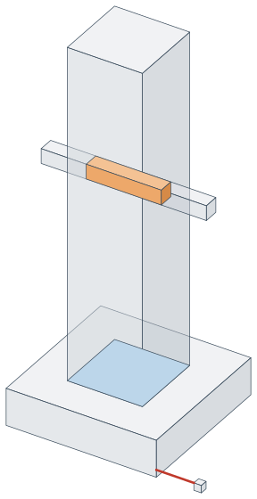
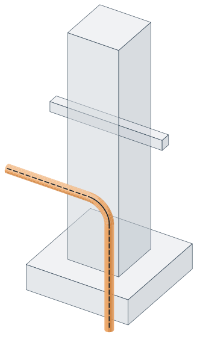

# Clashes and large meshes

## Checking parts against each other

`Clash3.Find` checks a whole set of parts, or one set against another, and says what every pair that clashes
does. It lives in `GeometryHelper.Clash` with everything it takes and gives: [`ClashOptions`](xref:GeometryHelper.Clash.ClashOptions), [`ClashResult`](xref:GeometryHelper.Clash.ClashResult) and
[`ClashKind`](xref:GeometryHelper.Clash.ClashKind).

```csharp
using GeometryHelper.Clash;

ClashResult[] clashes = Clash3.Find(parts, new ClashOptions(clearance: 25.0));

foreach (ClashResult clash in clashes)
{
    switch (clash.Kind)
    {
        case ClashKind.Hard:        // clash.Overlaps, one body per region; clash.Volume
            break;
        case ClashKind.Touch:       // clash.Contact, the patches face to face; clash.ContactArea
            break;
        case ClashKind.Clearance:   // clash.Distance and clash.Gap, the segment across it
            break;
        case ClashKind.Unresolved:  // clash.Error: the pair could not be checked
            break;
    }

    // clash.First and clash.Second index the parts; clash.Location says where
}

Clash3.Find(reinforcement, embeds);   // one set against another: First indexes the first set
```

A footing 200 by 200 by 50, a column 100 by 100 standing on it, a beam 20 by 20 through the column and a bracket 50
clear of the footing, checked with a clearance of 60, are three pairs: the column touches the footing over 10 000
square units, the beam runs into the column by 40 000 cubic units, and the bracket stands 50 from the footing.



Every part is prepared once — see [A body asked many questions](asking.md#a-body-asked-many-questions) — and the boxes
are swept along whichever axis leaves the fewest pairs, so only pairs whose boxes come within the clearance of each
other are looked at, however the parts lie: 4 900 bars 6 000 long laid side by side along X take 6.7 ms on one
thread, as they do along Y or Z. Those pairs are checked in parallel, and the results come back in the order of the
indexes. Openings are honoured:
a bolt through its hole is no clash. A pair whose check throws is reported `Unresolved` and logged rather than
costing the report for the rest of the model. Parts already prepared can be passed as they are, so a model
checked twice is prepared once.

A pair is measured the same whichever part is listed first: `Find(new[] { a }, new[] { b })` and
`Find(new[] { b }, new[] { a })` give the same volume, depth, location and distance to the last bit, and `a` and `b`
keep their sides. The patches of `Contact` face out of the part listed first, and `Gap` runs from it to the other.
To get that, the check always works from the part that sorts first by its box and then its faces, and turns what names
a side back to the side it was asked for.

Underneath, each pair is asked four questions, from cheapest to dearest, stopping at the first that settles
it — the recipe to follow for a check of your own:

```csharp
foreach (var (a, b) in pairs)
{
    if (!a.GetAabb().CollidesWith(b.GetAabb()))   // boxes apart: nothing to ask
    {
        continue;
    }

    if (!a.CollidesWith(b))                       // no touch at all, openings honoured
    {
        continue;
    }

    GeoSolid3[] clashes = a.Intersect(b);         // one body per region the two share

    if (clashes.Length == 0 && a.TryGetContact(b, out GeoFace3[] bearing))
    {
        // They only touch: bearing is where they lie against each other.
    }

    foreach (GeoSolid3 clash in clashes)
    {
        double overlap = clash.Volume;            // how badly, and clash.Centroid for where
    }
}
```

- **`Intersect` gives one body per clash.** A beam through two separate plates clashes twice, and
  `TryIntersect`, which gives the whole shared region as one body, cannot say where either is. The pieces
  always add up to it. Two regions meeting only along an edge share no volume and are two.
- **Touching is not a clash.** A column standing on a footing shares no volume with it, so `Intersect` is
  empty. `TryGetContact` says where the two lie against each other, face to face — back to back in one
  plane — and a hole in the material under the contact is left out of it. Two bodies meeting only along an
  edge or at a corner have no contact patch; `CollidesWith` is what reports those.
- **`SplitShells`** gives the separate pieces of any body, the same way.
- A part checked against many others is prepared once with `Prepare()`, below; `CollidesWith` between two
  large meshes builds an index on its own once they are big enough to be worth it, but throws it away again.

### How deep a clash runs

`clash.Depth` says how deep two parts run into each other: the least thickness of the region they share, the
smallest side of the least box round it, and of the deepest region where they share more than one. A bar grazing
a flange by half a millimetre is half a millimetre deep however long the graze, where its volume grows with the
length; a bar through a plate is as deep as the thinner of the two. Of boxes as small standing on faces of the
hull of a region, the thinnest is read: a block 18 by 24 by 40 meeting a prism on its corner's triangle is 14.4
deep, the prism's thickness across its long side. It is measured when first asked for. A report that should not
count modelling slack can say how deep, or how large, an overlap has to be:

```csharp
var options = new ClashOptions(clearance: 25.0, minimumDepth: 2.0, minimumVolume: 1000.0);
```

A shallower or smaller overlap is reported as `Touch`, keeping its `Overlaps`, `Volume` and `Depth`, or not at
all when touching is not asked for. Both are nought unless given, and every overlap is hard.

### Reinforcement by its centre line

A bar need not be built as a body to be checked. [`ClashBar`](xref:GeometryHelper.Clash.ClashBar) is its centre line and its radius, and it runs into
a part where the part comes nearer the centre line than the radius:

```csharp
GeoPolylineArc3 centreLine = new GeoPolyline3(
    new GeoPoint3(-100, 100, 150), new GeoPoint3(100, 100, 150), new GeoPoint3(100, 100, -100)).Fillet(40.0);
var bar = new ClashBar(centreLine, radius: 8.0);

ClashResult[] clashes = Clash3.Find(new[] { bar }, parts, new ClashOptions(clearance: 25.0));
// clash.Depth: how far the part reaches into the bar; clash.LengthInside: how much of the centre line runs inside
```



Among the parts above, the bar bends down through the column into the footing: two hard clashes, each the diameter
deep, its centre line 50 inside the footing and 132.8 inside the column. It is found exactly on the straight runs
and within the chord tolerance on the bends (a thousandth of the radius unless given), with no body built and no
boolean run, and the same prepared parts can be checked against bars and bodies alike. What bodies measure as a
volume, a bar measures as a depth and a length: `Overlaps` stays empty and `Volume` nought, so `minimumVolume`
does not apply to it, while `minimumDepth` does. A centre line lying along a face, within the tolerance of it, runs
inside for as long as it lies there, half the bar being in the material: a bar of radius 8 and 800 long laid on the
top of a box, half its length over it, is the radius deep and 400 inside. So is one laid along an edge of the box, a
quarter of it in the material. One drifting off the face runs inside only until it leaves the tolerance: a bar over a
box 1 000 long, from 0.0012 over the top to 0.0006 over it across 1 500, comes within a thousandth of the top 500
along and is 700 inside, up to the end of the box. Every stretch within the tolerance of the surface counts, wherever
it lies along the bar, and nothing between: from 0.0007 over the top of a box 250 before its edge to 0.0015 over it
1 000 along, a bar is 125 inside, from the edge to where it leaves the tolerance, where it read nought; dipping 0.0005
into the side of a box between two places 0.003 off it 200 apart, it is 85.71 inside, where it read 28.57; and rising
1E-5 for each unit from 0.0006 over a top that steps up 0.004 further on, it is within the tolerance over the top for
40 and over the step for 100, and is 140 inside, where it read nought. A stretch no longer than ten times the
tolerance at a crossing of a face, as a centre line crossing it at a slant steeper than about 6 degrees passes, is
left out: such a bar is measured to the crossing, as before. Three things read differently from the same bar built with `GeoSolid3.Pipe`:

- **The ends are rounded.** A ball rolled along the centre line reaches a radius past each end, where the bar
  ends flat, so a part up to a radius beyond an end is found to clash: the check errs on the side of reporting.
- **A plate thinner than the bar reads as the radius and half the plate.** Two bodies read the least thickness
  of what they share, the plate's own; by its centre line, the bar is cut through however thin the plate.
- **The bar is round.** A body built to a chord tolerance lies up to that far inside the bar, so its gaps come
  out a little wider and its depths a little shallower.

## Working with large meshes

Every operation above looks at the whole of what it is given, because nothing rules any of it out in
advance. [`GeoBvh3`](xref:GeometryHelper.Spatial.GeoBvh3) is the index that does: a tree of nested boxes over a triangle mesh, in which a ray that
misses a box misses everything inside it, and a box farther away than the best answer so far cannot hold
anything nearer.

```csharp
var tree = solid.BuildIndex();     // and on GeoFace3; GeoBvh3.FromSolid(solid) is the same tree

tree.DistanceTo(point);            // nearest point on the surface
tree.GetClosestPoint(point);
tree.GetIntersections(ray);        // every crossing of the surface; a GeoXLine3 is asked the same, both ways from its origin
tree.CollidesWith(otherTree);      // surface contact between two meshes
```

**When it is worth building.** When the *same* body is asked *many* questions. Building costs a sort of the
triangles, so it pays for itself over repeated queries and never on the first one — one distance to one point
is quicker asked of the body. Every geometry type here is immutable, so a mesh never goes stale under its
index: build it once, keep it as long as the body lives. It is called `BuildIndex` and not `GetIndex` because
it does work, and calling it inside the loop it was meant to speed up is slower than not having it.

**Where the library already builds one for you.** Two pairs are expensive enough that they index on their own
and you need do nothing: `Collision3.CollidesWith(solid, solid)` indexes both when the triangle counts
multiplied pass 64 × 64, below which the plain scan wins; and `Distance3.DistanceTo(solid, solid)` indexes
both every time, since two meshes that miss each other have no cheap answer. Everything else takes the body
as it finds it, which is why a loop of your own is where an index of your own pays.

**The index is over triangles and the body is not.** `tree.GetIntersections(ray)` reports one hit per
triangle, so a ray landing on the diagonal that two triangles share is named twice, while
`solid.GetIntersections(ray)` names each place once. Ask the body when you want places; ask the tree when you
want speed and can keep clear of the edges.

The mesh it indexes comes from `GeoSolid3.Triangulate`, which follows the material of every face: a
concave face is traced rather than spanned, and a hole in a face is left open. So a ray fired through the
notch of an L-shaped body, or through a bolt hole in a plate, passes clean through, and the nearest point
on the surface is a point that is really on it. That is what separates it from `GeoFace3.Triangulate`,
which fans the boundary from one vertex and is meant only for the signed sums — area, centroid, volume —
where the part of a fan reaching outside the face cancels against the part overlapping it. Use
`GeoFace3.TriangulateSurface` wherever the triangles stand for material.

A triangle out of either of them reads as a polygon or as a face, which is what the boolean, offset and
splitting families take:

```csharp
foreach (GeoTriangle3 triangle in body.Triangulate())
{
    if (triangle.IsDegenerate())
    {
        continue;                       // three collinear points are not a polygon, so this is refused
    }

    GeoFace3 face = triangle.ToFace3();  // and ToPolygon3() for the outline alone
}
```

`Collision3.CollidesWith(solid, solid)` builds one internally once the meshes are large enough to be worth
it, and falls back to comparing every pair below that — below the threshold, the plain scan wins.

One caveat, shared with any triangle mesh: a ray running exactly along an edge is reported by both
triangles that share it. Anything counting crossings to tell inside from outside must keep clear of edges,
which is why [`Containment3`](xref:GeometryHelper.Core.Containment3) throws its ray again in another direction when a hit lands near one.

## Point chains

`GeometryHelper.Extension` covers the step before a polyline exists: a raw list of points,
usually read out of a model and carrying more of them than the geometry needs.

```csharp
using GeometryHelper.Extension;

var traced = new List<GeoPoint3>
{
    new GeoPoint3(0, 0, 0), new GeoPoint3(0.0001, 0, 0), new GeoPoint3(5, 0, 0), new GeoPoint3(5, 0, 5),
};

// The second point is a hair away from the first and goes.
List<GeoPoint3> thinned = traced.RemoveConsecutiveNearPoints(new Tolerance(0.001, 0.001)); // 3 points

// One segment per consecutive pair.
List<GeoLine3> segments = thinned.ToGeoLine3s();                                           // 2 segments
```

`RemoveConsecutiveNearPoints` compares each point against the last one *kept*, not against its original
neighbour, which is what guarantees no two points of the result are coincident within the tolerance. A
huddle collapses onto its first point, and collapsing stops as soon as one point escapes the tolerance
around that anchor, so a long run thins rather than vanishes. Distance is measured in all three
dimensions, so two points that share X and Y but differ in Z are not fused.

The first point always survives; the last one is not privileged. A final point lying within the tolerance
of the one kept before it is dropped like any other, so re-append it yourself when the endpoint matters.

`ToGeoLine3s` leaves the chain open — nothing joins the last point back to the first, so a ring has to
repeat its first point at the end. It does not filter coincident neighbours either, so run
`RemoveConsecutiveNearPoints` first if zero length segments would be a problem.
